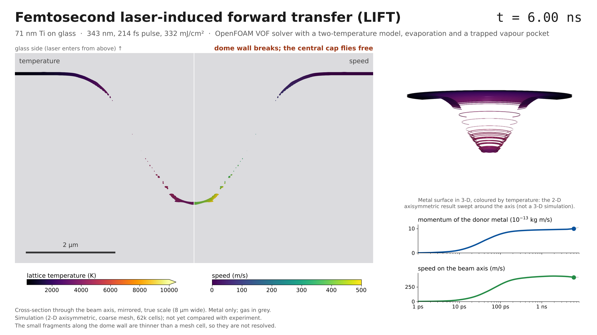
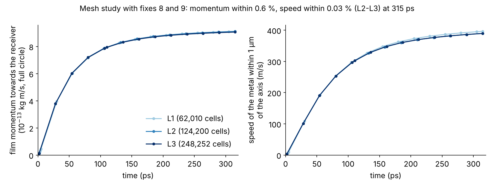
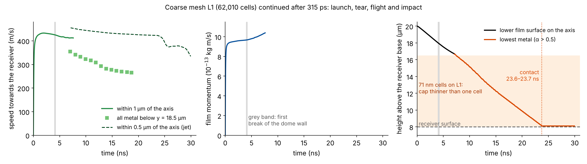
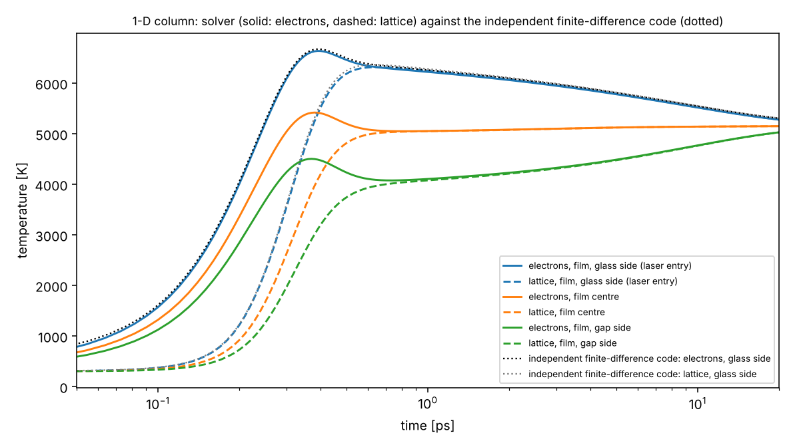
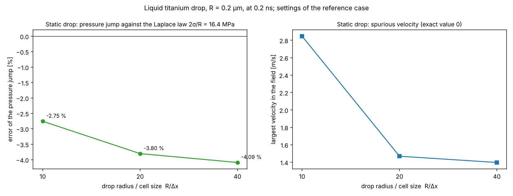

# compInterFoam-fsLIFT

An OpenFOAM v2406 solver for **femtosecond laser-induced forward transfer (fs-LIFT)** of a thin metal film, applied to a 71.4 nm titanium film: from the laser pulse (femtoseconds) through the launch of the film, the break of the dome it forms, and the flight of the metal to the receiver (nanoseconds).



*The current simulation at 6.0 ns on the coarse mesh (62,010 cells). Left: section through the beam axis at true scale, lattice temperature on the left half and speed on the right half. The dome wall broke at about 4 ns; the central cap flies on at about 410 m/s. The small fragments along the wall are thinner than a cell and are not resolved. The simulation is two-dimensional and axisymmetric; the 3-D view is that result revolved about the beam axis, not a 3-D simulation.*

> **Status, 27 November 2026.** The mesh study of the launch found two defects (fixes 8 and 9 of [docs/CODE_REVIEW.md](docs/CODE_REVIEW.md#1-defects-that-change-results)) that had made the film momentum about 80 % too low. The results below come from the corrected solver. The earlier reference simulation (`cases/fsLIFT_332mJ_axisymmetric`, 191.7 m/s, separation at 13 ns) is **superseded** ([docs/RESULTS.md §3](docs/RESULTS.md#3-the-earlier-reference-case-superseded)). On the coarse mesh the whole sequence from the laser pulse to the impact on the receiver (about 24 ns) is now computed; a run with finer cells along the flight path is in progress ([§5](#5-runs-in-progress)).

---

## Contents

1. [What fs-LIFT is](#1-what-fs-lift-is)
2. [What this solver adds to OpenFOAM](#2-what-this-solver-adds-to-openfoam)
3. [How far the results can be trusted](#3-how-far-the-results-can-be-trusted)
4. [The current results](#4-the-current-results)
5. [Runs in progress](#5-runs-in-progress)
6. [The main numbers](#6-the-main-numbers)
7. [Verification at a glance](#7-verification-at-a-glance)
8. [Limitations](#8-limitations)
9. [Quick start](#9-quick-start)
10. [Repository layout and documentation](#10-repository-layout-and-documentation)
11. [Licence and author](#11-licence-and-author)

---

## 1. What fs-LIFT is

Laser-induced forward transfer is a way of printing very small amounts of material. A transparent plate (the *donor*, here glass) is coated with a thin film of the material to be printed (here titanium, 71.4 nm thick). A second surface (the *receiver*) is placed a few micrometres below the film. A laser pulse is fired through the glass into the film. The film heats, melts and partly evaporates, and the pressure of the vapour trapped between the glass and the film pushes the molten metal off the glass towards the receiver.

```
            laser pulse (343 nm, 214 fs)
                     │
                     ▼
   ┌───────────────────────────────────────┐
   │         donor glass (1.05 mm)          │
   ├───────────────────────────────────────┤ ← vapour forms and is trapped here
   │░░░░░░░░ titanium film, 71.4 nm ░░░░░░░│
   └───────────────────────────────────────┘
                     │  molten metal pushed off the glass
                     ▼
                    ( )   droplet in flight across the 12 µm gap
   ═════════════════════════════════════════  receiver
```

With a femtosecond pulse, the energy is deposited far faster than the metal can move or conduct heat away. What happens next decides the outcome: whether the metal leaves as one clean droplet, as a spray of fragments, or not at all. The relevant processes span a huge range of scales:

| Process | Time scale | Length scale |
|---|---|---|
| absorption of the pulse by the electrons of the metal | 0.2 ps | 10 nm (absorption depth) |
| heating of the atoms by the electrons | 1 ps | 70 nm (film) |
| evaporation and build-up of vapour pressure | ps to ns | nm |
| motion of the film, thinning, separation | ns to tens of ns | µm (spot and gap) |

This solver follows the whole sequence in one simulation.

---

## 2. What this solver adds to OpenFOAM

The solver is built on OpenFOAM's `compressibleInterFoam`, which computes the flow of two immiscible phases (here liquid metal and gas) and tracks the interface between them with the volume-of-fluid method: every cell carries a metal fraction α between 0 (gas) and 1 (metal). The following models are added:

| Added model | What it represents | Details |
|---|---|---|
| **Laser heat source** | A pulse that is Gaussian in time and in radius, absorbed exponentially with depth below the glass-side surface of the film | [MODEL.md §3](docs/MODEL.md#3-laser-energy-deposition) |
| **Two-temperature model** | Separate temperatures for the electrons, which absorb the laser energy first, and for the atoms (the *lattice*), which the electrons heat within about a picosecond | [MODEL.md §4](docs/MODEL.md#4-two-temperature-model) |
| **Evaporation and recoil** | Hot metal evaporates (Hertz–Knudsen flux with a Clausius–Clapeyron saturation pressure); on a free surface the departing vapour pushes back on the metal with 0.54 times the saturation pressure | [MODEL.md §5](docs/MODEL.md#5-evaporation-and-recoil-pressure) |
| **Trapped-vapour model** | Vapour formed between the glass and the film cannot escape. Its mass, volume and pressure are tracked in rings around the beam axis, and its pressure pushes the film away from the glass | [MODEL.md §6](docs/MODEL.md#6-vapour-trapped-between-the-glass-and-the-film) |

The interface transport, surface tension and pressure coupling were also corrected and tested during development ([VERIFICATION.md §4](docs/VERIFICATION.md#4-defects-found-and-corrected)).

---

## 3. How far the results can be trusted

| | Status | Meaning |
|---|---|---|
| **Verified** | yes | Every added equation has been checked against an exact solution, an independent code or a hand calculation ([§7](#7-verification-at-a-glance), [VERIFICATION.md](docs/VERIFICATION.md)) |
| **Mesh-converged** | the launch, to 315 ps | On three meshes the film momentum agrees within 0.6 % and the speed near the axis within 0.03 % (finest pair). The break of the dome wall and the flight were computed on the coarsest mesh only, where the wall is about one cell thick when it breaks, the flying metal is a jet only 2–3 cells wide from about 7 ns, and the receiver is liquid, so the impact is not physical ([§8](#8-limitations)) |
| **Energy balance** | 4 % open at 315 ps | The laser energy is deposited correctly (−0.06 %), but 4 % of it is not accounted for at 315 ps and 7 % at 2.16 ns ([RESULTS.md §1.5](docs/RESULTS.md#15-energy-and-mass-balance)) |
| **Validated** | no | No comparison with measurements. The model also leaves out known physics, such as stress waves in the metal and the solid glass ([§8](#8-limitations)) |

**Read the numbers below as the result of this model, not as a prediction of an experiment.**

---

## 4. The current results

Case directory: [`cases/fsLIFT_332mJ_Ti_meshStudy`](cases/fsLIFT_332mJ_Ti_meshStudy). Full discussion: [docs/RESULTS.md](docs/RESULTS.md).

### 4.1 Inputs

| Quantity | Value | Note |
|---|---|---|
| Film | titanium, 71.4 nm | liquid everywhere, constant density 4506 kg/m³ (solid Ti, so the film mass is right), viscosity 2.35 mPa s, surface tension 1.613 N/m (measured at the melting point) |
| Two-temperature inputs | C_e = 318 T_e J/(m³ K); coupling capped at 2.5×10¹⁸ W/(m³ K) | first-principles level for titanium (Hobmaier et al. 2026) |
| Donor | glass, 1.05 mm | modelled as a gas of constant density (see [§8](#8-limitations)) |
| Laser | 343 nm, 214 fs (full width at half maximum), beam radius 3 µm at 1/e² | |
| Peak fluence | 332 mJ/cm² before the glass | 4.109e-8 J reaches the film after the glass |
| Optics of titanium at 343 nm | reflectivity 0.428 at the glass–titanium interface; absorption depth 9.66 nm | from n = 1.7283, k = 2.8242 |
| Gap to the receiver | 12 µm | |

### 4.2 Geometry and meshes

The case is **axisymmetric**: every quantity is the same at every angle around the beam axis. It is computed on a 5° wedge. y runs along the beam axis and r is the distance from it; the laser travels in −y.

```
 y [µm]
 32.07 ┌──────────────────────────────────────────┐
       │  donor glass (modelled as a gas)         │  ← laser enters here, travelling −y
 20.07 ├══════════════════════════════════════════┤  glass-side surface of the film (vapour is trapped here)
       │  titanium film, 71.4 nm                  │
 20.00 ├══════════════════════════════════════════┤  gap-side surface of the film (free surface)
       │  gap: fine cells for y = 17–20 µm,       │
       │  coarser cells for y = 8–16.5 µm         │
  8.00 ├──────────────────────────────────────────┤  receiver surface
       │  receiver                                │
  0.00 └──────────────────────────────────────────┘
       r = 0 (beam axis)                 r = 8 µm (open boundary)
```

| Mesh | Cells | Film | Gap, y = 17–20 µm | Gap, y = 8–16.5 µm | Radial, r < 3.5 µm |
|---|---|---|---|---|---|
| L1 | 62,010 | 11 cells of 6.5 nm | 8.5 nm | 71 nm | 49 nm |
| L2 | 124,200 | 16 cells of 4.5 nm | 6.0 nm | 50 nm | 35 nm |
| L3 | 248,252 | 23 cells of 3.1 nm | 4.2 nm | 35 nm | 25 nm |
| C (flight) | 112,148 | as L1 | as L1 | **15 nm** | as L1 |

### 4.3 What happens



*Film momentum (left) and speed of the metal within 1 µm of the axis (right) on the three meshes.*

- **Heating, 0–3 ps.** The electrons absorb the pulse in a layer about 10 nm thick at the glass-side surface and reach 25,000–27,000 K; the lattice follows and peaks at about 20,000 K at about 3 ps, more than twice the critical temperature of titanium.
- **Launch, to about 0.3 ns.** The glass-side surface evaporates. The vapour cannot escape; its pressure peaks at about 1.3 GPa at about 12 ps and pushes the hot centre of the film away from the glass. At 315 ps the centre moves as a nearly uniform plug at **389.5 m/s** (finest mesh). Its kinetic energy per area is 7.3 times the energy of the two new surfaces a free piece needs, and the Weber number is 29.
- **Dome, to about 4 ns.** The film keeps speeding up, to **433 m/s at 1.9 ns** near the axis (coarse mesh), and stretches into a dome.
- **Break, 3.96–4.26 ns.** The dome wall thins to about one radial cell and breaks. The central cap, 62–68 nm thick on the axis, flies free at about 410–420 m/s.
- **Flight.** From about 7 ns the metal near the axis is drawn into a thin jet, at most about 0.12 µm in radius (2–3 cells), moving at 455 → 422 m/s with a lattice temperature of about 3,500–3,900 K. It is not resolved on this mesh.
- **Impact, 23.6–23.7 ns.** The jet tip reaches the receiver at about 420 m/s and then digs a crater about 1 µm deep by 30 ns. **The crater is not physical:** the model has no solid phase, so the 300 K receiver behaves as a liquid ([RESULTS.md §1.3](docs/RESULTS.md#13-dome-tear-flight-and-impact-after-315-ps-coarse-mesh-l1-only)).



*Coarse mesh L1 after 315 ps: speed (left; dashed: the jet within 0.5 µm of the axis), film momentum (middle; not physical after about 4 ns, limitation 3), and the lowest metal against the receiver at 8 µm (right). Grey band: first break of the dome wall. Shaded: the 71 nm cells in which the flying metal is thinner than one cell.*

**What the mesh study changed.** On the coarse mesh at 315 ps the film momentum was 5.01 × 10⁻¹³ kg m/s before the fixes, 7.39 with fix 8 (temperatures carried with the metal, not with the mixture) and 9.12 with fix 9 as well (vapour pressure on the donor film only, not also on the receiver). Before fix 8 the momentum changed by about 6 % per mesh level; after it, by 0.6 % over all three.

---

## 5. Runs in progress

| Run | What | From → to |
|---|---|---|
| **C** | the L1 state at 2.96 ns (before the break) copied onto mesh C, with 15 nm cells along the flight path (71 nm on L1), and continued | 2.96 ns → 35 ns; started 27 Nov, about 32 h |

Run A (the coarse mesh to the receiver) finished at 29.95 ns; its results are in §4.3.

How C was set up and checked: [docs/INVESTIGATION_LOG.md §13](docs/INVESTIGATION_LOG.md#13-run-c-refined-flight-path-22-nov). Mesh C does not refine the radial cells, so the break of the dome wall and the radius of the jet remain mesh-limited, and its receiver is liquid too. C shows how much of the flight on L1 depended on the 71 nm cells along the path.

---

## 6. The main numbers

| Quantity | Value | How reliable |
|---|---|---|
| Peak electron / lattice temperature | 27,000 / 20,000 K (finest mesh) | GCI 4.5 % / 1.3 %; far above the critical point of titanium |
| Peak trapped-vapour pressure | about 1.3 GPa at about 12 ps | read from log lines written every 20 steps |
| Film momentum at 315 ps | 9.06–9.12 × 10⁻¹³ kg m/s (full circle) | three meshes within 0.6 %; still rising |
| Speed of the film centre at 315 ps | 389.5 m/s | converged (0.03 % between the two finest meshes) |
| Highest speed near the axis | 432.9 m/s at 1.9 ns | coarse mesh only |
| Break of the dome wall | 3.96–4.26 ns | coarse mesh; wall about one cell thick: **mesh-limited** |
| Central cap in flight | about 410–420 m/s at 5–6.5 ns, 62–68 nm thick | coarse mesh; not resolved after about 7 ns |
| Jet in flight | 455 → 422 m/s (7.3–23.6 ns), radius ≤ 0.12 µm, lattice 3,500–3,900 K | coarse mesh; 2–3 cells wide: **not resolved** |
| Contact with the receiver | 23.6–23.7 ns, at about 420 m/s | coarse mesh; qualitative |
| Mass | −0.098 % of the film by evaporation over 0–315 ps | |
| Energy | laser deposition −0.06 %; −4.0 % unaccounted for at 315 ps, −7.1 % at 2.16 ns | under investigation |

Data: [`figures/fsLIFT_332mJ_Ti_meshStudy/data/`](figures/fsLIFT_332mJ_Ti_meshStudy/data/), with the columns named in the first line of each file.

---

## 7. Verification at a glance

Each added equation was tested on its own. Selected results below; [VERIFICATION.md](docs/VERIFICATION.md) marks which tests were rerun with the code in this repository and which come from development runs of code paths that later corrections did not touch:

| Part | Test | Result |
|---|---|---|
| Laser source | energy deposited in a 1-D film; in the 2-D mesh-study run | within 0.2 %; −0.06 % |
| Two-temperature model | 1-D column against an independent finite-difference code with the same inputs | peak electron temperature −0.5 %; time at which electrons and atoms meet +0.8 % |
| Evaporation | Hertz–Knudsen flux in every evaporating cell | ratio to the formula 1.000000 |
| Recoil | 0.54 × saturation pressure in every recoil cell | within 0.1 % |
| Force on the film | time integral of the logged forces against the film's momentum change, 2–315 ps | 0.969 (L2), 0.977 (L3) |
| Temperature transport (fix 8) | film moving as a whole at −170 m/s for 90 ps | heat change −0.06 % (−3.0 % before the fix) |
| Mesh study | three meshes, 0–315 ps | momentum within 0.6 %, speed near the axis within 0.03 % |
| Surface tension | pressure jump of a static drop against the Laplace law | −2.75 % at 10 cells per radius, −4.1 % at 40 |
| Viscosity | decay of a pipe flow with an exact solution | −0.12 % |
| Moving film | a film moving as a whole at 170 m/s must keep its velocity and pressure | velocity exact, pressure within 0.1 %, metal volume exact |
| Drop oscillation | frequency of an oscillating drop against Lamb's solution | −12.9 % → −10.5 % as the mesh is refined; damping too weak (open point) |



*Two-temperature model: electron (solid) and lattice (dashed) temperatures at three depths of a 1-D film, against the independent finite-difference code `tools/ttm_fd_1d.py` (dotted) on the glass side.*



*Surface tension: error of the pressure jump of a static liquid titanium drop (left) and the largest spurious velocity (right), at 10, 20 and 40 cells per drop radius. The error does not decrease under refinement; it stays near −4 %, a known limitation of computing the curvature from the gradient of α.*

All tests, how to repeat them, the defects found and corrected, and the open points: [docs/VERIFICATION.md](docs/VERIFICATION.md).

---

## 8. Limitations

Ordered by how much each could change the answer to "does the film eject, and how?". Details in [docs/RESULTS.md](docs/RESULTS.md#limitations).

1. **The metal is incompressible.** There are no stress waves and no spallation, which in femtosecond LIFT can drive part of the ejection.
2. **The gas is incompressible, and the glass is modelled as a gas.** The gap reacts instantly to the film (negative gauge pressures appear above it), and the gas standing in for the glass follows the departing film.
3. **The break and the flight are mesh-limited, and momentum is not conserved after the break.** Only the launch to 315 ps is mesh-converged. After the dome wall breaks, the film momentum keeps rising, mostly through a numerical net surface-tension force on metal smeared below the cell size and through vapour-pocket pressure that the model does not vent ([INVESTIGATION_LOG.md §14](docs/INVESTIGATION_LOG.md#14-why-the-film-momentum-keeps-rising-after-the-tear-22-nov)). The dome wall breaks where it is about one cell thick, and on the coarse mesh the flying metal is a jet only 2–3 cells wide from about 7 ns. Run C refines the flight path, not the radial cells of the break.
4. **Temperatures far above the critical point** (about 20,000 K against 8,980 K). The evaporation closures are evaluated with the temperature capped at 10,000 K.
5. **Energy residual** of 4 % at 315 ps and 7 % at 2.16 ns, not yet explained.
6. **Trapped-vapour model simplifications.** No sideways vapour flow between rings, no cooling of the vapour by the glass, and an assumed initial gap of 1 nm.
7. **No solid phase.** All metal flows as a liquid, even below the melting temperature. This includes the 300 K receiver, so the impact digs a crater that a solid receiver would not allow: nothing after contact predicts the deposit.
8. **Damping of interface oscillations is too weak** (§7).
9. **Axisymmetric only.** Rings cannot break into separate droplets around their circumference.
10. **Not validated** against measurements; the LIFT experiments in the literature register could not be read for this work.
11. **Titanium inputs.** The surface tension is constant, the liquid's thermal expansion is missing, and the two-temperature inputs are at the first-principles level but without their full temperature dependence ([VALIDATION.md §5](docs/VALIDATION.md#5-level-3-input-validation)).

---

## 9. Quick start

Requirements:
- OpenFOAM v2406 (the ESI/OpenCFD release from openfoam.com);
- Python 3 with NumPy and Matplotlib, for the analysis scripts;
- ParaView 5.10 or later (`pvpython`), for the images.

```bash
source /usr/lib/openfoam/openfoam2406/etc/bashrc     # adjust to your installation

# 1. build the solver (about 1 minute; installs into $FOAM_USER_APPBIN)
cd src && wmake && cd ..

# 2. quick check (10-20 minutes on one core): laser heating in a 1-D column,
#    compared with the independent finite-difference code
cd cases/column1D_laser_TTM
blockMesh && rm -rf 0 && cp -r 0.orig 0 && topoSet && setFields && compInterFoam > log.run 2>&1
cd ../.. && python3 tools/compare_ttm_1d.py cases/column1D_laser_TTM

# 3. the mesh study (three meshes; level 3 takes about 6 hours to 1 ns on 4 processes)
tools/run_mesh_study.sh $HOME/meshstudy 4
for L in 1 2 3; do xvfb-run -a pvpython tools/mesh_study_fields.py $HOME/meshstudy/L$L; done
python3 tools/mesh_study_gci.py $HOME/meshstudy 8.02e-10

# 4. a single case on 4 processes, in stages (here the superseded reference case; see docs/USER_GUIDE.md)
tools/run_case.sh cases/fsLIFT_332mJ_axisymmetric 4 2e-8
RESUME=1 tools/run_case.sh cases/fsLIFT_332mJ_axisymmetric 4 2e-8    # continue after an interruption
```

Every setting of the case, every tool, and how to set up a new case (another fluence, mesh or film): [docs/USER_GUIDE.md](docs/USER_GUIDE.md).

---

## 10. Repository layout and documentation

| Path | Content |
|---|---|
| `src/` | solver source code and build files (`Make/`) |
| `cases/fsLIFT_332mJ_Ti_meshStudy/` | current case: literature inputs for titanium, mesh family L1–L3 (`tools/make_mesh_level.py`) |
| `cases/fsLIFT_332mJ_axisymmetric/` | the earlier reference case (results superseded): input dictionaries and initial fields (`0.orig`) |
| `cases/column1D_laser_TTM/` | 1-D column: laser heating and the two-temperature model |
| `cases/column1D_galilean_test/` | 1-D column moving as a whole at −170 m/s: velocity and pressure must not change |
| `tools/` | run script, analysis and plotting scripts (including `plot_model_inputs.py` for the model figures), independent finite-difference two-temperature code |
| `tools/benchmarks/` | drop benchmarks: surface tension, drop oscillation, viscosity |
| `figures/fsLIFT_332mJ_Ti_meshStudy/` | current results: mesh study, coarse-mesh flight, figures and data |
| `figures/fsLIFT_332mJ_axisymmetric/` | results of the superseded reference run: histories, results table, image gallery, data |
| `figures/verification/` | verification figures |
| `figures/model/` | figures of the model inputs (laser profiles, two-temperature properties, evaporation, mesh), used in docs/MODEL.md |
| `figures/literature/` | the sensitivity study of the two-temperature parameters, used in docs/LITERATURE.md |
| `literature/screened_candidates.csv` | 56 further papers found for the validation report: 48 with the abstract read and the reason for inclusion, 8 pending |
| `figures/validation/` | figures of the verification and validation report |
| `literature/register.csv` | register of 62 related papers with metadata checked against their DOIs, links, relevance, and corrections to the original list; the papers themselves are not included (copyright) |
| `docs/` | documentation |

| Document | Read it for |
|---|---|
| [docs/MODEL.md](docs/MODEL.md) | the assumptions and governing equations as implemented, the closures and inputs with their origin, characteristic scales and dimensionless numbers, and the numerical method, with figures |
| [docs/USER_GUIDE.md](docs/USER_GUIDE.md) | building, running and restarting, every case setting explained, the analysis tools, setting up a new case |
| [docs/VERIFICATION.md](docs/VERIFICATION.md) | every test with its result and how to repeat it, the defects found and corrected, the open points |
| [docs/RESULTS.md](docs/RESULTS.md) | the current results in detail, the runs in progress, the superseded reference run, and the limitations of the model |
| [docs/INVESTIGATION_LOG.md](docs/INVESTIGATION_LOG.md) | the chronological record of the mesh study, the energy balance, the coarse-mesh flight and the refined flight run, including hypotheses that were wrong |
| [docs/CODE_REVIEW.md](docs/CODE_REVIEW.md) | every defect found in the code review and the mesh study, its fix, and its effect on the old run |
| [docs/VALIDATION.md](docs/VALIDATION.md) | the verification and validation report: status of the five levels, every test, the titanium inputs against measured values, sub-model and mechanism comparisons, what can and cannot be claimed, and the validation plan, with figures |
| [docs/LITERATURE.md](docs/LITERATURE.md) | comparison of the inputs and results with published work: titanium two-temperature parameters, conductivity, critical temperature, stress confinement, surface-tension numerics; what could not yet be compared |

---

## 11. Licence and author

GNU General Public License version 3 or later (see [`LICENSE`](LICENSE)), the licence of OpenFOAM, from which this solver is derived. OpenFOAM is a registered trademark of OpenCFD Ltd. This software is not approved or endorsed by OpenCFD Ltd.

Author: Mavadidurai Gopinathan.
