# compInterFoam-fsLIFT

An OpenFOAM v2406 solver for **femtosecond laser-induced forward transfer (fs-LIFT)** of a thin metal film, with a complete reference simulation of a 71.4 nm titanium film from the laser pulse (femtoseconds) to the flight of the ejected droplet (20 nanoseconds).

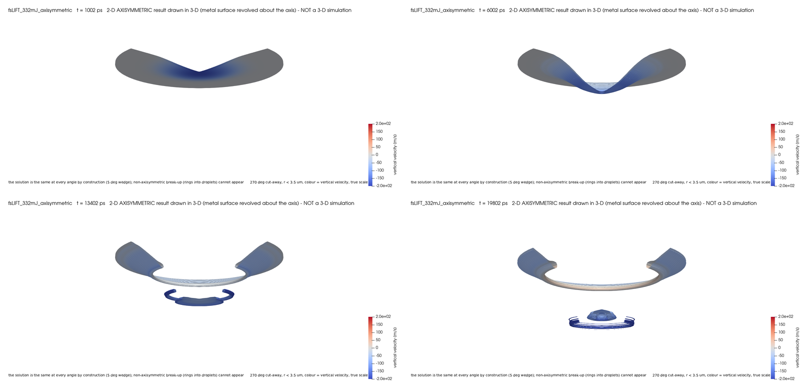

*The reference simulation at 1, 6, 13.4 and 19.8 ns. The film is pushed away from the glass into a dome (1 ns), deepens into a cup (6 ns), tears (13.4 ns), and its bottom flies on as one droplet with ring-shaped fragments around it (19.8 ns). Colour: vertical velocity, blue = towards the receiver. The simulation is two-dimensional and axisymmetric; these pictures are that result revolved about the beam axis, not a 3-D simulation.*

---

## Contents

1. [What fs-LIFT is](#1-what-fs-lift-is)
2. [What this solver adds to OpenFOAM](#2-what-this-solver-adds-to-openfoam)
3. [How far the results can be trusted](#3-how-far-the-results-can-be-trusted)
4. [The reference simulation](#4-the-reference-simulation)
5. [Results, stage by stage](#5-results-stage-by-stage)
6. [The main numbers](#6-the-main-numbers)
7. [Verification at a glance](#7-verification-at-a-glance)
8. [Limitations](#8-limitations)
9. [Quick start](#9-quick-start)
10. [Repository layout and documentation](#10-repository-layout-and-documentation)
11. [Licence and author](#11-licence-and-author)

---

## 1. What fs-LIFT is

Laser-induced forward transfer is a way of printing very small amounts of material. A transparent plate (the *donor*, here glass) is coated with a thin film of the material to be printed (here titanium, 71.4 nm thick). A second surface (the *receiver*) is placed a few micrometres below the film. A laser pulse is fired through the glass into the film. The film heats, melts and partly evaporates, and the pressure of the vapour trapped between the glass and the film pushes the molten metal off the glass towards the receiver.

```
            laser pulse (343 nm, 214 fs)
                     │
                     ▼
   ┌───────────────────────────────────────┐
   │         donor glass (1.05 mm)          │
   ├───────────────────────────────────────┤ ← vapour forms and is trapped here
   │░░░░░░░░ titanium film, 71.4 nm ░░░░░░░│
   └───────────────────────────────────────┘
                     │  molten metal pushed off the glass
                     ▼
                    ( )   droplet in flight across the 12 µm gap
   ═════════════════════════════════════════  receiver
```

With a femtosecond pulse, the energy is deposited far faster than the metal can move or conduct heat away. What happens next decides the outcome: whether the metal leaves as one clean droplet, as a spray of fragments, or not at all. The relevant processes span a huge range of scales:

| Process | Time scale | Length scale |
|---|---|---|
| absorption of the pulse by the electrons of the metal | 0.2 ps | 10 nm (absorption depth) |
| heating of the atoms by the electrons | 1 ps | 70 nm (film) |
| evaporation and build-up of vapour pressure | ps to ns | nm |
| motion of the film, thinning, separation | ns to tens of ns | µm (spot and gap) |

This solver follows the whole sequence in one simulation.

---

## 2. What this solver adds to OpenFOAM

The solver is built on OpenFOAM's `compressibleInterFoam`, which computes the flow of two immiscible phases (here liquid metal and gas) and tracks the interface between them with the volume-of-fluid method: every cell carries a metal fraction α between 0 (gas) and 1 (metal). The following models are added:

| Added model | What it represents | Details |
|---|---|---|
| **Laser heat source** | A pulse that is Gaussian in time and in radius, absorbed exponentially with depth below the glass-side surface of the film | [MODEL.md §3](docs/MODEL.md#3-laser-energy-deposition) |
| **Two-temperature model** | Separate temperatures for the electrons, which absorb the laser energy first, and for the atoms (the *lattice*), which the electrons heat within about a picosecond | [MODEL.md §4](docs/MODEL.md#4-two-temperature-model) |
| **Evaporation and recoil** | Hot metal evaporates (Hertz–Knudsen flux with a Clausius–Clapeyron saturation pressure); on a free surface the departing vapour pushes back on the metal with 0.54 times the saturation pressure | [MODEL.md §5](docs/MODEL.md#5-evaporation-and-recoil-pressure) |
| **Trapped-vapour model** | Vapour formed between the glass and the film cannot escape. Its mass, volume and pressure are tracked in rings around the beam axis, and its pressure pushes the film away from the glass | [MODEL.md §6](docs/MODEL.md#6-vapour-trapped-between-the-glass-and-the-film) |

The interface transport, surface tension and pressure coupling were also corrected and tested during development ([VERIFICATION.md §4](docs/VERIFICATION.md#4-defects-found-and-corrected)).

---

## 3. How far the results can be trusted

| | Status | Meaning |
|---|---|---|
| **Verified** | yes | Every added equation has been checked against an exact solution, an independent code or a hand calculation ([§7](#7-verification-at-a-glance), [VERIFICATION.md](docs/VERIFICATION.md)) |
| **Mesh-converged** | partly | The launch of the film is well resolved. The separation of the droplet happens where the film is thinner than one cell, so its time and volume depend on the mesh ([§8](#8-limitations)) |
| **Validated** | no | No comparison with measurements is included. The model also leaves out known physics, such as stress waves in the metal and the solid glass ([§8](#8-limitations)) |

**Read the numbers below as the result of this model on this mesh, not as a prediction of an experiment.**

---

## 4. The reference simulation

Case directory: [`cases/fsLIFT_332mJ_axisymmetric`](cases/fsLIFT_332mJ_axisymmetric).

### 4.1 Inputs

| Quantity | Value | Note |
|---|---|---|
| Film | titanium, 71.4 nm | liquid everywhere, constant density 4515 kg/m³, viscosity 2.35 mPa s, surface tension 1.64 N/m |
| Donor | glass, 1.05 mm | modelled as a gas of constant density (see [§8](#8-limitations)) |
| Laser wavelength | 343 nm | |
| Pulse duration | 214 fs | full width at half maximum |
| Beam radius | 3 µm | where the intensity falls to 1/e² |
| Peak fluence | 332 mJ/cm² before the glass | 4.109e-8 J reaches the film after the glass |
| Optics of titanium at 343 nm | reflectivity 0.428 at the glass–titanium interface; absorption depth 9.66 nm | from the refractive index n = 1.7283, k = 2.8242 |
| Gap to the receiver | 12 µm | |

### 4.2 Geometry and mesh

The case is **axisymmetric**: every quantity is assumed to be the same at every angle around the beam axis. It is computed on a wedge of 5°, a thin slice of the full cylinder. y runs along the beam axis and r is the distance from it; the laser travels in −y.

```
 y [µm]
 32.07 ┌──────────────────────────────────────────┐
       │  donor glass (modelled as a gas)         │  ← laser enters here, travelling −y
 20.07 ├══════════════════════════════════════════┤  glass-side surface of the film (vapour is trapped here)
       │  titanium film, 71.4 nm (16 cells)       │
 20.00 ├══════════════════════════════════════════┤  gap-side surface of the film (free surface)
       │  gap, 12 µm                              │  6 nm cells for the first 3 µm below the film
  8.00 ├──────────────────────────────────────────┤  receiver surface
       │  receiver                                │
  0.00 └──────────────────────────────────────────┘
       r = 0 (beam axis)                 r = 8 µm (open boundary)
```

| Mesh property | Value |
|---|---|
| Cells | 132,480 |
| Across the film | 16 cells of 4.46 nm |
| Below the film, along the beam axis | 6 nm cells for the first 3 µm, then graded to 50 nm |
| Radially | 160 cells of 50 nm over 8 µm |

### 4.3 Run

The case was run to 20 ns on 4 processes with [`tools/run_case.sh`](tools/run_case.sh), in three stages with growing largest time steps (10 fs, 1 ps, 2.5 ps). It took about 20 hours and wrote about 5 GB of fields. The metal volume changed by only −0.0135 % over the whole run, a change that includes the metal that evaporated.

### 4.4 How to read the section images

Most images below are cuts through the beam axis: the 5° wedge mirrored about r = 0, so the axis is in the middle of each picture and each picture is 8 µm wide.
- The glass is at the top and the receiver below.
- The vertical scale is stretched (by 1.1 to 2 times, written under each picture) so the thin film stays visible.
- The black or white line is the metal surface (α = 0.5).
- The time is in the title of each picture: `t = 202 ps` is 0.2 ns after the pulse.

---

## 5. Results, stage by stage

### 5.1 Laser heating: 0–2 ps

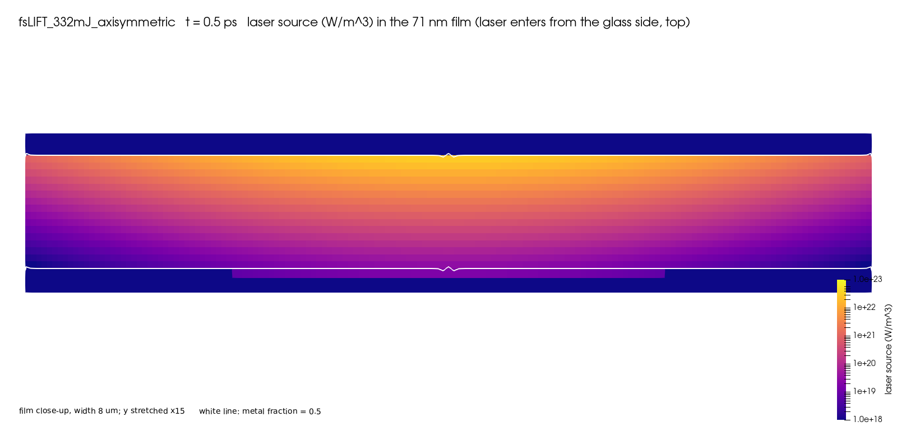

*Absorbed laser power at 0.5 ps in a close-up of the film (8 µm wide, vertical scale stretched 15 times; logarithmic colour scale). The laser enters from the glass at the top. The power is highest at the glass-side surface on the axis and falls by about three orders of magnitude across the film: the film is 7.4 absorption depths thick, and e^-7.4 ≈ 6e-4.*

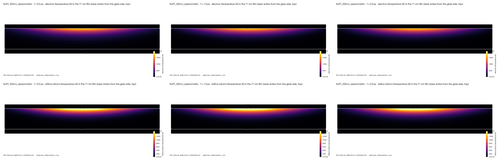

*Top row: electron temperature; bottom row: lattice (atom) temperature, at 0.5, 1 and 2 ps. Same close-up as above.*

- The laser energy is absorbed in a layer about 10 nm thick at the glass-side surface, mostly by the electrons.
- The electrons peak at about **16,400 K at 0.54 ps**.
- The electrons hand their energy to the atoms within a fraction of a picosecond: the lattice reaches about 16,400 K by 0.61 ps. By 2 ps electrons and atoms are at the same temperature, about 16,000 K at the hottest point.
- The heat stays concentrated at the glass-side surface, near the axis, because conduction across the film is slow compared with these few picoseconds.
- The hottest metal is above the critical temperature of titanium, where the model's distinction between liquid and vapour no longer strictly holds ([§8](#8-limitations)).

### 5.2 Trapped vapour and launch: 2 ps – 1 ns

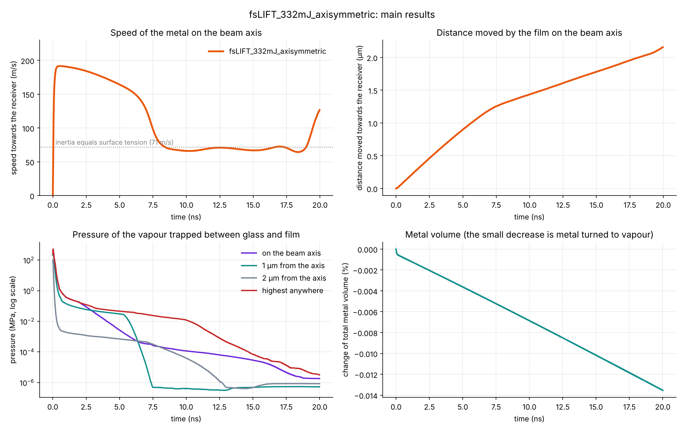

*Four histories over the 20 ns. **Top left:** speed of the metal on the beam axis towards the receiver; the dotted line is 71 m/s, the speed at which the inertia of the film equals its surface tension (Weber number 1). **Top right:** distance moved by the film on the axis. **Bottom left:** pressure of the trapped vapour on the axis, 1 µm and 2 µm from it, and the highest anywhere (logarithmic scale). **Bottom right:** change of the total metal volume; the steady small decrease is metal that evaporated.*

- The glass-side surface evaporates at once. The vapour cannot escape, and its pressure peaks at **524 MPa at 26 ps**.
- This pressure pushes the hot centre of the film away from the glass. The film reaches **191.7 m/s on the axis at 0.54 ns**.
- As the film moves away, the gap behind it opens and the vapour expands and cools. The pressure falls by more than two orders of magnitude within the first nanosecond and is below 1 MPa from 0.59 ns on. From then on the film coasts.
- At its highest speed the film's kinetic energy per unit area, ½ρhv² = 5.92 J/m², is **1.8 times** the energy of the two new surfaces a separated piece needs, 2σ = 3.28 J/m². The Weber number ρv²h/σ = 4515 · 191.7² · 71.4e-9 / 1.64 = **7.2**. So, in terms of energy, the centre of the film can separate.

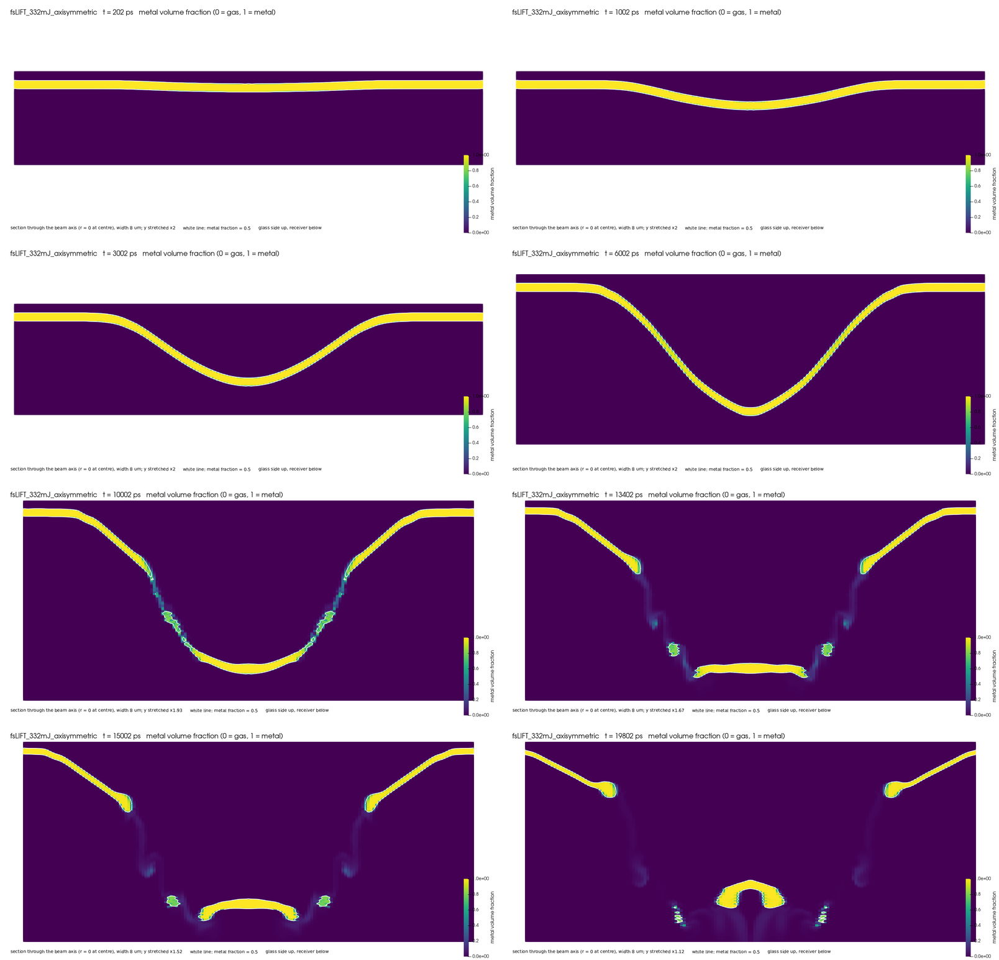

*Metal fraction (yellow = metal, dark = gas) at 0.2, 1, 3, 6, 10, 13.4, 15 and 19.8 ns. The first four pictures show the launch and the deepening dome; the last four the thinning, tearing and flight. Green cells are partly filled: there the metal is smeared over a few cells.*

At 0.2 ns the centre of the film has just started to bow downwards. By 1 ns it is a shallow dome 0.18 µm deep and roughly 5 µm wide.

### 5.3 The dome deepens and slows down: 1–10 ns

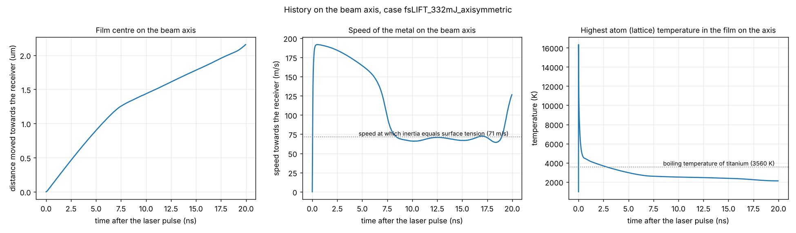

*History on the beam axis. **Left:** distance moved by the film centre. **Middle:** speed towards the receiver, with the 71 m/s line at which inertia equals surface tension. **Right:** highest lattice temperature in the film on the axis, with the boiling temperature of titanium (3560 K).*

| Time | Speed on the axis | Distance moved | Highest lattice temperature on the axis |
|---|---|---|---|
| 0.54 ns | 191.7 m/s | 0.09 µm | 4,510 K |
| 1 ns | 190.8 m/s | 0.18 µm | 4,260 K |
| 3 ns | 180.9 m/s | 0.55 µm | 3,500 K |
| 5 ns | 164.1 m/s | 0.90 µm | 2,960 K |
| 6 ns | 152.6 m/s | 1.06 µm | 2,760 K |
| 7 ns | 125.8 m/s | 1.20 µm | 2,620 K |
| 8 ns | 77.8 m/s | 1.30 µm | 2,570 K |
| 10 ns | 66.1 m/s | 1.44 µm | 2,510 K |

- With the vapour pressure gone, the dome is held back by surface tension and by the film around it, to which it is still attached. It slows slowly at first (191 → 153 m/s from 1 to 6 ns), then sharply between 6 and 8 ns (153 → 78 m/s). From 8 ns on the speed stays close to 70 m/s, near the speed at which inertia and surface tension balance.
- The dome deepens into a **cup** with steep side walls (6 ns picture above).
- The side walls are stretched and **thin**: their horizontal metal thickness falls from about 100–130 nm at 6 ns to 50–87 nm at 8.4 ns. By 10 ns the walls are smeared over few cells (green in the 10 ns picture).
- The film on the axis falls below the boiling temperature of titanium at 2.9 ns and cools to about 2,100 K at 20 ns. It stays above the melting temperature (1941 K), so the metal remains liquid throughout.

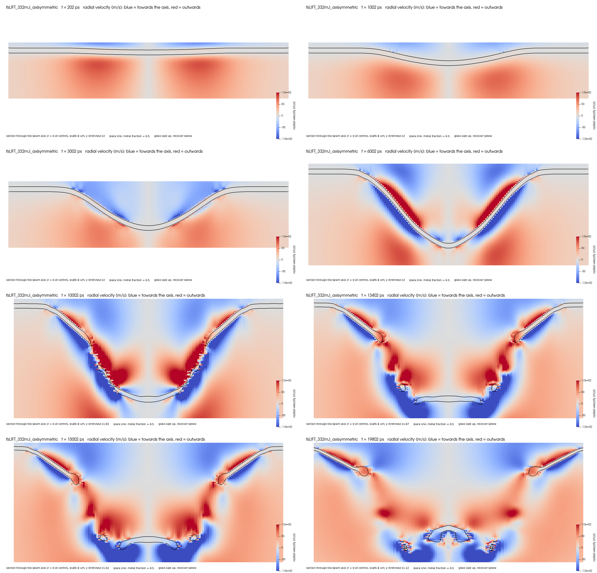

*Radial velocity: red = away from the axis, blue = towards it. In the first nanoseconds, the gas below the descending film is pushed outward (red), while the gas on the glass side flows towards the axis (blue) to fill the space the dome leaves behind. From 6 ns on, strong radial velocities appear inside the thinning walls, where the metal is spread over only a few cells.*

### 5.4 Separation: about 13 ns

- The walls thin to about **5 nm at 13.4 ns**, far less than one radial cell (50 nm), and tear. The tear is **off the axis**, around the rim of the cup bottom.
- The bottom of the cup is now free. At 13.4 ns it holds 0.48 µm³ (the volume of a 0.97 µm sphere) All the metal below the torn walls (the main body plus the ring that later breaks off it) moves at about 130 m/s on average; the main body's centre of mass moves at about 100 m/s (§5.5).
- The torn walls pull back into thick rounded rims on the film that stays attached to the glass (13.4 ns and later pictures).

Because the walls become thinner than one cell well before they tear, **the time of separation and the separated volume are set by the radial cell size** and are not mesh-converged ([§8](#8-limitations)).

### 5.5 Flight: 13–20 ns

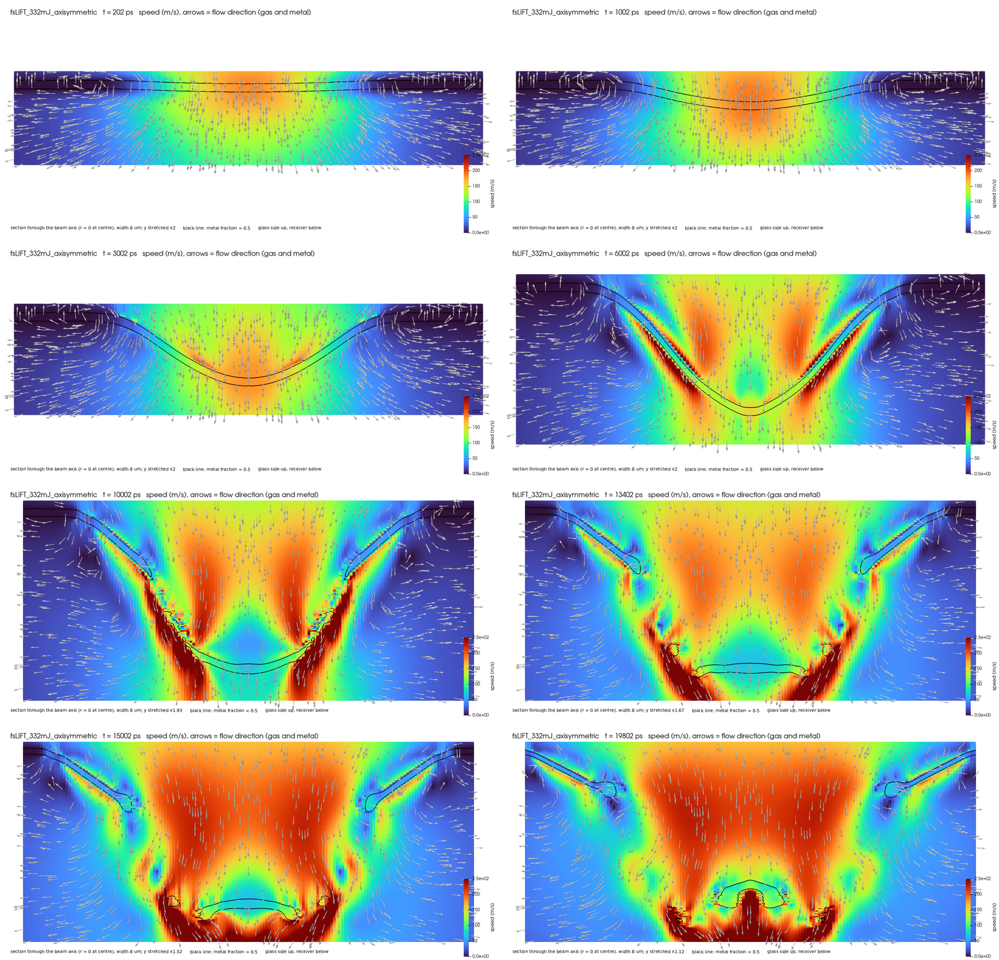

*Speed of gas and metal (colour) and flow direction (arrows). Up to 6 ns the fastest flow is the gas pushed ahead of and drawn behind the dome. From 10 ns on, a fast gas stream (dark red) runs down through the opening in the torn film and onto the separated piece.*

At 19.8 ns, counted with [`tools/count_metal_pieces.py`](tools/count_metal_pieces.py) (cells with α > 0.5):

| Piece | Volume | Sphere of equal volume | Mean speed towards the receiver |
|---|---|---|---|
| **Main droplet** (the former cup bottom) | **0.254 µm³** | **0.79 µm diameter** | **about 100 m/s** (centre of mass; constant from 13.4 to 19.8 ns) |
| Ring fragments around it | 0.105 µm³ in total, a few cells each | – | 170–217 m/s |
| Metal smeared below α = 0.5 | about 0.22 µm³ | – | – |

- **One main droplet** forms, with small ring-shaped fragments around it.
- In this axisymmetric model a "fragment" is a ring around the axis. In reality such a ring would break up into separate droplets around its circumference.
- The lowest metal is still about 9.5 µm above the receiver at 20 ns. Nothing has reached the receiver, so there is **no splash** within the simulated time.

**Which speed to quote.** The speed of the droplet as a body is the velocity of its centre of mass. It is **about 100 m/s and constant** after separation: 102 m/s at 13.4 ns and 98 m/s at 19.8 ns, and a linear fit of the centre-of-mass position gives 100 m/s. The velocity sampled on the beam axis is a different quantity: the local velocity of the liquid there. A droplet that has just torn free is still changing shape, so its internal flow makes the axis sample differ from the body speed. It is about 70 m/s around the tear and rises to 126 m/s at 20 ns, while the droplet as a whole does not speed up.

After about 10 ns the gas that stands in for the glass flows in behind the film and through the opening, faster than the metal (190 m/s on the axis at 19.8 ns). This flow is not physical, since real glass cannot follow the film, but it does not change the droplet's speed: the gas is about 4,000 times less dense than the metal, and the drag of a 190 m/s gas jet on the 0.79 µm droplet moving at 100 m/s (Reynolds number about 5) would change the droplet's speed by about 0.02 m/s over 1.5 ns, and by less than 0.3 m/s even at the full 190 m/s relative speed for the whole 6.4 ns of flight.

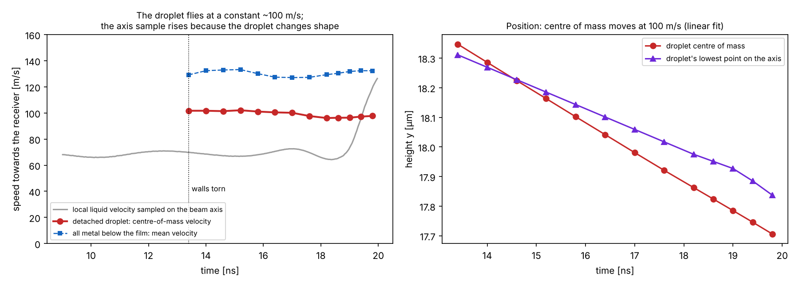

*Left: centre-of-mass velocity of the detached droplet (red), mean velocity of all metal below the film (blue), and the local liquid velocity sampled on the beam axis (grey). Right: height of the droplet's centre of mass and of its lowest point on the axis. Computed with `tools/droplet_motion.py`; data in `figures/fsLIFT_332mJ_axisymmetric/data/droplet_motion.csv`.*

### 5.6 Pressure

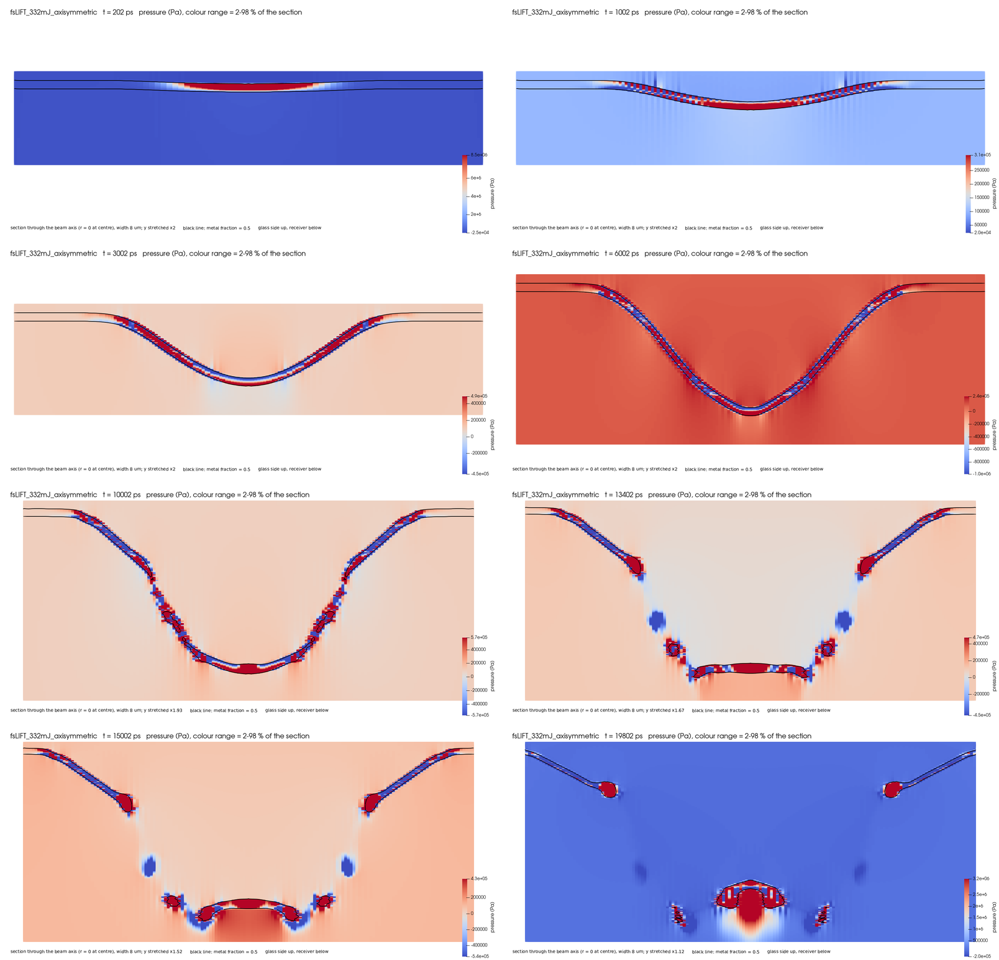

*Pressure; the colour range of each picture covers 2–98 % of its values.*

- **0.2 ns:** the pressure inside the centre of the film is several MPa: the film is being pushed by the vapour behind it.
- **From 1 ns on:** a red-and-blue cell-to-cell **checkerboard** appears inside the thin metal. It is a numerical artefact of the pressure in the thin film, not a physical pressure wave.
- **13.4–19.8 ns:** the main droplet and the rims of the torn film carry pressures of a few MPa. This is the pressure of surface tension in small curved liquid bodies, of the order 2σ/R: about 8 MPa for a radius of 0.4 µm.

### 5.7 The whole story in one table

| Time | Event |
|---|---|
| 0.27 ps | peak of the laser pulse |
| 0.54 ps | electrons peak at about 16,400 K |
| 0.6 ps | atoms at the same temperature as the electrons |
| 26 ps | trapped vapour peaks at 524 MPa |
| 0.54 ns | film on the axis reaches its highest speed, 191.7 m/s |
| 0.59 ns | trapped vapour below 1 MPa; the film coasts from here |
| 2.9 ns | film on the axis below the boiling temperature |
| 6–8 ns | dome is now a cup; speed on the axis falls from 153 to 78 m/s; walls thin |
| about 13 ns | walls tear; the cup bottom is free |
| 13–20 ns | main droplet (centre of mass at a constant ~100 m/s) and ring fragments in flight |
| 20 ns | end of the run; nothing has reached the receiver |

---

## 6. The main numbers

From [`figures/fsLIFT_332mJ_axisymmetric/results_table.md`](figures/fsLIFT_332mJ_axisymmetric/results_table.md) and the piece count above:

| Quantity | Value | How reliable |
|---|---|---|
| Peak electron temperature | about 16,400 K at 0.54 ps | verified model, but its titanium coupling and heat capacity are higher than published values ([LITERATURE.md §3](docs/LITERATURE.md#3-two-temperature-parameters-of-titanium)); above the critical point of titanium |
| Peak trapped-vapour pressure | 524 MPa at 26 ps | depends on the trapped-vapour model (assumed initial gap 1 nm) |
| Highest speed of the film on the axis | 191.7 m/s at 0.54 ns | well-resolved part of the run; no mesh study yet |
| Weber number at that speed | 7.2 | |
| Kinetic energy / surface energy of a separated piece | 1.81 | |
| Distance moved on the axis at 1 / 5 / 20 ns | 0.18 / 0.90 / 2.16 µm | |
| Time of separation | about 13 ns | **mesh-limited** |
| Main droplet at 19.8 ns | 0.254 µm³, equal-volume sphere 0.79 µm | **mesh-limited** |
| Speed of the droplet (centre of mass) | about 100 m/s, constant from 13.4 to 19.8 ns | separation time and volume mesh-limited |
| Change of total metal volume | −0.0135 % (evaporated metal) | |

The data behind the time plots are in [`figures/fsLIFT_332mJ_axisymmetric/data/`](figures/fsLIFT_332mJ_axisymmetric/data/), with the columns named in the first line of each file. The full discussion is in [docs/RESULTS.md](docs/RESULTS.md).

---

## 7. Verification at a glance

Each added equation was tested on its own. Selected results below; [VERIFICATION.md](docs/VERIFICATION.md) marks which tests were rerun with the code in this repository (two-temperature model, force on the film, drop benchmarks, viscosity, moving film) and which come from development runs before the last corrections to the interface transport, which do not touch the laser, evaporation or recoil code:

| Part | Test | Result |
|---|---|---|
| Laser source | energy deposited in a 1-D film | within 0.2 % of the requested energy |
| Two-temperature model | 1-D column against an independent finite-difference code with the same inputs | peak electron temperature −0.5 %; time at which electrons and atoms meet +0.8 % |
| Evaporation | Hertz–Knudsen flux in every evaporating cell | ratio to the formula 1.000000 |
| Recoil | 0.54 × saturation pressure in every recoil cell | within 0.1 % |
| Force on the film | change of the metal momentum against the applied recoil and vapour force, from the reference run | 0.99, 0.96 and 0.94 over three intervals up to 0.4 ns |
| Surface tension | pressure jump of a static drop against the Laplace law | −2.75 % at 10 cells per radius, −4.1 % at 40 |
| Viscosity | decay of a pipe flow with an exact solution | −0.12 % |
| Moving film | a film moving as a whole at 170 m/s must keep its velocity and pressure | velocity exact, pressure within 0.1 %, metal volume exact |
| Drop oscillation | frequency of an oscillating drop against Lamb's solution | −12.9 % → −10.5 % as the mesh is refined; damping too weak (open point) |

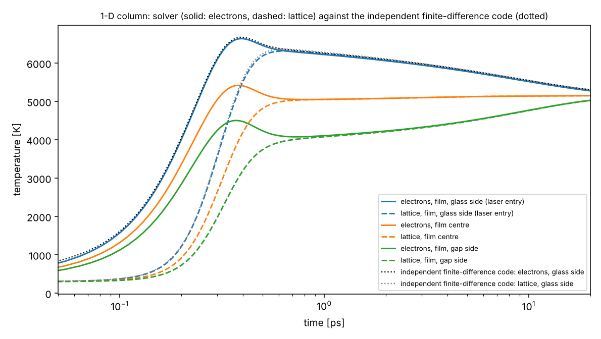

*Two-temperature model: electron (solid) and lattice (dashed) temperatures at three depths of a 1-D film, against the independent finite-difference code `tools/ttm_fd_1d.py` (dotted) on the glass side.*

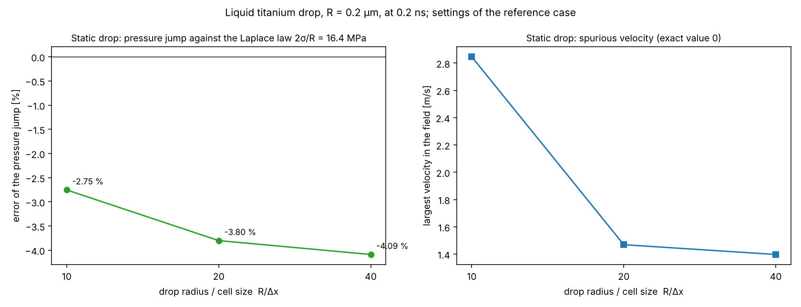

*Surface tension: error of the pressure jump of a static liquid titanium drop (left) and the largest spurious velocity (right), at 10, 20 and 40 cells per drop radius. The error settles near −4 % rather than vanishing, a known limitation of computing the curvature from the gradient of α.*

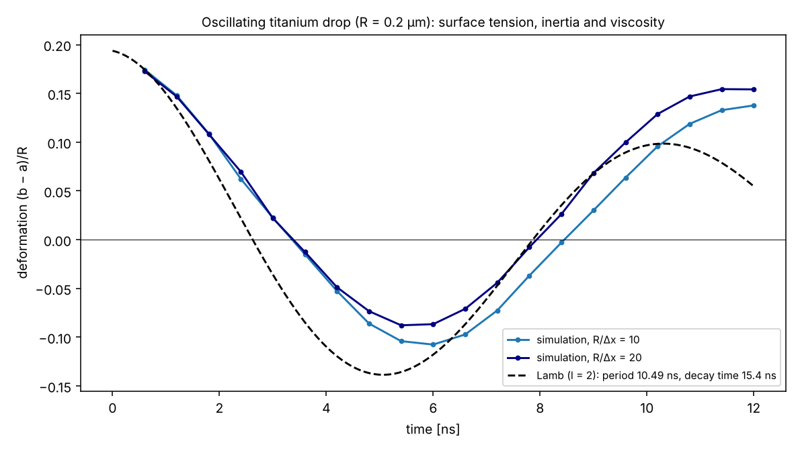

*Oscillating drop: deformation of a drop released as an ellipsoid, at two resolutions, against Lamb's damped oscillation. The frequency approaches Lamb's value as the mesh is refined; the damping is too weak. This affects how well thinning liquid sheets are captured.*

All tests, how to repeat them, the defects found and corrected, and the open points: [docs/VERIFICATION.md](docs/VERIFICATION.md).

---

## 8. Limitations

Ordered by how much each could change the answer to "does the film eject, and how?". Details in [docs/RESULTS.md](docs/RESULTS.md#limitations).

1. **The metal is incompressible.** There are no stress waves and no spallation, which in femtosecond LIFT can drive part of the ejection.
2. **The glass is modelled as an incompressible gas.** It pulls slightly on the departing film and, after about 10 ns, streams through the torn film. It is too light to change the droplet's speed (§5.5), but the flow behind the film is not physical.
3. **The separation is mesh-limited.** The walls become thinner than one radial cell (50 nm) before they tear. A run from about 6 ns on a radially refined mesh is needed.
4. **Temperatures above the critical point.** The hottest metal exceeds the critical temperature of titanium; the evaporation model uses a temperature capped at 10,000 K.
5. **Trapped-vapour model simplifications.** No sideways vapour flow between rings, no cooling of the vapour by the glass, and an assumed initial gap of 1 nm.
6. **No solid phase.** All metal flows as a liquid, even below the melting temperature.
7. **Damping of interface oscillations is too weak** (§7).
8. **Axisymmetric only.** Rings cannot break into separate droplets around their circumference, and an off-centre beam or film defects cannot be represented.
9. **Not validated** against measurements; the LIFT experiments in the literature register could not be read for this work.
10. **Titanium inputs.** The density gives the right film mass but not the expansion of the liquid (7.7 % at the melting point), and the surface tension is constant ([VALIDATION.md §5](docs/VALIDATION.md#5-level-3-input-validation)). **Two-temperature parameters of titanium.** The electron–lattice coupling (5–27 times above 5,000 K) and the electron heat capacity (about 2 times) are higher than published values. This mainly speeds up the heating of the atoms (0.25 ps instead of about 2 ps); the peak surface temperature changes by −11 % to +9 % ([LITERATURE.md §3](docs/LITERATURE.md#3-two-temperature-parameters-of-titanium)).

---

## 9. Quick start

Requirements:
- OpenFOAM v2406 (the ESI/OpenCFD release from openfoam.com);
- Python 3 with NumPy and Matplotlib, for the analysis scripts;
- ParaView 5.10 or later (`pvpython`), for the images.

```bash
source /usr/lib/openfoam/openfoam2406/etc/bashrc     # adjust to your installation

# 1. build the solver (about 1 minute; installs into $FOAM_USER_APPBIN)
cd src && wmake && cd ..

# 2. quick check (10-20 minutes on one core): laser heating in a 1-D column,
#    compared with the independent finite-difference code
cd cases/column1D_laser_TTM
blockMesh && rm -rf 0 && cp -r 0.orig 0 && topoSet && setFields && compInterFoam > log.run 2>&1
cd ../.. && python3 tools/compare_ttm_1d.py cases/column1D_laser_TTM

# 3. the reference case on 4 processes to 20 ns (about 20 hours, about 5 GB)
tools/run_case.sh cases/fsLIFT_332mJ_axisymmetric 4 2e-8
RESUME=1 tools/run_case.sh cases/fsLIFT_332mJ_axisymmetric 4 2e-8    # continue after an interruption

# 4. results: histories on the axis, results table, images
python3 tools/axis_timeseries.py cases/fsLIFT_332mJ_axisymmetric
python3 tools/results_package.py cases/fsLIFT_332mJ_axisymmetric
xvfb-run -a pvpython tools/render_gallery.py cases/fsLIFT_332mJ_axisymmetric
xvfb-run -a pvpython tools/count_metal_pieces.py cases/fsLIFT_332mJ_axisymmetric 1.98e-8
```

Every setting of the case, every tool, and how to set up a new case (another fluence, mesh or film): [docs/USER_GUIDE.md](docs/USER_GUIDE.md).

---

## 10. Repository layout and documentation

| Path | Content |
|---|---|
| `src/` | solver source code and build files (`Make/`) |
| `cases/fsLIFT_332mJ_axisymmetric/` | reference case: input dictionaries and initial fields (`0.orig`) |
| `cases/column1D_laser_TTM/` | 1-D column: laser heating and the two-temperature model |
| `cases/column1D_galilean_test/` | 1-D column moving as a whole at −170 m/s: velocity and pressure must not change |
| `tools/` | run script, analysis and plotting scripts (including `plot_model_inputs.py` for the model figures), independent finite-difference two-temperature code |
| `tools/benchmarks/` | drop benchmarks: surface tension, drop oscillation, viscosity |
| `figures/fsLIFT_332mJ_axisymmetric/` | results of the reference case: histories, results table, image gallery, data |
| `figures/verification/` | verification figures |
| `figures/model/` | figures of the model inputs (laser profiles, two-temperature properties, evaporation, mesh), used in docs/MODEL.md |
| `figures/literature/` | the sensitivity study of the two-temperature parameters, used in docs/LITERATURE.md |
| `literature/screened_candidates.csv` | 56 further papers found for the validation report: 48 with the abstract read and the reason for inclusion, 8 pending |
| `figures/validation/` | figures of the verification and validation report |
| `literature/register.csv` | register of 62 related papers with metadata checked against their DOIs, links, relevance, and corrections to the original list; the papers themselves are not included (copyright) |
| `docs/` | documentation |

| Document | Read it for |
|---|---|
| [docs/MODEL.md](docs/MODEL.md) | the assumptions and governing equations as implemented, the closures and inputs with their origin, characteristic scales and dimensionless numbers, and the numerical method, with figures |
| [docs/USER_GUIDE.md](docs/USER_GUIDE.md) | building, running and restarting, every case setting explained, the analysis tools, setting up a new case |
| [docs/VERIFICATION.md](docs/VERIFICATION.md) | every test with its result and how to repeat it, the defects found and corrected, the open points |
| [docs/RESULTS.md](docs/RESULTS.md) | the reference result in detail, and the limitations of the model |
| [docs/VALIDATION.md](docs/VALIDATION.md) | the verification and validation report: status of the five levels, every test, the titanium inputs against measured values, sub-model and mechanism comparisons, what can and cannot be claimed, and the validation plan, with figures |
| [docs/LITERATURE.md](docs/LITERATURE.md) | comparison of the inputs and results with published work: titanium two-temperature parameters, conductivity, critical temperature, stress confinement, surface-tension numerics; what could not yet be compared |

---

## 11. Licence and author

GNU General Public License version 3 or later (see [`LICENSE`](LICENSE)), the licence of OpenFOAM, from which this solver is derived. OpenFOAM is a registered trademark of OpenCFD Ltd. This software is not approved or endorsed by OpenCFD Ltd.

Author: Mavadidurai Gopinathan.
