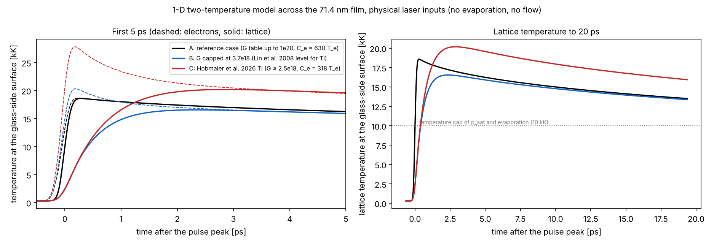

# Comparison with the literature

This document compares the model inputs and results of the reference case with published work. The register of 62 papers is in [`literature/register.csv`](../literature/register.csv), with the metadata as resolved from each DOI, the corrections made to the original list, and what could be read for this check.

**Contents**

1. [What was checked, and how](#1-what-was-checked-and-how)
2. [Summary](#2-summary)
3. [Two-temperature parameters of titanium](#3-two-temperature-parameters-of-titanium)
4. [Electron heat conductivity](#4-electron-heat-conductivity)
5. [Critical temperature and phase explosion](#5-critical-temperature-and-phase-explosion)
6. [Stress confinement](#6-stress-confinement)
7. [Surface-tension numerics](#7-surface-tension-numerics)
8. [LIFT experiments: not yet compared](#8-lift-experiments-not-yet-compared)
9. [Corrections to the register](#9-corrections-to-the-register)

---

## 1. What was checked, and how

**Metadata.** Every entry was looked up by DOI, or by exact title where no DOI was given, in two public bibliographic databases (OpenAlex and Crossref).
- 57 of the 62 entries were matched; 5 could not be found and keep their original, unverified metadata.
- DOIs were found for 35 entries that had none.
- 13 entries had a wrong first author, year or title; they are listed in §9.

**Full texts.** The papers themselves are **not** included in this repository: most are copyrighted by their publishers and may not be redistributed. Each entry links to its DOI.

| Access in this check | Entries |
|---|---|
| Full text read (author copies on arXiv or the HAL open archive) | Hobmaier et al. 2026; Bévillon et al. 2014; Lippert et al. 2022; Murali et al. 2022; Li et al. 2019; Li et al. 2017 (Optics Express); Long et al. 2023; Bibal et al. 2024; Zhang et al. 2023; Boyd & Ling 2022; Boniou 2021 (thesis) |
| Abstract read | Ye & Grigoropoulos 2001; Grojo et al. 2005; Deshpande et al. 2012 (abstract and method section) |
| Open access at the publisher, but the publisher refused automated access from this environment | 13 entries (column `publisher_open_access` of the register) |
| Behind a subscription; publisher refused automated access | among others Kuznetsov et al. 2012; Pohl et al. 2015; Banks et al. 2006; Lin et al. 2008 |

The register lists, for each paper, any legal open copy (column `legal_open_copy`: the HAL open archive or arXiv) and whether the publisher's version is open access. 25 of the 62 papers can be obtained freely and legally; the rest need a library subscription.

The three copper jetting studies read in full (Murali et al. 2022; Li et al. 2019; Li et al. 2017) use a double-pulse scheme on 1 µm copper films: a long pulse melts the film and a femtosecond pulse drives the jet. That is a different regime from a single femtosecond pulse on a 71.4 nm titanium film, so they are not used for any quantitative comparison here.

Only numbers that were read in a source are used below. Where a comparison could not be made, it says so.

**Rule for comparisons.** A number is compared only with the same quantity under comparable conditions. Thresholds and speeds are not compared across materials, pulse durations, wavelengths, film thicknesses or fluence definitions.

---

## 2. Summary

| Item | Model | Literature | Verdict |
|---|---|---|---|
| Electron–lattice coupling $G(T_e)$ of Ti | table from 10¹⁸ (300 K) to 10²⁰ W/(m³ K) (20,000 K) | peak ≈ 2.5×10¹⁸ (first principles, Hobmaier et al. 2026); ≈ 1.5× higher in Lin et al. 2008 | **inconsistent**: the model is 5× higher at 5,000 K and 14–27× higher at 10,000–20,000 K (§3) |
| Electron heat capacity $C_e = \gamma T_e$ of Ti | γ = 630 J/(m³ K²) | γ = 318 J/(m³ K²); $C_e$ peaks at 2.29 MJ/(m³ K) near 12,000 K (Hobmaier et al. 2026) | **inconsistent**: about 2× higher, and 3× higher at 12,000 K (§3) |
| Liquid density of Ti | 4,515 kg/m³, constant | 4,193 − 0.238 (T − 1941 K) kg/m³ (Ozawa et al. 2017, levitation) | **inconsistent**: 7.7 % high at the melting point, more at higher temperature ([VALIDATION.md §5](VALIDATION.md#5-level-3-input-validation)) |
| Surface tension of liquid Ti | 1.64 N/m, constant | 1.613 − 0.000205 (T − 1941 K) N/m (Seimiya et al. 2022, levitation) | consistent at the melting point; 9–17 % high at 2,500–3,000 K, and no temperature dependence ([VALIDATION.md §5](VALIDATION.md#5-level-3-input-validation)) |
| Effect of these two on the heating | – | 1-D sensitivity study with this repository's code | peak surface temperature changes by −11 % to +9 %; electron–lattice equilibration takes 1.7–2.3 ps instead of 0.25 ps (§3.3) |
| Electron conductivity form | Drude, $k_{e0} T_e/T_l$ | the Drude form overestimates the peak lattice temperature of Ti by 7 % (melting threshold) and up to 19 % (Hobmaier et al. 2026) | **known bias**, same direction as above (§4) |
| Critical temperature of Ti | 9,500 K (case value; used only by a switched-off sub-model) | 8,980 K (as cited by Hobmaier et al. 2026) | 6 % apart; no effect on the results (§5) |
| Phase explosion | sub-model switched off; surface reaches about 16,400 K | onset criterion $T_l > 0.9\,T_{crit}$ ≈ 8,100 K (Hobmaier et al. 2026) | **the reference case is far into the phase-explosion regime** that the model does not describe (§5) |
| Stress confinement | incompressible metal: no stress waves | liquid Ti sound speed 4.4 km/s; stress confinement when the heating is faster than the acoustic time (Hobmaier et al. 2026) | **the real film is stress-confined**; spallation is physically expected and absent from the model (§6) |
| Surface tension: static drop | pressure-jump error settles near −4 % | interFoam curvature converges to a value ≈ 10 % off (Deshpande et al. 2012) | **consistent**; the model does better than standard interFoam (§7) |
| Surface tension: spurious currents | do not vanish under refinement; oscillation damping too weak | interFoam parasitic currents reach a plateau; OpenFOAM surface-tension approximation needs "significant improvements" (Lippert et al. 2022) | **consistent**: a known limitation of the method (§7) |
| LIFT experiments (ejection speed, droplet size, regimes) | dome 192 m/s; droplet at 70–90 m/s, 0.25 µm³ | could not be read here | **not compared** (§8) |

---

## 3. Two-temperature parameters of titanium

### 3.1 What the literature gives

Hobmaier et al. (2026) computed the electronic properties of hcp titanium from first principles. Their results, read from the full text:

- **Electron heat capacity.** A Sommerfeld fit gives γ = 318 J/(m³ K²). The full $C_e(T_e)$ is not linear: it "reach[es] a peak of 2.29 MJ m⁻³ K⁻¹ for Ti … near 12 kK, before decreasing".
- **Electron–lattice coupling.** "G rises with $T_e$ and reaches a peak of approximately 25×10¹⁷ W K⁻¹ m⁻³ for Ti".
- **Comparison with Lin et al. (2008).** "The temperature dependence of both $C_e$ and G for Ti agrees well with the data of Lin et al., while the absolute magnitude of G is lower by a factor of about 1.5". The titanium G of Lin et al. therefore peaks near 1.5 × 2.5×10¹⁸ ≈ 3.7×10¹⁸ W/(m³ K). Lin et al.'s own data could not be read here (publisher and data page not reachable), so this value is inferred, not read.

### 3.2 What the model uses

| $T_e$ | Model $G$ [W/(m³ K)] | Ratio to the Lin et al. peak (≈ 3.7×10¹⁸) | Model $C_e$ [MJ/(m³ K)] | First-principles $C_e$ |
|---|---|---|---|---|
| 300 K | 1.0×10¹⁸ | 0.3 | 0.19 | 0.10 (318 × 300) |
| 1,000 K | 3.0×10¹⁸ | 0.8 | 0.63 | 0.32 |
| 5,000 K | 2.0×10¹⁹ | 5 | 3.15 | ≤ 2.29 |
| 10,000 K | 5.0×10¹⁹ | 14 | 6.3 | ≤ 2.29 |
| 20,000 K | 1.0×10²⁰ | 27 | 12.6 | ≤ 2.29 |

The case files describe the G table as following Lin et al. (2008). It does not: from about 2,000 K up the table exceeds the titanium values of that paper, by 5 times at 5,000 K and 14–27 times at 10,000–20,000 K, the temperatures the film reaches. The table's origin is not documented. The case comments have been corrected.

### 3.3 Does it matter? A sensitivity study

The two-temperature model across the 71.4 nm film was solved with the independent 1-D finite-difference code ([`tools/ttm_parameter_sensitivity.py`](../tools/ttm_parameter_sensitivity.py)). It uses the physical laser inputs of the reference case, without evaporation or flow, for three parameter sets:

- **A**: the reference case;
- **B**: $G$ capped at 3.7×10¹⁸ W/(m³ K), the Lin et al. level;
- **C**: γ = 318 J/(m³ K²) and $G$ capped at 2.5×10¹⁸ W/(m³ K), the first-principles values. $C_e$ is kept linear, so above about 7,200 K it is higher than the first-principles $C_e$. The true electron temperatures in C would be even higher.

| Glass-side surface | A: reference | B: Lin level | C: first principles |
|---|---|---|---|
| Peak electron temperature | 18,600 K | 20,300 K | 27,800 K |
| Peak lattice temperature | 18,600 K at 0.28 ps | 16,500 K at 2.35 ps | 20,200 K at 2.88 ps |
| Electrons and lattice meet (within 5 %) | 0.25 ps | 1.73 ps | 2.28 ps |
| Lattice temperature at 20 ps | 13,500 K | 13,400 K | 15,900 K |
| Gap-side surface at 20 ps | 640 K | 650 K | 770 K |

*Times after the pulse peak. Data: [`figures/literature/data/`](../figures/literature/data/).*

**Reading.**
1. The coupling parameters mainly change **how fast** the lattice heats: equilibration takes about 2 ps instead of 0.25 ps. The peak surface temperature changes by only −11 % to +9 %. The energy stays near the glass-side surface in all three cases, because the Drude conductivity is low once the lattice is hot (gap side below 800 K at 20 ps).
2. In all three cases the surface stays above 10,000 K throughout the first 20 ps. The model evaluates the saturation pressure and evaporation with the temperature capped at 10,000 K ([MODEL.md §5.1](MODEL.md#51-saturation-pressure-and-evaporation-flux)). So **the early trapped-vapour drive is nearly unchanged by the coupling error**.
3. With the first-principles values (C) the surface stays about 2,400 K hotter at 20 ps. Evaporation and the vapour pressure would then last longer, so the launch speed would probably be somewhat higher. By how much has not been computed: it needs a full 2-D run with corrected parameters [UNCERTAIN].

**Recommendation.** Replace the $G$ table and γ with first-principles titanium values (Hobmaier et al. 2026, or Lin et al. 2008 from the original data), and repeat the launch phase to 1 ns.

---

## 4. Electron heat conductivity

The model uses the low-temperature Drude form $k_e = k_{e0} T_e/T_l$ ([MODEL.md §4.2](MODEL.md#42-closures)). Hobmaier et al. (2026) compare it with their first-principles conductivity for titanium:
- "Replacing the first-principles thermal conductivity with the low-T approximation lowers $F_{th}$ by roughly 8 % across all pulse durations below 2 ps";
- the low-T model "yields $T_{l,max}$ = 2914 K, overshooting the first-principles result by 7.1 %" at the melting threshold;
- it "shifts $T_{l,max}$ by up to 19 % for Ti".

At high electron temperature the Drude form underestimates the conductivity, so heat is carried too slowly into the film and the surface is too hot. The model's surface temperatures are therefore probably overestimated by of the order of 10 % [UNCERTAIN: the 7–19 % were obtained for bulk titanium at other fluences]. As in §3, the 10,000 K cap limits the effect on the vapour pressure in the first tens of picoseconds.

---

## 5. Critical temperature and phase explosion

- Hobmaier et al. (2026) use a critical temperature of titanium of $T_{crit}$ = 8,980 K, citing their reference [67]. The case uses 9,500 K. This value is read only by the phase-explosion sub-model, which is switched off, so it does not affect the results.
- They take the onset of phase explosion as $T_{l,max} = 0.9\,T_{crit}$ ≈ 8,080 K.
- **The reference case reaches about 16,400 K at the glass-side surface, about twice that onset temperature.** Under this criterion the heated layer would decompose explosively into vapour and droplets. The model describes it by surface evaporation and the trapped-vapour model instead ([MODEL.md §10](MODEL.md#10-sub-models-present-but-switched-off)). This is a model limitation; it is consistent with the limitation already stated for temperatures above the critical point ([RESULTS.md](RESULTS.md#limitations)).

---

## 6. Stress confinement

Hobmaier et al. (2026) state the condition for stress confinement as $\max(\tau_p, \tau_{ep}) < d_{eff}/c_l$. Here $\tau_p$ is the pulse duration, $\tau_{ep}$ the electron–lattice equilibration time, $d_{eff}$ the heated depth, and $c_l$ = 4.4 km/s the sound speed of liquid titanium, citing their reference [72]. "Within the stress-confinement regime, ablation proceeds through spallation".

For the reference case:

| Quantity | Value |
|---|---|
| Pulse duration | 0.21 ps |
| Equilibration time | 0.25 ps (model parameters); 1.7–2.3 ps (literature parameters, §3.3) |
| Acoustic time over the absorption depth, 9.66 nm / 4.4 km/s | 2.2 ps |
| Acoustic time over the film, 71.4 nm / 4.4 km/s | 16 ps |

The heating is faster than the acoustic time across the film, so the real film is stress-confined, and tensile stress waves and spallation are physically expected. With the literature coupling the equilibration time approaches the acoustic time over the absorption depth, so the conditions are close to the limit for the heated surface layer. The model has incompressible metal and no stress waves ([MODEL.md §1](MODEL.md#1-physical-setting-and-modelling-assumptions), A3), which remains its first-ranked limitation.

---

## 7. Surface-tension numerics

| Source | Finding | This model |
|---|---|---|
| Deshpande, Anumolu & Trujillo 2012 (abstract) | in interFoam the curvatures "converge to a value slightly (10%) different from the analytical value" | static-drop pressure-jump error −2.75 % at 10 cells per radius, settling at −4.1 % at 40 cells ([VERIFICATION.md §2.3](VERIFICATION.md#23-flow-interface-and-surface-tension)) |
| Lippert et al. 2022 (full text) | for interFoam the parasitic-current errors "reach some kind of plateau state" instead of decaying; "the benchmark results demonstrate a need for significant improvements in the approximation of surface tension forces, especially for the unstructured VoF methods available in OpenFOAM" | spurious velocities fall from 2.85 to 1.40 m/s from 10 to 40 cells per radius but do not vanish; oscillation damping too weak |

Both are consistent with the behaviour of this solver, which uses the same continuum-surface-force approach with the curvature from the gradient of α. Its static-drop error is smaller than the 10 % reported for standard interFoam, probably because of the three-cell surface-tension band [UNCERTAIN: the two tests differ in geometry and resolution]. A more accurate curvature (height functions, or the geometric methods compared by Lippert et al.) remains the recommended improvement.

---

## 8. LIFT experiments: not yet compared

The register's directly relevant LIFT experiments could not be read here, because the publishers refused automated access:
- Kuznetsov et al. 2012, jet and droplet formation from thin metal films with femtosecond pulses;
- Pohl et al. 2015, ejection regimes with picosecond pulses;
- Klini et al. 2008 and Banks et al. 2006, femtosecond LIFT of Cr, Au and Zn films.

No comparison of ejection speeds, droplet sizes or ejection regimes is therefore made, and no literature speed range is quoted anywhere in this repository.

The observables to compare, once the texts are available, are:
- the film displacement and speed on the axis against time (model: 0.18 µm and 191 m/s at 1 ns);
- the dome height and radial extent;
- the time of separation (about 13 ns, mesh-limited);
- the droplet diameter and transferred volume (0.25 µm³, 0.79 µm equivalent diameter, mesh-limited).

A meaningful comparison also needs the same film thickness, wavelength, pulse duration and fluence definition, as the register's own notes require.

---

## 9. Corrections to the register

Found by resolving each DOI or exact title (full list with all fields in [`literature/register.csv`](../literature/register.csv), column `corrections_to_register`):

| Entry | Correction |
|---|---|
| LIT-005 | the first author's family name is Yang (Li Yang); the register lists the given name "Li" |
| LIT-018 | published 2012, not 2013 |
| LIT-032 | authors are D. Pérez and L. J. Lewis, not Ivanov et al. |
| LIT-033 | authors are C. Cheng and X. Xu, not Zhigilei et al. |
| LIT-035 | Wellershoff, Hohlfeld, Güdde, Matthias, 1999 (authors and year were unverified) |
| LIT-036 | Bévillon, Colombier, Recoules, Stoian, 2014 (authors and year were unverified) |
| LIT-037 | first author M. Park (authors were unverified) |
| LIT-038 | title "Plasma analyses during femtosecond laser ablation of Ti, Zr, and Hf"; authors Grojo, Hermann, Perrone; 2005 |
| LIT-039 | first author G. Parris |
| LIT-042 | published 2013, not 2014 |
| LIT-055 | the first author's family name is Long (Tian Long); the register lists the given name "Tian" |
| LIT-057 | authors B. Zhang, B. Boyd, Y. Ling (authors were unverified) |
| LIT-062 | published 2025 (year was unverified) |

Five entries could not be found by exact title and remain unverified: LIT-014, LIT-015, LIT-045, LIT-050, LIT-053.

---

## References used in this document

- K. Hobmaier, G. E. Allemand, A. Marmodoro, M. J. Verstraete, J. Minár, H. P. Huber, D. Redka, "First-principles electronic transport properties of Ti and Ti-6Al-4V for modeling ultrashort-pulse laser ablation", *Physical Review Materials* (2026), DOI [10.1103/6sn3-ltl4](https://doi.org/10.1103/6sn3-ltl4); preprint [arXiv:2607.18085](https://arxiv.org/abs/2607.18085).
- Z. Lin, L. V. Zhigilei, V. Celli, *Physical Review B* **77**, 075133 (2008), DOI [10.1103/PhysRevB.77.075133](https://doi.org/10.1103/PhysRevB.77.075133) (not read; values inferred through Hobmaier et al.).
- E. Bévillon, J. P. Colombier, V. Recoules, R. Stoian, *Physical Review B* **89**, 115117 (2014), DOI [10.1103/PhysRevB.89.115117](https://doi.org/10.1103/PhysRevB.89.115117); preprint [arXiv:1403.5117](https://arxiv.org/abs/1403.5117).
- A. Lippert, T. Tolle, A. Dörr, T. Marić, "A benchmark for surface-tension-driven incompressible two-phase flows", [arXiv:2212.02904](https://arxiv.org/abs/2212.02904) (2022).
- S. S. Deshpande, L. Anumolu, M. F. Trujillo, "Evaluating the performance of the two-phase flow solver interFoam", *Computational Science & Discovery* **5**, 014016 (2012), DOI [10.1088/1749-4699/5/1/014016](https://doi.org/10.1088/1749-4699/5/1/014016).
