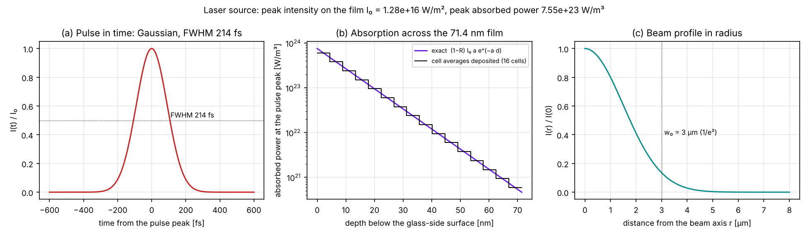
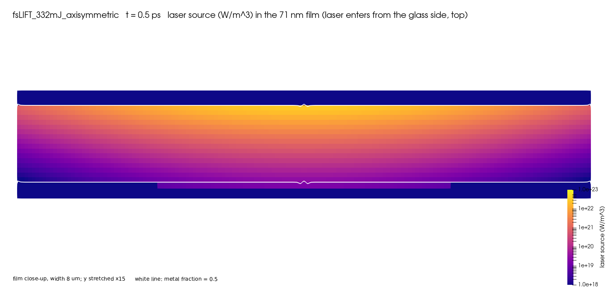
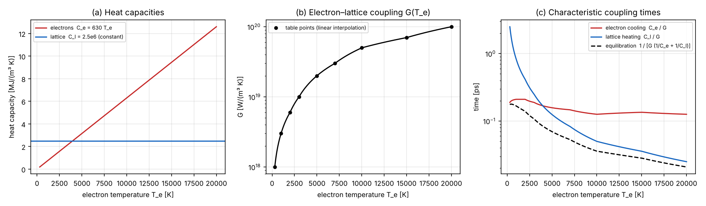
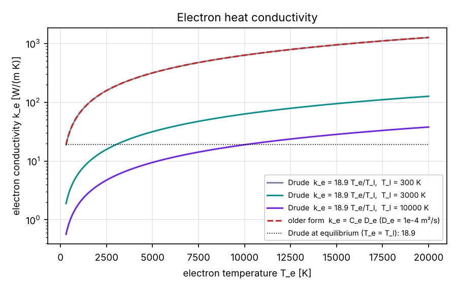
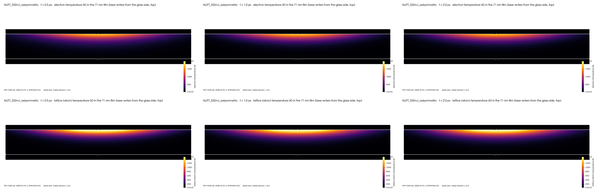
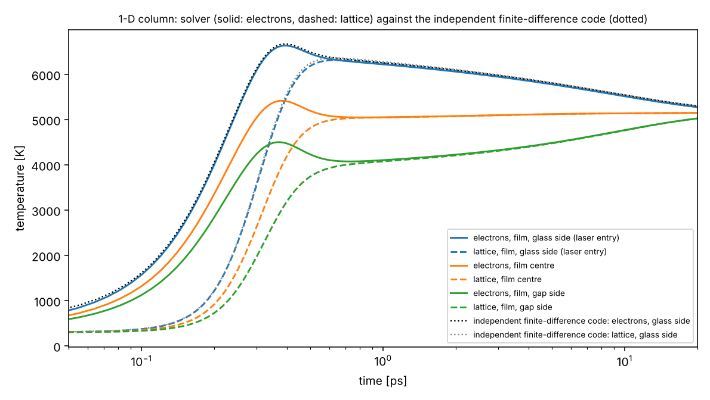
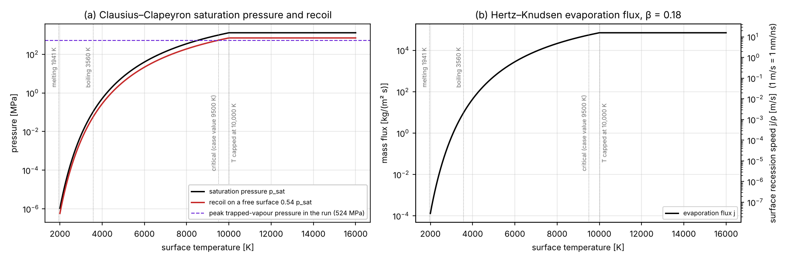
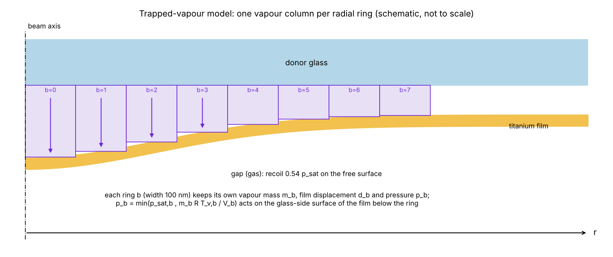
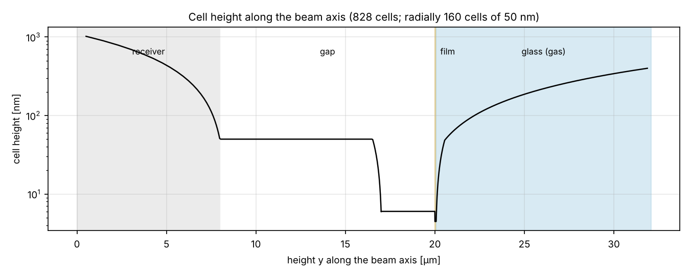

# The model

This document describes the mathematical model and its numerical implementation: the physical assumptions, the governing equations as they are implemented in `src/`, the closures and input values of the reference case `cases/fsLIFT_332mJ_axisymmetric`, the characteristic scales that follow from them, and the numerical method. Every figure in the [figures/model](../figures/model) folder is computed from the case inputs with the formulas below by [`tools/plot_model_inputs.py`](../tools/plot_model_inputs.py); figures from the simulation itself are marked as such.

**Contents**

1. [Physical setting and modelling assumptions](#1-physical-setting-and-modelling-assumptions)
2. [The coupled system at a glance](#2-the-coupled-system-at-a-glance)
3. [Laser energy deposition](#3-laser-energy-deposition)
4. [Two-temperature model](#4-two-temperature-model)
5. [Evaporation and recoil pressure](#5-evaporation-and-recoil-pressure)
6. [Vapour trapped between the glass and the film](#6-vapour-trapped-between-the-glass-and-the-film)
7. [Two-phase flow, interface capturing and surface tension](#7-two-phase-flow-interface-capturing-and-surface-tension)
8. [Characteristic scales and dimensionless numbers](#8-characteristic-scales-and-dimensionless-numbers)
9. [Numerical method](#9-numerical-method)
10. [Sub-models present but switched off](#10-sub-models-present-but-switched-off)
11. [Input parameters](#11-input-parameters)
12. [References](#12-references)

Notation:

| Symbol | Meaning | Unit |
|---|---|---|
| $\alpha$ | volume fraction of metal in a cell (1 = metal, 0 = gas) | – |
| $\mathbf{u}$, $p$ | mixture velocity and pressure | m/s, Pa |
| $T_e$, $T_l$ | electron and lattice (atom) temperature | K |
| $Q$ | absorbed laser power per unit volume | W/m³ |
| $p_{sat}$ | saturation vapour pressure of titanium | Pa |
| $j$ | evaporation mass flux per unit interface area | kg/(m² s) |
| $r$, $y$ | distance from the beam axis; position along the axis | m |
| $d$ | depth below the glass-side surface of the film | m |
| $h$ | film thickness, 71.4 nm | m |

---

## 1. Physical setting and modelling assumptions

A 214 fs pulse at 343 nm crosses a 1.05 mm glass plate and is absorbed in a 71.4 nm titanium film coated on the glass. The film surface bonded to the glass is called the **glass-side surface**; the surface facing the 12 µm gap to the receiver is the **gap-side surface**. The laser travels in −y.

The model rests on the following assumptions. Each is a deliberate simplification; their consequences are discussed in [RESULTS.md](RESULTS.md#limitations).

| # | Assumption | Justification | Consequence |
|---|---|---|---|
| A1 | **Axisymmetry.** All fields are independent of the azimuthal angle; the domain is a 5° wedge | beam at normal incidence on a uniform film | no azimuthal break-up of rings into droplets |
| A2 | **Continuum, two immiscible phases** (liquid titanium and a gas), tracked by a volume fraction | film thickness ≫ atomic spacing | atomistic processes (spallation by voids, homogeneous nucleation) are not resolved |
| A3 | **Both phases incompressible** with constant density | removes acoustic time steps; the flow is far below the sound speed after the first tens of ps | **no stress waves**: the heating (≈ 0.3 ps) is much faster than the acoustic time across the film (≈ 10–20 ps, see §8), so a real film is stress-confined; this physics is absent |
| A4 | **The metal is a liquid everywhere** | the film is melted near the axis within picoseconds | the cold film outside the spot can flow; there is no solid rim |
| A5 | **The glass is represented by a gas** of constant density | the solver is two-phase | the gas can flow in behind the departing film (an artefact after ≈ 10 ns) |
| A6 | **Electrons and lattice have separate temperatures** (two-temperature model) | electron–lattice coupling time ≈ 0.03–0.2 ps is comparable to the pulse | captures the non-equilibrium heating |
| A7 | **Evaporation follows Hertz–Knudsen kinetics** with a Clausius–Clapeyron saturation pressure | standard for surface evaporation of metals | above the critical temperature of titanium the liquid–vapour picture no longer strictly holds |
| A8 | **Vapour on the glass side is held in a lumped model**, one column per radial ring, not resolved as a field | the field solver cannot hold a compressible vapour (A3) | no sideways vapour flow; vapour temperature equals the surface temperature |
| A9 | **No optical effects of the hot metal or the vapour**: constant reflectivity and absorption coefficient; no plasma shielding | the pulse is over before significant motion | changes of optical properties during the pulse are ignored |

---

## 2. The coupled system at a glance

| Unknown | Equation | Where in `src/` | Section |
|---|---|---|---|
| $Q(\mathbf{x},t)$ | Beer–Lambert absorption of a Gaussian beam, integrated over each cell and time step | `femtosecondLaserModel.C` | §3 |
| $T_e$, $T_l$ | two coupled heat equations (two-temperature model), with laser source and latent-heat sink | `twoTemperatureModel.C`, `TEqn.H` | §4 |
| $j$, $p_{sat}$, recoil $p_r$ | Hertz–Knudsen flux, Clausius–Clapeyron, Anisimov recoil | `twoPhaseMixtureThermo.C`, `advancedInterfaceCapturing.C` | §5 |
| $m_b$, $d_b$, $p_b$ per ring | ordinary differential equations for the trapped vapour | `advancedInterfaceCapturing.C` | §6 |
| $\alpha$ | volume-fraction transport with interface compression and evaporation sink | `alphaEqn.H` | §7.1 |
| $\mathbf{u}$, $p$ | incompressible two-phase Navier–Stokes with surface tension and recoil force | `UEqn.H`, `pEqn.H` | §7.2 |

The coupling within one time step is described in §9.4.

---

## 3. Laser energy deposition

### 3.1 Equations

The intensity reaching the film is Gaussian in time and radius:

$$
I(r,t) = I_0 \exp\!\left(-\frac{(t-t_c)^2}{2\sigma_t^2}\right) \exp\!\left(-\frac{2r^2}{w_0^2}\right),
\qquad \sigma_t = \frac{\tau_{FWHM}}{2\sqrt{2\ln 2}}
$$

with the pulse duration $\tau_{FWHM}$ = 214 fs (full width at half maximum), the beam radius $w_0$ = 3 µm at which the intensity falls to $1/e^2$, and the pulse centre $t_c = \min\left(\tfrac{1}{2}(t_{end}-t_{start}),\, 3\sigma_t\right)$ = 273 fs when `pulseCenterTime` is not given. The peak intensity follows from the pulse energy $E$ that reaches the film:

$$
E = I_0 \cdot \frac{\pi w_0^2}{2} \cdot \tau_{FWHM}\sqrt{\frac{\pi}{4\ln 2}}
\quad\Rightarrow\quad
I_0 = 1.276\times10^{16}\ \text{W/m}^2
$$

Inside the film the light is absorbed exponentially with depth $d$ (Beer–Lambert):

$$
Q(r,d,t) = (1-R)\, I(r,t)\, a\, e^{-a d}
$$

with the reflectivity $R$ of the glass–titanium interface and the absorption coefficient $a$.

### 3.2 Implementation

The solver does not evaluate $Q$ at the cell centre. For each cell it computes the path interval $[s_{in}, s_{out}]$ of the beam through the cell and deposits the **exact cell average**

$$
\bar Q_{cell} = (1-R)\,\bar I \;\frac{e^{-a s_{in}} - e^{-a s_{out}}}{s_{out}-s_{in}},
$$

where $\bar I$ is the intensity **averaged over the time step** (the Gaussian integrated analytically between $t$ and $t+\Delta t$). The deposited energy is therefore exact for any cell size and time step: panel (b) below compares the exact profile with the 16 cell averages across the film. In the 5° wedge, `beamCoverage geometric` normalises the deposition to the share of the beam that falls into the wedge sector.

*(a) Temporal profile of the pulse. (b) Absorbed power density at the pulse peak across the 71.4 nm film: exact profile and the cell averages the solver deposits on the 4.46 nm cells. (c) Radial profile of the beam.*

### 3.3 Optical inputs and the energy reaching the film

| Quantity | Value | Origin |
|---|---|---|
| Refractive index of titanium at 343 nm | $n$ = 1.7283, $k$ = 2.8242 | case input |
| Absorption coefficient | $a = 4\pi k/\lambda = 1.0347\times10^8$ 1/m; absorption depth $1/a$ = 9.66 nm | derived |
| Reflectivity of the glass–titanium interface | $R = \dfrac{(n-n_g)^2+k^2}{(n+n_g)^2+k^2} = 0.428$ with the glass index $n_g$ = 1.5463 | derived |
| Nominal peak fluence before the glass | $F_0 = 2E_0/(\pi w_0^2)$ = 332 mJ/cm², so $E_0$ = 4.694e-8 J | case definition |
| Transmission to the film | (1 − 0.0460) × 0.9177 = 0.87545: Fresnel reflection at the air–glass surface and internal transmission of the glass | case input |
| Energy reaching the film | $E$ = 0.87545 $E_0$ = 4.109e-8 J; peak fluence on the film 290.6 mJ/cm² | derived |
| Absorbed fraction | $(1-R)(1-e^{-ah}) = 0.5717 \times 0.99938 = 0.5713$; only $e^{-ah} = 6\times10^{-4}$ of the light leaves the film on the gap side | derived |
| Peak absorbed fluence on the axis | 0.5713 × 290.6 = 166 mJ/cm² | derived |
| Peak absorbed power density | $Q_0 = (1-R) I_0 a = 7.55\times10^{23}$ W/m³ | derived |

**Energy estimate.** The energy absorbed per unit volume right at the glass-side surface on the axis is $a \times 1661\ \text{J/m}^2 = 1.7\times10^{11}$ J/m³. If it stayed where it was absorbed, electrons and lattice in equilibrium would reach the temperature $T$ that solves $\tfrac12\gamma T^2 + C_l T = 1.7\times10^{11}$ J/m³, i.e. about 19,700 K. The simulation reaches about 16,400 K. Two effects lower it: the solver holds the average over the first 4.46 nm cell, which is 0.79 of the surface value for a 9.66 nm absorption depth (about 17,200 K by the same estimate), and the electrons diffuse about $\sqrt{D_e t} \approx 5$ nm during the 0.3 ps of the pulse while the lattice is still cold (§4.3) [UNCERTAIN: the split between the two effects has not been computed].

*Simulation: absorbed power at 0.5 ps (0.23 ps after the pulse peak) in an 8 µm wide close-up of the film, vertical scale stretched 15 times, logarithmic colour scale.*

---

## 4. Two-temperature model

### 4.1 Equations

A femtosecond pulse heats the conduction electrons much faster than they can transfer energy to the lattice. The electron and lattice temperatures are therefore carried separately:

$$
C_e(T_e)\,\frac{\partial T_e}{\partial t} = \nabla\cdot\big(k_e \nabla T_e\big) - G(T_e)\,(T_e - T_l) + Q
$$

$$
C_l\,\frac{\partial T_l}{\partial t} = \nabla\cdot\big(k_l \nabla T_l\big) + G(T_e)\,(T_e - T_l) - S_{evap}
$$

where $S_{evap} = j\,h_v\,|\nabla\alpha|$ is the latent heat removed by evaporation (§5.2). Both temperatures are also transported with the flow (`advectTemperatures true`), so ejected metal keeps its heat. Heat exchange between the metal and the surrounding gas is handled by a separate interfacial exchange model; it is small compared with the terms above.

### 4.2 Closures

| Property | Model | Value in the reference case |
|---|---|---|
| Electron heat capacity | Sommerfeld, linear in $T_e$ | $C_e = \gamma T_e$, $\gamma$ = 630 J/(m³ K²) |
| Lattice heat capacity | constant | $C_l$ = 2.5×10⁶ J/(m³ K) |
| Electron–lattice coupling | tabulated $G(T_e)$, linear interpolation | 10¹⁸ W/(m³ K) at 300 K to 10²⁰ W/(m³ K) at 20,000 K |
| Electron conductivity | Drude-type, valid for $T_e \ll T_F$ | $k_e = k_{e0}\, T_e/T_l$, $k_{e0}$ = 18.9 W/(m K) |
| Lattice conductivity | constant | $k_l$ = 4.5 W/(m K) |

> **Literature check.** The coupling table and γ of the reference case are higher than published values for titanium: G by 5–27 times above 5,000 K, and γ by about 2 times. A sensitivity study shows that this changes mainly the electron–lattice equilibration time (0.25 ps instead of about 2 ps), and the peak surface temperature by only −11 % to +9 % ([LITERATURE.md §3](LITERATURE.md#3-two-temperature-parameters-of-titanium)).

*(a) Electron and lattice heat capacities. Above about 4,000 K the electron heat capacity exceeds that of the lattice. (b) The coupling factor $G(T_e)$ and its table points. (c) The characteristic times $C_e/G$ (electron cooling), $C_l/G$ (lattice heating) and the equilibration time $\tau_{eq} = [G(1/C_e + 1/C_l)]^{-1}$ of the linearised system.*

**Electron conductivity.** In the Drude picture $k_e = \tfrac13 v_F^2 C_e \tau_e$ with the electron relaxation time dominated by electron–phonon scattering, $1/\tau_e \propto T_l$. With $C_e \propto T_e$ this gives $k_e \propto T_e/T_l$. The constant $k_{e0}$ = 18.9 W/(m K) equals $C_e D_e$ at 300 K with $D_e = 10^{-4}$ m²/s, so room-temperature conduction is unchanged. The older form $k_e = C_e D_e$, still available, is the same as the Drude form with the lattice temperature frozen at 300 K. In a film where electrons and lattice are both at 5,000 K it gives 315 W/(m K) instead of 18.9: 17 times too high. In early tests this carried the heat away from the glass-side surface so fast that the film moved the wrong way.

*Electron conductivity. The older form $C_e D_e$ (dashed red) coincides with the Drude form at $T_l$ = 300 K (grey) and ignores the heating of the lattice.*

### 4.3 Time scales of the heating

From the closures (figure above, panel c, and §8):

| Process | Estimate | Value |
|---|---|---|
| Pulse | $\tau_{FWHM}$ | 0.21 ps |
| Electron–lattice equilibration | $\tau_{eq} = [G(1/C_e+1/C_l)]^{-1}$ | 0.17 ps at 1,000 K; 0.07 ps at 5,000 K; 0.03 ps at 16,000 K |
| Electron diffusion across the film while the lattice is cold ($T_l$ = 300 K) | $h^2/D_e$, $D_e = k_e/C_e = k_{e0}/(\gamma T_l) = 10^{-4}$ m²/s | 51 ps; in 0.3 ps the electrons diffuse only $\sqrt{D_e t} \approx$ 5 nm |
| Electron diffusion across the film once the lattice is hot ($T_l$ = 10,000 K) | $h^2/D_e$, $D_e = 3\times10^{-6}$ m²/s | 1.7 ns |

Because equilibration is as fast as the pulse, electrons and lattice reach nearly the same temperature within a few hundred femtoseconds. Once the lattice is hot, the electron conductivity drops ($k_e \propto 1/T_l$) and the heat stays near the glass-side surface for nanoseconds. This is what the simulation shows:

*Simulation: electron (top) and lattice (bottom) temperature at 0.5, 1 and 2 ps in an 8 µm wide close-up of the film (vertical scale stretched 15 times). The electrons peak at about 16,400 K at 0.54 ps; the lattice reaches the same temperature by 0.61 ps.*

### 4.4 Implementation

- Both equations are discretised implicitly (Euler) with the coupling term $G(T_e-T_l)$ treated in coupled sweeps (`nInnerCouplingSweeps 3`, tolerance 1e-4).
- The electron equation is sub-stepped within each flow time step: at least `electronSubCycles 4` and enough to keep the sub-step at `maxElectronDeltaT` = 1 fs, but at most `maxElectronSubCycles 20`. The sub-step is therefore 1 fs or less during stage 1 (Δt ≤ 10 fs), but Δt/20 later: 50 fs at Δt = 1 ps and 125 fs at 2.5 ps.
- The temperatures are bounded by safety limits (`maxTe`, `maxTl`, `maxT` = 50,000 K) that are never reached in the reference case. Limits of 10,000 K, used in early development, were reached and removed energy.
- The implementation is checked against an independent finite-difference solution of the same equations ([VERIFICATION.md](VERIFICATION.md#21-laser-heating-and-two-temperature-model)): peak electron temperature −0.5 %, time at which electrons and lattice meet +0.8 %.

*Verification: electron (solid) and lattice (dashed) temperatures at three depths of a 1-D film against the independent finite-difference code (dotted). This test uses verification inputs (reflectivity 0.35, absorption coefficient 1.07e7 1/m, $k_e = C_e D_e$), not the physical optics of §3.3.*

---

## 5. Evaporation and recoil pressure

### 5.1 Saturation pressure and evaporation flux

The saturation pressure follows the integrated Clausius–Clapeyron relation, referenced to the normal boiling point:

$$
p_{sat}(T) = p_{ref}\,\exp\!\left[\frac{h_v}{R_v}\left(\frac{1}{T_v} - \frac{1}{T}\right)\right]
$$

with $p_{ref}$ = 101,325 Pa at $T_v$ = 3,560 K, the latent heat of vaporisation $h_v$ = 9.1×10⁶ J/kg and the specific gas constant of titanium vapour $R_v = R/M$ = 8.314/0.047867 ≈ 174 J/(kg K). The net evaporation flux is the Hertz–Knudsen expression:

$$
j = \beta\,\frac{p_{sat}(T) - p_{v,\infty}}{\sqrt{2\pi R_v T}}
$$

with the evaporation coefficient β = 0.18. The back-flux term $p_{v,\infty}$ is read from a metal-vapour pressure field when one exists; no provided case creates it, so $p_{v,\infty}$ = 0 and $j$ is the one-way evaporation flux. The temperature $T$ is the lattice temperature, capped at `maxPhysicalTemperature` = 10,000 K. Evaporation is evaluated only in interface cells: cells above the melting temperature, with α ≥ 0.01 and a resolved interface ($|\nabla\alpha|\,\Delta x \geq 10^{-3}$).

*(a) Saturation pressure and free-surface recoil pressure; the dashed line is the peak trapped-vapour pressure of the reference run. (b) Evaporation flux and the corresponding surface recession speed $j/\rho$. Both curves are flat above 10,000 K because of the temperature cap. The vertical lines mark the melting and boiling temperatures, the critical temperature given in the case (9,500 K), and the cap.*

| Surface temperature | $p_{sat}$ | Recoil 0.54 $p_{sat}$ | Flux $j$ | Recession speed $j/\rho$ |
|---|---|---|---|---|
| 3,560 K (boiling) | 0.10 MPa | 0.055 MPa | 9.2 kg/(m² s) | 2.0 mm/s |
| 5,000 K | 7.0 MPa | 3.8 MPa | 540 kg/(m² s) | 0.12 m/s |
| 7,000 K | 138 MPa | 75 MPa | 9.0×10³ kg/(m² s) | 2.0 m/s |
| 10,000 K (cap) | 1.30 GPa | 0.70 GPa | 7.1×10⁴ kg/(m² s) | 15.7 m/s |

At 10,000 K the surface recedes by 15.7 nm per nanosecond. Evaporation is therefore significant only while the surface is far above the boiling point, i.e. during the first few hundred picoseconds. Over the whole reference run the metal volume decreases by 0.0135 %.

### 5.2 Mass and heat sources

The surface flux is converted into volumetric sources with the interface area density $|\nabla\alpha|$, a continuum-field representation of the interface source (Hardt & Wondra, 2008):

$$
\dot m''' = j\,|\nabla\alpha|, \qquad
S_{evap} = j\,h_v\,|\nabla\alpha|, \qquad
\left.\frac{\partial\alpha}{\partial t}\right|_{evap} = -\frac{j\,|\nabla\alpha|}{\rho_m}
$$

The evaporated mass leaves the metal; no gas volume is created in its place (`phaseChangeVolumeSource false`). The same $j$ and the same $|\nabla\alpha|$ are used for the mass and the heat, so the metal and its latent heat are removed in step. The heat source is bounded by `maxSource` = 10²⁵ W/m³, which is not reached.

### 5.3 Recoil pressure

Vapour leaving a free surface carries momentum away and pushes back on the liquid. For strong evaporation into vacuum, the gas-dynamic analysis of the thin non-equilibrium (Knudsen) layer above the surface (Anisimov, 1968) gives a recoil pressure of about 0.54 $p_{sat}$, with the back-flux of vapour already included. The solver computes

$$
p_r = c_m\,\frac{0.54}{\beta}\, j\, \sqrt{2\pi R_v T} \;=\; c_m \cdot 0.54\, p_{sat}(T)
$$

with the momentum accommodation coefficient $c_m$ = 1 (`momentumAccommodationCoeff`). The recoil is bounded at 5 GPa (`maxRecoilPressure`). Because of the temperature cap it cannot exceed 0.54 × 1.30 GPa = 0.70 GPa, so the bound is never reached.

**How the recoil enters the momentum equation.** The recoil pressure is non-zero only in interface cells. It is applied as a force on the cell faces that carry the jump of α, $\mathbf{f}_f = -p_{r,f}\,\Delta\alpha_f\,\mathbf{S}_f$, consistent with the surface-tension force (§7.3). The face value $p_{r,f}$ is taken from the neighbour with the larger recoil (`recoilFaceInterpolation localMax`). Then the sum over the faces of a monotone interface is exactly $p_r A$. A linear face average gave each of the two faces half the cell value, so only half the recoil was applied; this was found by the force-balance test and corrected.

---

## 6. Vapour trapped between the glass and the film

### 6.1 Why a separate model is needed

On the glass-side surface the vapour cannot escape: it is confined between the glass and the film and pushes the film away from the glass. This is the main driving force of LIFT. Both phases of the flow solver are incompressible (A3), so a compressible vapour layer cannot be represented in the fields. The vapour is therefore held in a lumped model that is integrated alongside the flow and acts on the film through a surface pressure.

### 6.2 Equations

The glass-side surface is divided into rings $b$ of width $\Delta r$ = 100 nm (`binWidth`), out to $r_{max}$ = 10 µm. Each ring is an independent vapour column. Over a time step $\Delta t$:

$$
m_b \;\leftarrow\; m_b + \Delta t \sum_{c\,\in\,b} \rho_m\,\dot\alpha_{evap,c}\,V_c
\qquad\text{(the metal mass the } \alpha \text{ equation removes from the glass-side interface cells of the ring)}
$$

$$
d_b \;\leftarrow\; d_b + \Delta t\,\frac{\sum_{c\in b} \rho_m \alpha_c V_c\, \mathbf{u}_c\cdot(-\mathbf{n}_g)}{\sum_{c\in b} \rho_m \alpha_c V_c}
\qquad\text{(mass-averaged displacement of the film away from the glass)}
$$

$$
V_b = A_b\,\big(h_0 + \max(d_b, 0)\big) + \frac{m_b}{\rho_m}
\qquad\text{(initial gap } h_0\text{, opened gap, and the volume left by the evaporated metal)}
$$

$$
p_b = \min\!\left(\langle p_{sat}\rangle_b,\; \frac{m_b R_v \langle T\rangle_b}{V_b}\right),
\qquad m_b \leftarrow \min\!\left(m_b,\ \frac{\langle p_{sat}\rangle_b V_b}{R_v \langle T\rangle_b}\right)
$$

- $A_b$ is the ring area in the wedge and $\mathbf{n}_g$ the normal pointing into the glass.
- $\dot\alpha_{evap} = j\,|\nabla\alpha|/\rho_m$ is the evaporation sink of §5.2 (the field `dgdt`), so the pocket gains exactly the mass the film loses. $A_b$ is the sum of $|\nabla\alpha|V$ over the metal- and gas-side cells of the surface.
- $\langle\cdot\rangle_b$ are averages over the evaporating cells of the ring, weighted by the evaporation flux, so the hottest surface dominates.
- The vapour behaves as an ideal gas but cannot exceed the saturation pressure. Vapour in excess of saturation condenses back (it is removed from $m_b$).
- When no cell of the ring evaporates any more, the stored vapour keeps its ideal-gas pressure without the saturation cap.
- Like the recoil, $p_b$ is bounded at 5 GPa; this bound is not reached.

The pressure applied to the glass-side interface cells of ring $b$ is $\max(p_b,\ p_r)$, through the same face force as the recoil (§5.3).

### 6.3 Parameters and behaviour in the reference case

| Parameter | Value | Note |
|---|---|---|
| `mode` | `local` | one column per ring |
| `binWidth` | 100 nm | 2 radial cells |
| `maxRadius` | 10 µm | beyond the domain (8 µm) |
| `minThickness` $h_0$ | 1 nm | not known; assumed |
| `metalDensity` | 4515 kg/m³ | |
| `filmMinHeight` | 9 µm | only metal above y = 9 µm counts as donor film (receiver top at 8 µm) |

In the reference run the pressure on the axis peaks at **524 MPa at 26 ps**. It then falls by more than two orders of magnitude within the first nanosecond, as the gap opens and the surface cools, and is below 1 MPa from 0.59 ns on.

**Why rings, and not one pocket for the whole spot.** A single pocket (`mode uniform`) applies one pressure to the whole heated area and pushed a 7.4 µm-wide region as a rigid plug, which tore at its cold edge. Within a few nanoseconds the real vapour cannot travel far sideways, so independent rings are the better approximation. The truth lies between these limits, since sideways flow is neglected (A8).

**Restarts.** The ring state ($m_b$, $d_b$, vapour temperature) is written to `<time>/uniform/vapourPocket`. A restart with a different `mode`, `binWidth` or `maxRadius` stops with an error, because the saved columns would be reassigned.

---

## 7. Two-phase flow, interface capturing and surface tension

### 7.1 Volume-fraction transport

The metal fraction is transported with an interface-compression term (Weller's formulation, used by OpenFOAM's volume-of-fluid solvers):

$$
\frac{\partial\alpha}{\partial t} + \nabla\cdot(\alpha\,\mathbf{u}) + \nabla\cdot\big(\alpha(1-\alpha)\,\mathbf{u}_c\big) = -\frac{j\,|\nabla\alpha|}{\rho_m}
$$

The compression velocity acts only normal to the interface. On each face

$$
\mathbf{u}_{c,f} = \min\!\left(c_\alpha\,|u_f|,\ \lambda\,|u_f|\right)\,\mathbf{n}_f,
\qquad \mathbf{n}_f = \frac{(\nabla\alpha)_f}{|(\nabla\alpha)_f| + \delta},
$$

with $|u_f| = |\phi_f|/|S_f|$ the face-normal flow speed, $c_\alpha$ = `cAlpha` and λ = `compressionLimiter`.

- **Effective compression coefficient.** With the reference values $c_\alpha$ = 2 and λ = 0.5, the compression speed is $\min(2, 0.5)\,|u_f| = 0.5\,|u_f|$. The effective coefficient is therefore **0.5**, and `cAlpha` has no effect as long as it is above 0.5.
- **Interface normal.** The normal is evaluated from the current α field at every time step. An earlier version used a normal built once at the start, which left the compression without effect on a moving interface.
- **Band.** The compression acts only on faces next to an α = 0.5 crossing (`compressionInterfaceBand true`). Applied everywhere, it amplified small round-off dips of α inside the metal.
- **Discretisation.** The equation is solved with the MULES limiter, which keeps α within [0, 1], with van Leer interpolation for $\alpha\mathbf{u}$ and 2 sub-cycles per time step. The compression flux uses the standard bounded form $\alpha(1-\alpha)\phi_c$ (`stockCompressionFlux true`); the volume of the metal is conserved to machine precision apart from evaporation.

### 7.2 Momentum and pressure

Both phases are incompressible and Newtonian. The mixture density and viscosity are

$$
\rho = \alpha\rho_m + (1-\alpha)\rho_g, \qquad \mu = \alpha\mu_m + (1-\alpha)\mu_g
$$

| Phase | Density | Viscosity |
|---|---|---|
| Metal: liquid titanium | 4515 kg/m³ | 2.35×10⁻³ Pa s |
| Gas: the gap, and the stand-in for the glass | 1.16 kg/m³ | 1.8×10⁻⁵ Pa s |

The momentum equation is

$$
\frac{\partial(\rho\mathbf{u})}{\partial t} + \nabla\cdot(\rho\,\mathbf{u}\mathbf{u})
= -\nabla p_{rgh} - \mathbf{g}\cdot\mathbf{x}\,\nabla\rho
+ \nabla\cdot\big[\mu\big(\nabla\mathbf{u} + \nabla\mathbf{u}^T\big)\big]
+ \mathbf{f}_\sigma + \mathbf{f}_r
$$

with the pressure written as $p = p_{rgh} + \rho\,\mathbf{g}\cdot\mathbf{x}$, the surface-tension force $\mathbf{f}_\sigma$ (§7.3) and the recoil and trapped-vapour force $\mathbf{f}_r$ (§5.3, §6). Gravity is included but negligible: the Bond number of the film is about 10⁻¹⁰.

The pressure–velocity coupling uses the PIMPLE algorithm, with 3 outer iterations and 3 pressure correctors per time step. Continuity $\nabla\cdot\mathbf{u} = 0$ is enforced by the pressure equation. The face forces $\mathbf{f}_\sigma$ and $\mathbf{f}_r$ enter the face fluxes in the same way as the pressure gradient (a balanced-force formulation). The optional pressure clamp must be off (`pressureClamp false`): it overwrote $p_{rgh}$ after the pressure solve, so the fluxes no longer satisfied continuity.

The density is updated once per time step, after the α sub-cycles. Updating it inside the sub-cycles corrupted the old-time density in $\partial(\rho\mathbf{u})/\partial t$. A uniformly moving interface then carried a spurious pressure of $-\rho_m U^2$, about −1.3×10⁸ Pa at 170 m/s. This was found by the Galilean-invariance test and corrected.

### 7.3 Surface tension

Surface tension is modelled as a continuum surface force (Brackbill, Kothe & Zemach, 1992):

$$
\mathbf{f}_\sigma = \sigma\,\kappa\,\nabla\alpha, \qquad \kappa = -\nabla\cdot\left(\frac{\nabla\alpha}{|\nabla\alpha|}\right)
$$

with σ = 1.64 N/m. The force is applied only in a band three cells wide around the α = 0.5 crossings (`surfaceTensionBandLayers 3`). A band one cell wide misses part of the force, because the interface is spread over two to three cells: it gave a pressure jump 17 % too low in the static-drop test.

The curvature is computed from the gradient of α. This produces small spurious velocities, and the pressure-jump error does not vanish under refinement but settles near −4 % ([VERIFICATION.md](VERIFICATION.md#23-flow-interface-and-surface-tension)). The same spurious velocities make the damping of capillary oscillations too weak. This matters for the thinning and breaking of liquid sheets.

---

## 8. Characteristic scales and dimensionless numbers

Evaluated with the inputs of §11 and, where a speed is needed, the peak speed of the film on the axis, $v$ = 191.7 m/s.

| Quantity | Definition | Value | Meaning |
|---|---|---|---|
| Absorption depth | $1/a$ | 9.66 nm | the laser heats a layer one seventh of the film thickness |
| Optical thickness | $a h$ | 7.4 | the film is optically thick |
| Electron–lattice equilibration | $[G(1/C_e+1/C_l)]^{-1}$ | 0.03–0.17 ps | as fast as the pulse |
| Lattice heat diffusion across the film | $h^2 C_l / k_l$ | 2.8 ns | lattice conduction alone is slow |
| Electron diffusion across the film, hot lattice | $h^2 \gamma T_l / k_{e0}$ at 10,000 K | 1.7 ns | heat stays near the glass side |
| Acoustic time across the film | $h / c_l$, $c_l$ = 4.4 km/s (liquid titanium, as used by Hobmaier et al. 2026) | 16 ps | ≫ heating time: the real film is stress-confined (A3; [LITERATURE.md §6](LITERATURE.md#6-stress-confinement)) |
| Peak trapped-vapour pressure | from the run | 524 MPa at 26 ps | the main driving force |
| Weber number | $\rho_m v^2 h / \sigma$ | 7.2 | inertia dominates surface tension at the launch |
| Speed at which $We$ = 1 | $\sqrt{\sigma/(\rho_m h)}$ | 71 m/s | below this, surface tension wins |
| Kinetic / surface energy | $\tfrac12\rho_m h v^2 \,/\, 2\sigma$ | 5.92 / 3.28 = 1.81 | enough energy for two new surfaces |
| Reynolds number | $\rho_m v h / \mu_m$ | 26 | viscous effects moderate on the film scale |
| Ohnesorge number | $\mu_m / \sqrt{\rho_m \sigma h}$ | 0.10 | low-viscosity capillary dynamics |
| Taylor–Culick speed | $\sqrt{2\sigma/(\rho_m h)}$ | 101 m/s | speed at which a torn 71 nm sheet retracts |
| Bond number | $\rho_m g h^2/\sigma$ | 1.4×10⁻¹⁰ | gravity irrelevant |
| Capillary time-step limit | $\sqrt{\bar\rho\,\Delta x^3/(2\pi\sigma)}$, $\bar\rho = (\rho_m+\rho_g)/2$, $\Delta x$ = 4.46 nm | 4.4 ps | the largest stable time step for surface tension on the film cells |

---

## 9. Numerical method

### 9.1 Domain and mesh

The domain is a 5° wedge of a cylinder of radius 8 µm and height 32.07 µm. Its boundaries:
- the axis (`empty`);
- the two wedge planes (`wedge`);
- the receiver bottom and the glass top (walls);
- the outer radius (open to the ambient: total pressure 10⁵ Pa, inlet–outlet velocity, zero gradient for α).

A zero-gradient condition for α at the outer radius lets the film continue through the boundary, as the real film continues for millimetres. An inflow condition with α = 0 cut the film open there, and the surface tension of that false edge pushed on the film.

| Block | y range | Cells along y | Cell height |
|---|---|---|---|
| Receiver | 0–8 µm | 24 | graded, ≈ 1 µm at the bottom to 50 nm at the top |
| Gap | 8–20 µm | 694 | 50 nm, graded to 6 nm over 0.5 µm, then 6 nm for the last 3 µm below the film |
| Film | 20–20.0714 µm | 16 | 4.46 nm |
| Glass (gas) | 20.0714–32.07 µm | 94 | 4.8 nm at the film, graded to ≈ 400 nm |

Radially there are 160 cells of 50 nm, for 132,480 cells in all. The mesh is orthogonal.

*Cell height along the beam axis. The gap is refined to 6 nm over the first 3 µm below the film so the moving dome tip stays sharp; on coarser cells the tip smeared to α ≈ 0.5. The radial cell size (50 nm) is not refined. It is the limit on how thin a wall of the dome can become before it is spread over a single cell (see [RESULTS.md](RESULTS.md#limitations)).*

### 9.2 Discretisation

| Term | Scheme |
|---|---|
| Time derivatives | first-order implicit Euler |
| Gradients | linear (Gauss), with cell limiting for velocity, α and the temperatures |
| Convection of α | van Leer, with MULES limiting; compression flux with the `interfaceCompression` scheme |
| Convection of momentum | linear-upwind |
| Convection of the temperatures | limited linear |
| Diffusion (viscous and thermal) | linear, with non-orthogonal correction (inactive on this orthogonal mesh) |
| Interpolation | linear |

The pressure equation is solved with OpenFOAM's geometric-agglomerated algebraic multigrid solver (GAMG); the temperatures with tight absolute tolerances (10⁻¹⁴). A looser tolerance (10⁻⁶ to 10⁻⁸) once let the temperature solver skip the steps after the pulse with zero iterations, freezing the temperature.

### 9.3 Time step

The time step is the smaller of:
- the flow Courant limit (`maxCo 0.2`; OpenFOAM's standard `setDeltaT.H`, which also limits the growth to 20 % per step);
- the user limit `maxDeltaT`, which `tools/run_case.sh` sets in three stages:

| Stage | Time | `maxDeltaT` | Reason |
|---|---|---|---|
| 1 | 0–2 ps | 10 fs | resolve the pulse (FWHM 214 fs) and the electron–lattice coupling |
| 2 | 2 ps – 1 ns | 1 ps | launch of the film; large vapour pressures |
| 3 | 1 ns – end | 2.5 ps | flight; kept below the capillary limit of 4.4 ps (§8) |

`maxAlphaCo` and `maxThermalCourant` do **not** limit the time step in this solver. The interface Courant number is computed and only logged, and `maxThermalCourant` only bounds the gas–metal exchange coefficient in the gas temperature equation. The capillary limit is respected only through the `maxDeltaT` values above.

The electron equation is additionally sub-stepped (§4.4).

### 9.4 Order of operations in one time step

1. Set the time step (§9.3).
2. Update the laser source $Q$ for the interval $[t, t+\Delta t]$ (§3.2).
3. PIMPLE outer loop (3 iterations):
   1. update mixture properties and the evaporation sources (§5);
   2. **α transport** in 2 sub-cycles: in each, refresh the recoil and trapped-vapour state, advect α with interface compression and bound it to [0, 1]; afterwards update the density once (§7.1–7.2);
   3. **temperatures**: $T_e$ and $T_l$ with electron sub-steps and coupling sweeps (§4.4);
   4. **recoil and trapped-vapour pressure** (§5.3, §6);
   5. **momentum predictor** with the surface-tension and recoil face forces;
   6. **pressure correctors** (3), with the recoil re-evaluated in each.
4. Diagnostics: energy audit; the force budget on the metal when `momentumBudget` is on; a droplet-breakup indicator for information (it changes α only if `applyAlphaRedistribution` is set, which no case does).
5. Write the fields at the write times.

---

## 10. Sub-models present but switched off

`enhancedLIFTPhysics.C` also contains a phase-explosion model (enhanced evaporation near the spinodal), a plasma model (ionisation and shielding of the laser) and a breakup model (Weber-number criterion for jets). They have **not been verified**. With the physical laser inputs, the mass source of the phase-explosion model caused a numerical runaway within 2–6 ps. In every provided case `enablePhaseExplosion` and `enablePlasmaModel` are `false`, and the trapped-vapour model (§6) represents the vaporisation at the glass-side surface instead. The breakup model runs as a diagnostic only.

---

## 11. Input parameters

All values are those of `cases/fsLIFT_332mJ_axisymmetric`. "Case input" means the value is set in the case files and has not been re-derived here. "Derived" means it is computed from other inputs as stated.

| Group | Parameter | Value | Origin |
|---|---|---|---|
| Laser | wavelength | 343 nm | case input |
| | pulse duration (FWHM) | 214 fs | case input |
| | beam radius $w_0$ (1/e²) | 3 µm | case input |
| | energy reaching the film | 4.109×10⁻⁸ J | derived (§3.3) |
| | reflectivity, glass–titanium | 0.428 | derived from $n$, $k$, $n_g$ |
| | absorption coefficient | 1.0347×10⁸ 1/m | derived, $4\pi k/\lambda$ |
| Titanium, liquid | density | 4515 kg/m³ | case input: within 0.2 % of solid titanium at room temperature (4,506 kg/m³), which with the deposited 71.4 nm gives the right film mass; the liquid is **7.1 % less dense at the melting point** (4,193 kg/m³; the film expands by 7.7 %), so the real liquid film is thicker (Ozawa et al. 2017; [VALIDATION.md §5](VALIDATION.md#5-level-3-input-validation)) |
| | dynamic viscosity | 2.35×10⁻³ Pa s | case input |
| | surface tension | 1.64 N/m | case input; matches the measured value at the melting point (1.613 N/m) but is constant, while the measured value falls by 0.2 mN/m per K (Seimiya et al. 2022; [VALIDATION.md §5](VALIDATION.md#5-level-3-input-validation)) |
| | melting (solidus = liquidus) temperature | 1941 K | case input |
| | boiling temperature at 1 atm | 3560 K | case input |
| | latent heat of vaporisation | 9.1×10⁶ J/kg | case input |
| | gas constant of the vapour | 174 J/(kg K) | derived, $R/M$ |
| | critical temperature (used only by the switched-off phase-explosion model) | 9500 K | case input; Hobmaier et al. (2026) use 8,980 K |
| Two-temperature model | $\gamma$ ($C_e = \gamma T_e$) | 630 J/(m³ K²) | case input; first-principles value for titanium 318 J/(m³ K²) ([LITERATURE.md §3](LITERATURE.md#3-two-temperature-parameters-of-titanium)) |
| | $G(T_e)$ | table, 10¹⁸–10²⁰ W/(m³ K) | case input of undocumented origin. **5–27 times higher than published titanium values above 5,000 K** (peak about 2.5–3.7×10¹⁸; [LITERATURE.md §3](LITERATURE.md#3-two-temperature-parameters-of-titanium)) |
| | $C_l$ | 2.5×10⁶ J/(m³ K) | case input |
| | $k_l$ | 4.5 W/(m K) | case input |
| | $k_{e0}$ | 18.9 W/(m K) | derived, $\gamma \cdot 300\ \text{K} \cdot D_e$ with $D_e$ = 10⁻⁴ m²/s |
| Evaporation and recoil | evaporation coefficient β | 0.18 | case input |
| | recoil coefficient | 0.54 | Anisimov (1968) |
| | momentum accommodation $c_m$ | 1 | physical value; 0.54 $p_{sat}$ already includes the back-flux |
| | temperature cap in $p_{sat}$ and $j$ | 10,000 K | case input |
| Trapped vapour | ring width, initial gap | 100 nm, 1 nm | case input; initial gap assumed |
| Gas | density, viscosity | 1.16 kg/m³, 1.8×10⁻⁵ Pa s | case input |
| Interface | `cAlpha`, `compressionLimiter` | 2, 0.5 (effective compression 0.5) | case input |
| | surface-tension band | 3 cells | case input |

---

## 12. References

- S. I. Anisimov, "Vaporization of metal absorbing laser radiation", *Soviet Physics JETP* **27**, 182 (1968). Recoil pressure of about 0.54 $p_{sat}$ for strong evaporation.
- J. U. Brackbill, D. B. Kothe, C. Zemach, "A continuum method for modeling surface tension", *Journal of Computational Physics* **100**, 335–354 (1992). Continuum surface force.
- S. Hardt, F. Wondra, "Evaporation model for interfacial flows based on a continuum-field representation of the source terms", *Journal of Computational Physics* **227**, 5871–5895 (2008). Volumetric representation of interface sources with $|\nabla\alpha|$.
- K. Hobmaier, G. E. Allemand, A. Marmodoro, M. J. Verstraete, J. Minár, H. P. Huber, D. Redka, "First-principles electronic transport properties of Ti and Ti-6Al-4V for modeling ultrashort-pulse laser ablation", *Physical Review Materials* (2026), DOI 10.1103/6sn3-ltl4. Titanium values of $C_e$, $G$ and $k_e$ used in the comparison of [LITERATURE.md](LITERATURE.md).
- Z. Lin, L. V. Zhigilei, V. Celli, "Electron-phonon coupling and electron heat capacity of metals under conditions of strong electron-phonon nonequilibrium", *Physical Review B* **77**, 075133 (2008). Temperature-dependent electron–lattice coupling.
- H. Lamb, *Hydrodynamics*, 6th ed., Cambridge University Press (1932). Oscillation of a liquid drop, used in the verification.
