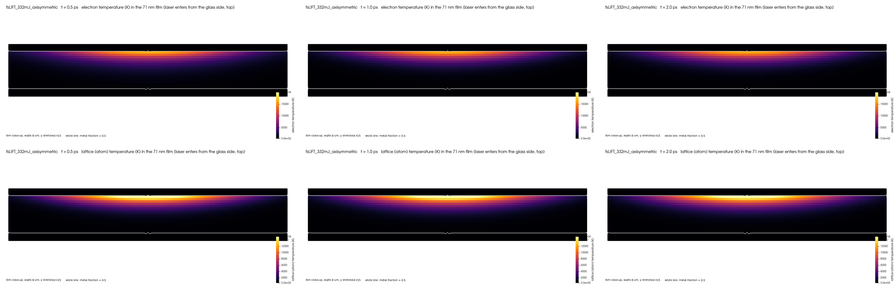
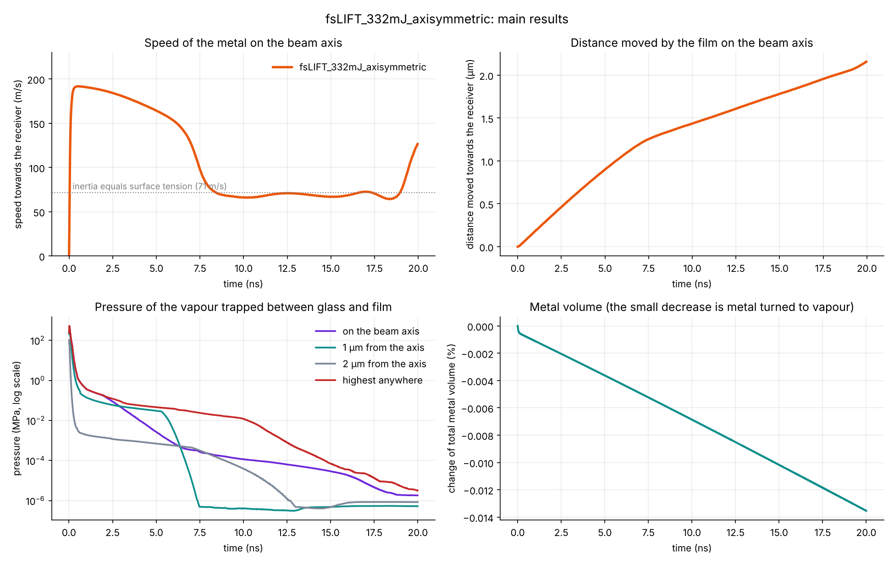
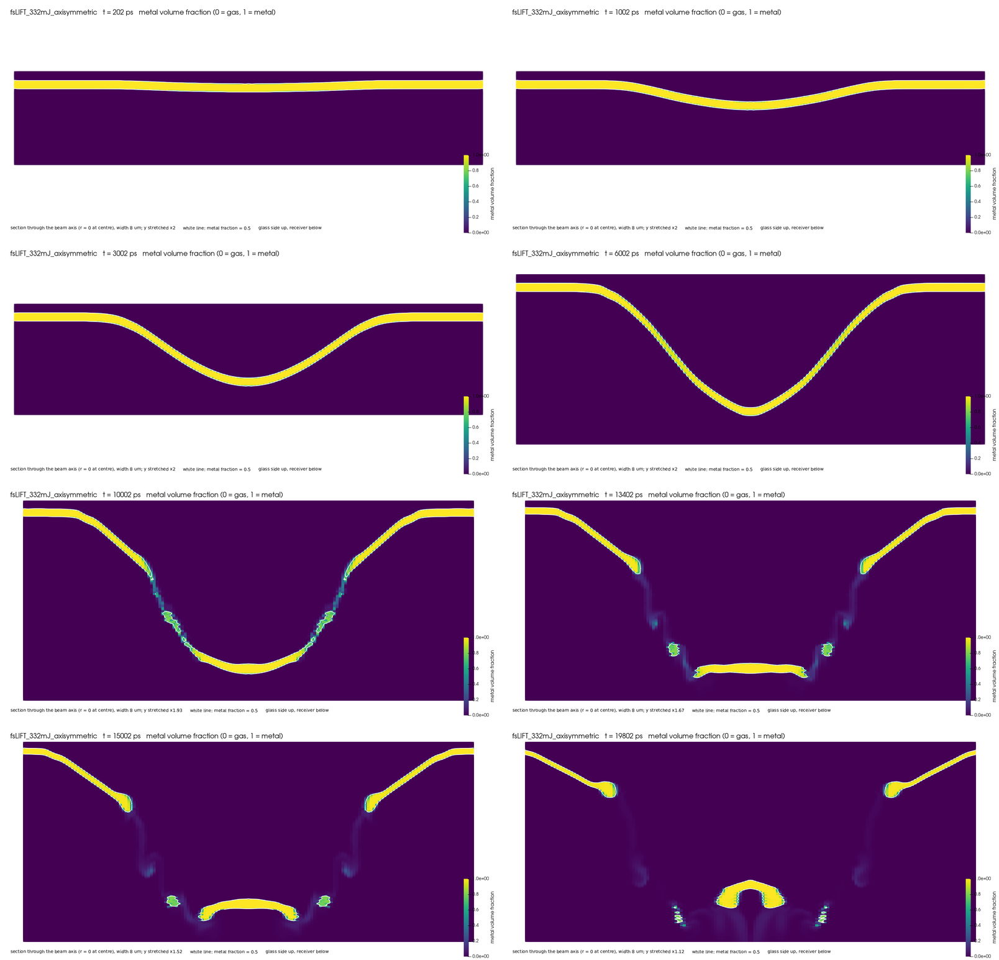
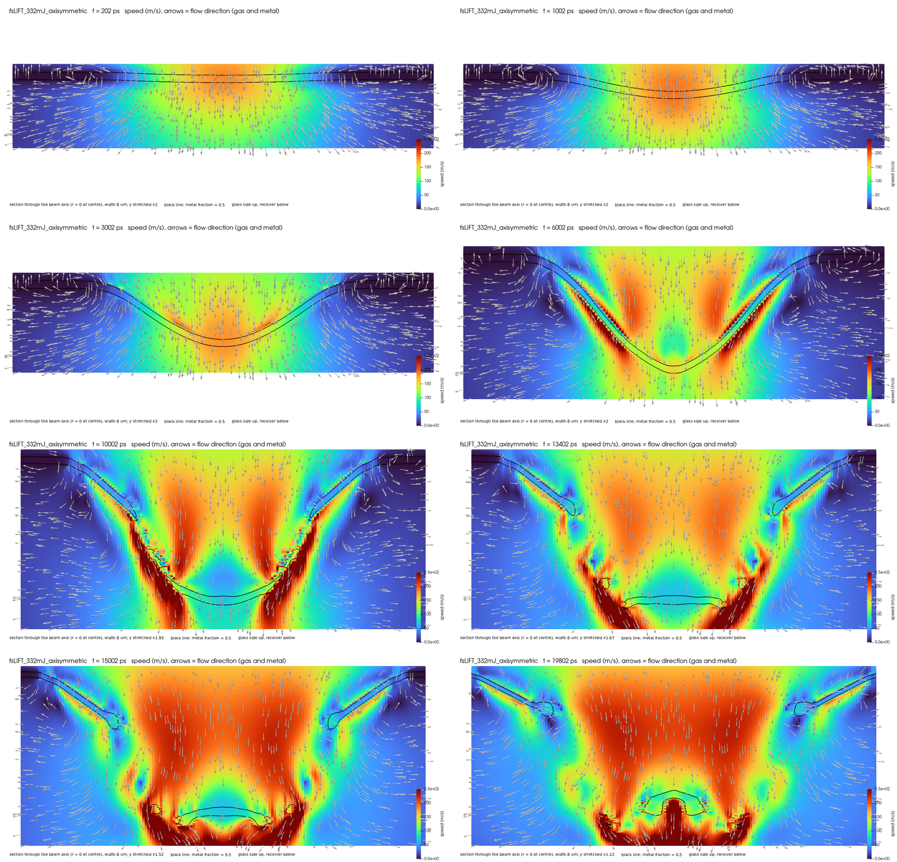
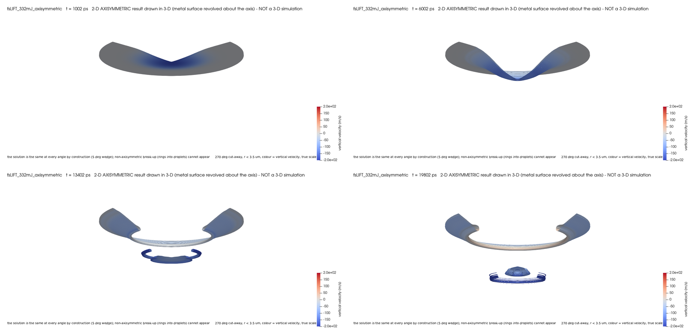
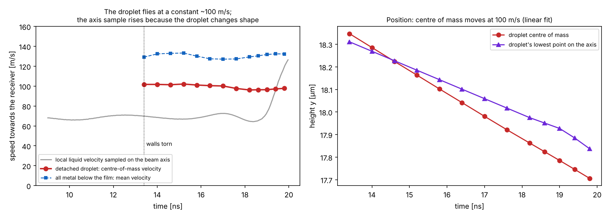

# Results of the reference case

Case `cases/fsLIFT_332mJ_axisymmetric`, run to 20 ns on 4 processes with `tools/run_case.sh`. The inputs are described in [MODEL.md](MODEL.md); the main numbers are also in [`figures/fsLIFT_332mJ_axisymmetric/results_table.md`](../figures/fsLIFT_332mJ_axisymmetric/results_table.md).

**Read the [limitations](#limitations) before using any number.** In short:
- the launch of the film (up to about 1 ns) is the best-resolved part of the result;
- the separation of a droplet at about 13 ns happens where the film is thinner than one cell, so its time and volume depend on the mesh;
- after about 10 ns the gas standing in for the glass flows in behind the film. It does not change the droplet's speed, but the velocity sampled on the axis then reflects the droplet's internal flow, not its motion; quote the centre-of-mass speed (§2.6).

---

## 1. Inputs in brief

| Quantity | Value |
|---|---|
| Film | titanium, 71.4 nm, on 1.05 mm glass |
| Laser | 343 nm, 214 fs (full width at half maximum), beam radius 3 µm at 1/e² |
| Peak fluence | 332 mJ/cm² before the glass; 4.109e-8 J reaches the film |
| Gap to the receiver | 12 µm |
| Mesh | 132,480 cells in a 5° wedge: 4.46 nm across the film, 6 nm cells for the first 3 µm below the film, 50 nm radially |

---

## 2. What happens, stage by stage

### 2.1 Heating: 0–2 ps

- The electrons near the glass-side surface peak at about 16,400 K at 0.54 ps.
- They pass their energy to the atoms within a fraction of a picosecond: the lattice reaches about 16,400 K by 0.61 ps.
- By 2 ps the electrons and atoms are at the same temperature (about 16,000 K at the hottest point).

### 2.2 Launch: 2 ps – 1 ns

- The glass-side surface evaporates, and the vapour is trapped against the glass. Its pressure on the beam axis peaks at **524 MPa at 26 ps**, then falls as the gap opens. It is below 1 MPa from 0.59 ns, after which the film coasts.
- The centre of the film is pushed away from the glass into a dome. On the beam axis it reaches **191.7 m/s at 0.54 ns** and has moved 0.18 µm at 1 ns.
- At that speed the kinetic energy of the film per unit area, ½ρhv² = 5.92 J/m², is **1.8 times** the surface energy of the two new surfaces a detached piece needs, 2σ = 3.28 J/m². The Weber number ρv²h/σ = 4515 · 191.7² · 71.4e-9 / 1.64 = 7.2. Energetically, the centre can separate.

### 2.3 Deceleration and thinning: 1–13 ns

- Surface tension, and the surrounding film to which the dome is still attached, slow the dome down. The speed on the axis falls from 191 m/s at 1 ns to 164 m/s at 5 ns and 66 m/s at 10 ns. The dome has moved 0.90 µm at 5 ns and 1.44 µm at 10 ns.
- The dome deepens into a cup with steep side walls. The walls thin: their horizontal metal thickness falls from about 100–130 nm at 6 ns to 50–87 nm at 8.4 ns, and to about 5 nm at 13.4 ns.

### 2.4 Separation: about 13 ns

- At about 13 ns the side walls tear, away from the axis, and the bottom of the cup is free.
- At 13.4 ns all the metal below the torn walls holds 0.48 µm³ (the volume of a 0.97 µm sphere: the main body plus the ring that later breaks off it) and moves at about 130 m/s on average. The main body's centre of mass moves at about 100 m/s.
- The torn walls retract into rims on the film that stays on the glass.

### 2.5 Flight: 13–20 ns

At 19.8 ns, counted with `tools/count_metal_pieces.py` (cells with α > 0.5):

| Piece | Volume | Sphere of equal volume | Mean vertical speed |
|---|---|---|---|
| Main droplet (the former cup bottom) | 0.254 µm³ | 0.79 µm diameter | about 100 m/s towards the receiver (centre of mass, constant from 13.4 to 19.8 ns) |
| Ring fragments around it | 0.105 µm³ in total, a few cells each | – | 170–217 m/s |
| Metal smeared below α = 0.5 | about 0.22 µm³ | – | – |

- The ring at the edge of the free piece has broken into fragments. In this axisymmetric model a "fragment" is a ring around the axis; in reality such a ring would break into separate droplets around its circumference.
- The lowest metal is still about 9.5 µm above the receiver at 20 ns. Nothing has reached the receiver, so there is **no splash** in this run.
- The total metal volume changed by −0.0135 % over the run, which includes the metal that evaporated.

*The 3-D views are the 2-D axisymmetric result revolved about the beam axis; they are not a 3-D simulation.*

### 2.6 Which speed to quote for the separated metal

The speed of the droplet as a body is the velocity of its centre of mass. It is **about 100 m/s and constant** after separation: 102 m/s at 13.4 ns and 98 m/s at 19.8 ns, and a linear fit of the centre-of-mass position gives 100 m/s. The velocity sampled on the beam axis is a different quantity: the local velocity of the liquid there. A droplet that has just torn free is still changing shape, so its internal flow makes the axis sample differ from the body speed. It is about 70 m/s around the tear and rises to 126 m/s at 20 ns, while the droplet as a whole does not speed up.

After about 10 ns the gas that stands in for the glass flows in behind the film and through the opening, faster than the metal (190 m/s on the axis at 19.8 ns). This flow is not physical, since real glass cannot follow the film, but it does not change the droplet's speed: the gas is about 4,000 times less dense than the metal, and the drag of a 190 m/s gas jet on the 0.79 µm droplet moving at 100 m/s (Reynolds number about 5) would change the droplet's speed by about 0.02 m/s over 1.5 ns, and by less than 0.3 m/s even at the full 190 m/s relative speed for the whole 6.4 ns of flight.

*Left: centre-of-mass velocity of the detached droplet (red), mean velocity of all metal below the film (blue), and the local liquid velocity sampled on the beam axis (grey). Right: height of the droplet's centre of mass and of its lowest point on the axis. Computed with `tools/droplet_motion.py`; data in `figures/fsLIFT_332mJ_axisymmetric/data/droplet_motion.csv`.*

### 2.7 Further figures

All in [`figures/fsLIFT_332mJ_axisymmetric/`](../figures/fsLIFT_332mJ_axisymmetric/):
- `axis_position_speed_temperature.png`: position, speed and lattice temperature of the film on the beam axis;
- `gallery/`: sections at 0.2, 1, 3, 6, 10, 13.4, 15 and 19.8 ns of the metal fraction (`alpha_*`), the speed with arrows (`Umag_*`), the radial velocity (`Ur_*`) and the pressure (`p_*`); laser heating close-ups at 0.5, 1 and 2 ps (`heat_*`); 3-D views (`3d_*`); and a montage of each series;
- `data/axis_timeseries.csv` and `data/trapped_vapour_pressure.csv`: the data behind the time plots, with the columns named in the first line.

The pressure sections show a cell-to-cell checkerboard inside the metal. It is a numerical artefact of the pressure field in the thin film.

---

## Limitations

Ordered by how much each could change the answer to "does the film eject, and how?".

1. **The metal is incompressible.** Titanium has a constant density, so the model has no stress waves and no spallation (the tearing of a solid or liquid by a tensile stress wave). In femtosecond LIFT these can drive part of the ejection. How large a part for this film is not known.
2. **The glass is modelled as an incompressible gas.** The region above the film is a gas of constant density. As the film moves away, this gas must follow it: it pulls on the departing film (a few percent of the trapped-vapour force during the launch) and, after about 10 ns, it streams through the torn film. It is too light to change the droplet's speed (§2.6), but the flow behind the film is not physical; a real solid glass with a vapour-filled gap behind the film cannot do this.
3. **The separation is limited by the mesh.** The gap mesh is refined to 6 nm along the axis but has 50 nm cells radially. The steep walls of the cup become thinner than one radial cell well before they tear. The time of separation and the volumes of the pieces are therefore set by the radial cell size, and the result is not mesh-converged. A run from about 6 ns on a mesh refined radially (about 10 nm for r < 2.5 µm) is needed to settle it.
4. **Temperatures above the critical point.** The lattice reaches about 16,400 K, above the critical temperature of titanium (8,980 K as cited by Hobmaier et al. 2026; the case file uses 9,500 K) and about twice the usual onset of phase explosion, 0.9 times the critical temperature ([LITERATURE.md §5](LITERATURE.md#5-critical-temperature-and-phase-explosion)). There the distinction between liquid and vapour, on which the model rests, no longer strictly holds. The saturation pressure and evaporation flux are evaluated with the temperature capped at 10,000 K.
5. **Trapped-vapour model simplifications.** No sideways vapour flow between the radial rings, no cooling of the vapour by the glass, and an unknown initial gap (1 nm assumed). None of these has been varied yet.
6. **No solid phase.** All metal flows as a liquid, even below the melting temperature (1941 K). The cold film outside the heated spot can therefore shear and flow, where real titanium would hold.
7. **Damping of interface oscillations is too weak** ([VERIFICATION.md §5](VERIFICATION.md#5-open-points)). This matters for the thinning and breaking of liquid necks and walls.
8. **Axisymmetric only.** Every quantity is the same at every angle around the beam axis. Effects that break this symmetry cannot appear: an off-centre beam, defects in the film, or a ring breaking into separate droplets around its circumference. A full 3-D run would need at least 72 times the cells of the 5° wedge.
9. **Not validated.** No comparison with measurements is included. The LIFT experiments in the literature register could not be read for this work, so the ejection speed and droplet size have not been compared with measured values ([LITERATURE.md §8](LITERATURE.md#8-lift-experiments-not-yet-compared)).
10. **Titanium inputs.** The liquid density of the case (4,515 kg/m³) is 7.7–15 % above measured values, and the surface tension is constant where the measured value falls with temperature ([VALIDATION.md §5](VALIDATION.md#5-level-3-input-validation)); with the measured density the same vapour pressure would accelerate the film 8–15 % more. **Two-temperature parameters of titanium.** The electron–lattice coupling and the electron heat capacity of the case are higher than published values for titanium: the coupling by 5–27 times above 5,000 K, the heat capacity by about 2 times. A 1-D sensitivity study shows this changes mainly how fast the atoms heat (0.25 ps instead of about 2 ps), and the peak surface temperature by −11 % to +9 %. With published values the surface stays hotter for longer, so the vapour drive would probably last longer [UNCERTAIN: not yet computed in 2-D] ([LITERATURE.md §3](LITERATURE.md#3-two-temperature-parameters-of-titanium)).

## Next steps

In order of priority:
1. Replace the coupling table and electron heat capacity with published titanium values, and repeat the launch phase to 1 ns ([LITERATURE.md §3](LITERATURE.md#3-two-temperature-parameters-of-titanium)).
2. Repeat the window from about 6 ns to 20 ns on a radially refined mesh, to make the separation a mesh-converged result (limitation 3).
3. Re-tune the interface compression settings now that the compression works on moving interfaces ([VERIFICATION.md §5](VERIFICATION.md#5-open-points)).
4. Run the launch phase (to 1 ns) on a coarser and a finer mesh, to give the 190 m/s launch speed a numerical error bar.
5. Vary the ring width (50 and 200 nm) and the initial gap (0.5–5 nm) of the trapped-vapour model, to see whether the result depends on them.
6. For validation: run the case at several fluences and compare the ejection threshold and the transfer modes with experiments. This will need the physics missing from limitations 1, 2 and 6.
