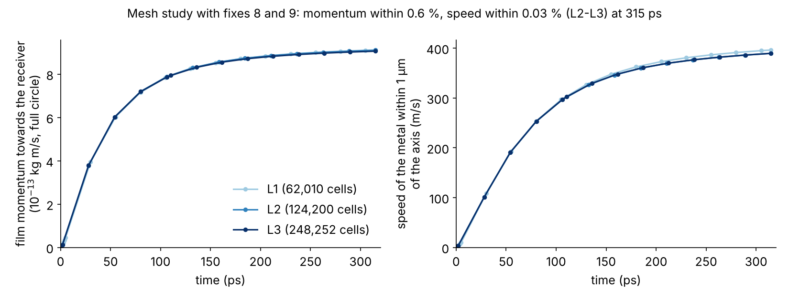
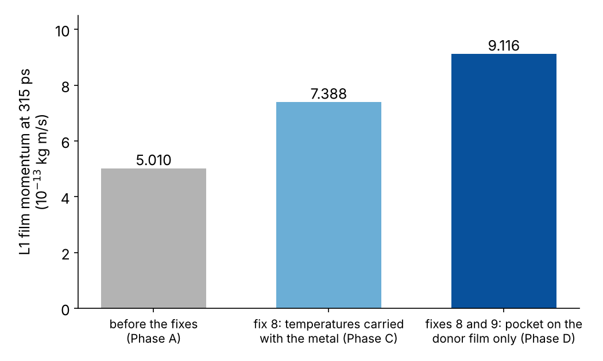
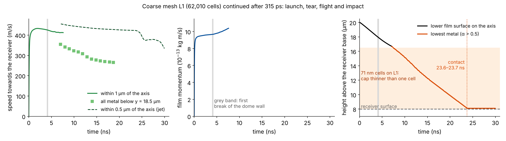
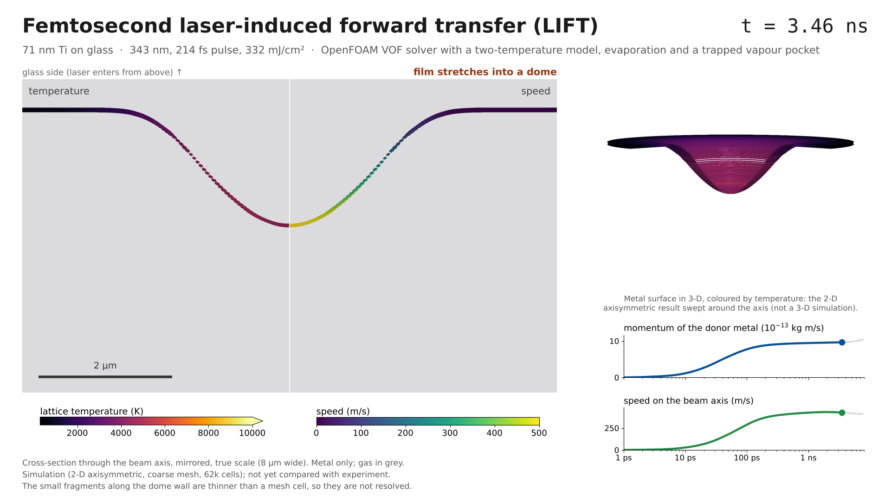
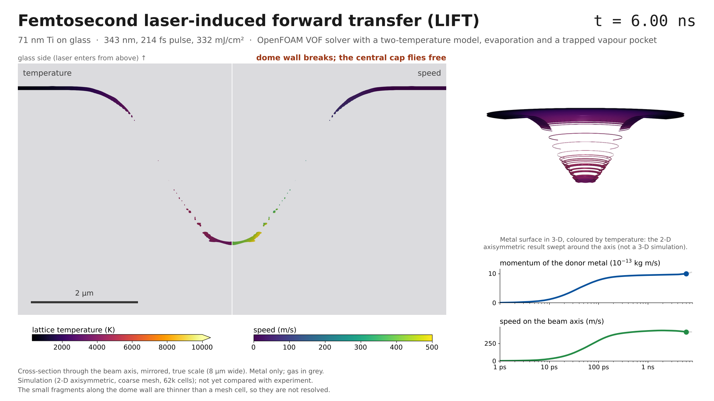
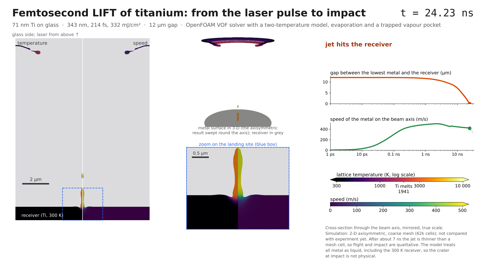
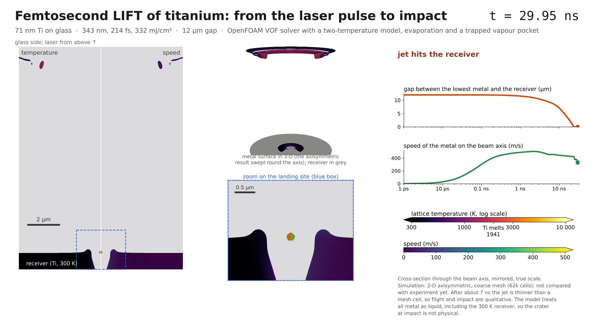
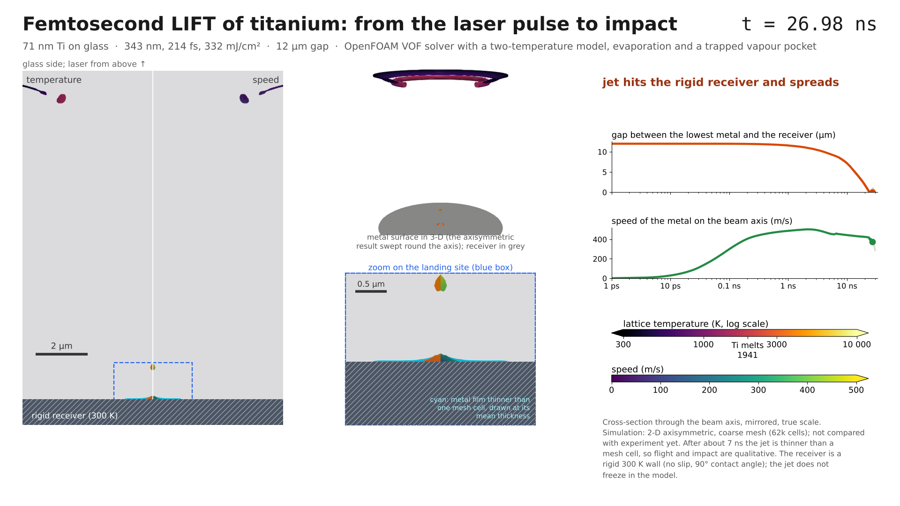

# Results

Status: 27 November 2026.

| Section | Run | Code | Status |
|---|---|---|---|
| [§1](#1-current-results-mesh-study-case-with-fixes-8-and-9) | `cases/fsLIFT_332mJ_Ti_meshStudy`: three meshes to 315 ps, the coarsest continued to the impact on the receiver (29.95 ns) | all fixes of [CODE_REVIEW.md §1](CODE_REVIEW.md#1-defects-that-change-results), including 8 and 9 | **current** |
| [§2](#2-runs-in-progress) | the same case on a mesh refined along the flight path, from 2.96 ns to 35 ns | the same | **running** |
| [§3](#3-the-earlier-reference-case-superseded) | `cases/fsLIFT_332mJ_axisymmetric` to 20 ns | before fixes 1–9 | **superseded**: kept for the record only |

**Read the [limitations](#limitations) before using any number.** In short:
- the launch of the film up to 315 ps is mesh-converged: momentum within 0.6 % and speed on the axis within 0.03 % over three meshes;
- everything after 315 ps comes from the coarsest mesh only. The dome wall tears where it is about one cell thick, and from about 7 ns the flying metal is a jet only 2–3 cells wide. Tear and flight are therefore qualitative;
- the jet reaches the receiver at about 24 ns on that mesh, its tip at about 495 m/s. With 15 nm cells along the flight path (run C, §2) a thin thread at the tip arrives at 20.6 ns at about 650 m/s, so the arrival time is not mesh-converged. On a rigid receiver (rerun from 21.5 ns) the peak wall pressure is about 0.5 GPa, close to ½ρv², and the metal spreads into a film about 3 µm across by 30 ns. That film is thinner than one cell, so the deposit's shape is not resolved. With the model's liquid receiver the jet digs a crater instead, which is not physical;
- about 4 % of the laser energy is unaccounted for at 315 ps, and about 7 % at 2.16 ns ([§1.5](#15-energy-and-mass-balance));
- nothing is compared with an experiment.

---

## 1. Current results: mesh-study case with fixes 8 and 9

### 1.1 Inputs

The geometry, laser and optics are those of the reference case: a 71.4 nm titanium film on glass, 343 nm, 214 fs, beam radius 3 µm, 332 mJ/cm² before the glass, 4.109e-8 J reaching the film, 12 µm gap to the receiver. Some titanium inputs differ and are taken from the literature:

| Input | Mesh-study case (current) | Reference case (superseded) |
|---|---|---|
| Density | 4506 kg/m³ (solid Ti at 300 K, so the mass per area of the 71.4 nm film is right) | 4515 kg/m³ |
| Surface tension | 1.613 N/m (measured at the melting point) | 1.64 N/m |
| Electron heat capacity | 318 T_e J/(m³ K) (Hobmaier et al. 2026) | 630 T_e J/(m³ K) |
| Electron–lattice coupling | table capped at 2.5e18 W/(m³ K) (Hobmaier et al. 2026) | table up to 1e20 W/(m³ K) |
| Mesh | L1 / L2 / L3 = 62,010 / 124,200 / 248,252 cells; radial cells for r < 3.5 µm of 49 / 35 / 25 nm; film 11 / 16 / 23 cells | 132,480 cells, 50 nm radially |

Details: [USER_GUIDE.md §2.4](USER_GUIDE.md#24-mesh-study-with-titanium-inputs-from-the-literature) and [LITERATURE.md §3](LITERATURE.md#3-two-temperature-parameters-of-titanium).

### 1.2 Heating and launch, 0–315 ps, on three meshes

At 315 ps, from [`data/fixes8and9/gci_3.148e-10s.csv`](../figures/fsLIFT_332mJ_Ti_meshStudy/data/fixes8and9/gci_3.148e-10s.csv) (full-circle values):

| Quantity | L1 | L2 | L3 | Mesh result |
|---|---|---|---|---|
| Film momentum towards the receiver (10⁻¹³ kg m/s) | 9.116 | 9.104 | 9.061 | spread 0.6 %; the change grows on the finer pair, so no order or GCI |
| Kinetic energy (10⁻¹⁰ J) | 1.300 | 1.285 | 1.267 | spread 2.6 %, same pattern |
| Speed of the metal within 1 µm of the axis (m/s) | 396.3 | 389.6 | 389.5 | converged: L2–L3 0.03 % |
| Film thickness on the axis (nm) | 68.84 | 68.88 | 68.90 | converged, GCI 0.02 % |
| Distance moved on the axis (nm) | 103.4 | 103.1 | 102.8 | spread 0.6 % |
| Peak electron temperature (K) | 25,353 | 26,406 | 27,042 | monotonic, GCI 4.5 % |
| Peak lattice temperature (K) | 19,183 | 19,778 | 20,044 | monotonic, GCI 1.3 % |
| Peak trapped-vapour pressure | 1302 MPa at about 12 ps | | | read from log lines written only every 20 steps; not a mesh comparison |

- The electrons absorb the pulse in a layer about 10 nm thick at the glass-side surface and pass the energy to the lattice within a few picoseconds; the lattice peaks at about 20,000 K at about 3 ps, more than twice the critical temperature of titanium (limitation 4).
- The trapped vapour pushes the hot centre away from the glass. Most of the momentum is gained in the first 100 ps; the film is still accelerating slowly at 315 ps (L1: 9.056 at 280 ps, 9.116 at 315 ps).
- At 315 ps the centre moves as a nearly uniform plug at about 390 m/s. Its kinetic energy per unit area, ½ρhv² = 0.5 · 4506 · 68.9e-9 · 389.5² = 23.6 J/m², is 7.3 times the energy of the two new surfaces a free piece needs, 2σ = 3.23 J/m². The Weber number ρv²h/σ = 4506 · 389.5² · 68.9e-9 / 1.613 = 29.
- The momentum budget (time integral of the forces on the film) closes to 0.969 (L2) and 0.977 (L3) of the film's momentum change over 2–315 ps.

**Effect of fixes 8 and 9.** On L1 at 315 ps the film momentum was 5.010 before the fixes, 7.388 with fix 8 and 9.116 with both, +82 % in all ([INVESTIGATION_LOG.md](INVESTIGATION_LOG.md)). Before fix 8, the three meshes differed by about 6 % per level; with it, by 0.6 % over all three.

### 1.3 Dome, tear, flight and impact after 315 ps (coarse mesh L1 only)

*Left: speed within 1 µm of the axis (solid line, to 7.6 ns), within 0.5 µm of the axis (dashed: the jet, from 7.3 ns) and the mean speed of all metal below y = 18.5 µm (squares). Middle: film momentum. Right: the lower surface of the film on the axis and, after it can no longer be found, the lowest metal with α > 0.5; the receiver surface is at 8 µm, and the curve stops at 8.106 µm because the cell layer touching the receiver is not counted. Grey band: first break of the dome wall. Data: [`data/flightL1/`](../figures/fsLIFT_332mJ_Ti_meshStudy/data/flightL1/).*

| Time | Speed within 1 µm of the axis | Film momentum (10⁻¹³ kg m/s) | Lowest film surface on the axis | Event |
|---|---|---|---|---|
| 0.315 ns | 396.1 m/s | 9.11 | 19.90 µm | plug-like launch |
| 1.0 ns | 425.8 m/s | 9.44 | | still accelerating |
| 1.9 ns | **432.9 m/s** (highest) | 9.54 | 19.10 µm | |
| 3.96–4.26 ns | 426 → 424 m/s | 9.66–9.69 | | **first break of the dome wall** |
| 5.5 ns | 416.5 m/s | 9.86 | 17.32 µm | the central cap flies free |
| 6.5 ns | 413.8 m/s | 10.10 | | |
| 7.2 ns | | | | cap enters the 71 nm cells; no longer resolved |
| 18.7 ns | (mean of the flying metal 266 m/s) | | 10.52 µm (lowest metal) | 2.5 µm above the receiver |
| 23.6–23.7 ns | jet within 0.5 µm of the axis: 422 m/s | | 8.04 µm (cell touching the receiver) | **the jet tip reaches the receiver** |
| 26.1 / 28.1 / 29.95 ns | jet 376 / 371 / 334 m/s | | | crater in the (liquid) receiver 0.32 / 0.63 / 1.07 µm deep; not physical (see below) |
| **rigid receiver:** 23.9–24.0 ns | tip 495 m/s | | 8.035 µm (first cell layer) | contact; wall pressure 508 MPa (½ρv² = 0.55 GPa) |
| **rigid receiver:** 27.0 / 30.0 ns | radial 230–430 m/s | | | metal film on the wall to r = 1.06 / 1.70 µm, thinner than one cell from 27.3 ns |

*Left: cross-section through the beam axis at true scale (8 µm wide): lattice temperature on the left half, speed on the right half. Top right: the 2-D axisymmetric result revolved about the axis (not a 3-D simulation). Bottom right: momentum and speed on the axis, logarithmic time axis.*

- The film stretches into a dome. The dome wall thins until it is about one radial cell thick (about 43 nm by a volume estimate, against 49 nm cells) and breaks between 3.96 and 4.26 ns. The small fragments along the wall in the pictures are thinner than a cell and are **not resolved**; they are mesh artefacts, not predictions.
- The central cap, about 62–68 nm thick on the axis and moving at about 410–420 m/s, flies free.
- From about 7 ns the cap reaches the part of the coarse mesh with 71 nm cells (y < 16.5 µm). From then on no cell near the axis is full of metal (largest metal fraction 0.78), so the cap's shape and speed there are set by the mesh. The mean speed of the metal below y = 18.5 µm falls from 355 m/s at 7 ns to 266 m/s at 18.7 ns; how much of this is real (the cap is still tied to the wall; the gas ahead resists) and how much is numerical smearing cannot be told on one mesh.
- The film momentum keeps rising after the tear (9.66 at 4 ns to 10.39 at 7.6 ns) while the kinetic energy stays at 1.41–1.44 × 10⁻¹⁰ J. **This rise is mostly not physical** ([INVESTIGATION_LOG.md §14](INVESTIGATION_LOG.md#14-why-the-film-momentum-keeps-rising-after-the-tear-22-nov)). About 45 % of it is a numerical net force of the surface tension on metal smeared over partly filled cells: the surface-tension force summed over all cells is zero before the tear and −0.57 × 10⁻¹³ kg m/s over 3.96–7.59 ns after it. About 18 % is the trapped-vapour pocket, which keeps pushing after the dome has opened, when the vapour should have vented. About 13 % is gas pressure, and about 24 % is within the sampling uncertainty. Treat the momentum after about 4 ns as unreliable.
- **What flies is a thin jet on the axis, not a flat cap.** From about 7 ns the metal near the axis is drawn into a jet at most about 0.12 µm in radius (2–3 radial cells of 49 nm), whose metal fraction never exceeds 0.78. Its speed within 0.5 µm of the axis falls slowly from 455 m/s at 7.3 ns to 422 m/s at 23.6 ns; its lowest point moves at about 0.5 µm/ns. Its lattice temperature is about 3,500–3,900 K, above the melting point (1,941 K). A jet only 2–3 cells wide is not resolved: its radius, and whether a real cap would form a jet at all, are set by the mesh here.
- **Contact.** The jet tip reaches the cell layer touching the receiver between the writes at 23.63 and 23.73 ns, at about 420 m/s (checked cell by cell: at 23.985 ns that layer is 72 % metal for r < 0.12 µm, moving at −432 m/s). This is early in the range of 24–28 ns estimated from the position at 18.7 ns.
- **Impact.** The jet keeps feeding metal into the landing site and digs a crater into the receiver with a raised rim: 0.32 µm deep at 26.1 ns, 0.63 µm at 28.1 ns and 1.07 µm at 29.95 ns, about 1 µm wide, still deepening when the run stops. **The crater is not physical.** The model has no solid phase (limitation 7): the 300 K titanium receiver is a liquid with a viscosity of 2.35 mPa s, so it gives way like a pool. A solid titanium receiver would at most deform plastically under the impact, which this model cannot represent [the size of that deformation has not been estimated]. The impact on this mesh is therefore a picture of a liquid jet entering a liquid pool, nothing more.
- **Impact on a rigid receiver** ([INVESTIGATION_LOG.md §16](INVESTIGATION_LOG.md#16-rigid-receiver-impact-of-run-as-jet-on-a-wall-27-nov)). Run A was restarted at 21.5 ns, when the lowest metal was 1.17 µm above the receiver, with the receiver cells removed. In their place is a no-slip wall near 300 K with a 90° contact angle. The jet tip reaches the wall between 23.9 and 24.0 ns at 495 m/s. The largest wall pressure is 508 MPa, close to ½ρv² = 0.55 GPa. The metal spreads along the wall: the edge of the film is at r = 0.37 µm at 24.0 ns, 1.06 µm at 27.0 ns and 1.70 µm at 30.0 ns. From 27.3 ns the film is thinner than half a cell (19 nm at its thickest at 29.4 ns), so its shape is not resolved. No metal rebounds, but a jet 2–3 cells wide could not show a splash anyway. The centre of the deposit is at 2,900–3,300 K, while its edge cools to 550–700 K by 30 ns, far below the melting point: a real deposit would begin to freeze, which the model cannot do. About 0.06 µm³ has landed by 27 ns, about 0.4 % of the metal; most of the film is still near the donor at 30 ns.

*Frames of the whole-run animation (`tools/render_full_run.py`, `tools/compose_full_run.py`). Left: section through the axis from the glass side (top) to the receiver (bottom), true scale, lattice temperature (log scale) on the left half and speed on the right half; metal is drawn where α ≥ 0.5, so the smeared parts of the jet are not shown. Middle: 3-D view and a zoom on the landing site (blue box). Right: gap to the receiver and speed within 0.5 µm of the axis against log time. The crater in the second frame is an artefact of the liquid receiver.*

*The rigid-receiver rerun at 26.98 ns (`RIGID=1 FILM=… tools/compose_full_run.py`). The receiver is a no-slip wall at 300 K. The metal that has landed has spread to r ≈ 1 µm as a film mostly thinner than half a cell. The α = 0.5 rendering misses that film, so it is drawn in cyan at its equivalent thickness (`tools/wall_film_profile.py`). A second piece of the jet is on its way down.*

- In cells that are less than about 90 % metal the solver's mixture temperature `T` is the gas-side value, not the metal's (`src/TEqn.H`, the blend with `Tl`). In the jet it sits at the lower bound `minT` = 200 K. Read the metal temperature from `Tl`, not from `T`.

### 1.4 Mass

The film lost 0.0140 µm³ (0.098 %) by evaporation over 0–315 ps and 0.011 µm³ more to 7.6 ns (the metal volume above the receiver falls from 14.3237 to 14.3127 µm³). Evaporation therefore changes the momentum by at most about 0.1 %.

### 1.5 Energy and mass balance

From the solver's energy diagnostics on L1 (pJ for the 5° wedge; [INVESTIGATION_LOG.md §11](INVESTIGATION_LOG.md#11-energy-and-mass-balance-l1-with-fixes-8-and-9-22-nov)):

| Up to | Energy change | Laser | Evaporation | Net unaccounted |
|---|---|---|---|---|
| 0.51 ps | 321.90 | 324.51 | −0.00 | −2.61 (−0.8 %) |
| 30 ps | 315.41 | 326.04 | −3.06 | −7.58 (−2.3 %) |
| 315 ps | 306.33 | 326.04 | −6.64 | −13.08 (−4.0 %) |
| 2.16 ns | 294.23 | 326.04 | −8.77 | −23.04 (−7.1 %) |

- The laser deposits 326.04 pJ against the requested 326.24 pJ (−0.06 %).
- The evaporation heat is 92 % of the latent heat of the mass lost.
- The unaccounted part grows after the launch. It is taken to be the mismatch between the temperature transport with the metal flux (fix 8) and the transport of the metal fraction between steps, two large terms (about 40 % of the laser energy each by 315 ps) that cancel in exact arithmetic. This is not proven, and its effect on the momentum has not been measured.

---

## 2. Runs in progress

Run A, L1 continued to the receiver, finished on 27 November at 29.95 ns; its results are in §1.3.

| Run | What | Mesh | From → to | Expected |
|---|---|---|---|---|
| **C** | the L1 state at 2.9625 ns, before the tear, copied onto a mesh refined along the flight path, and continued | 112,148 cells: 15 nm cells for y = 8–16.5 µm (instead of 71 nm), graded to the unchanged 8.5 nm cells above 17 µm | 2.9625 ns → 35 ns, started 27 Nov 10:08 UTC; paused on 27 Nov from 12:15 to about 18:00 UTC for the rigid-receiver run; at 24.47 ns on 28 Nov 13:12 UTC, advancing 16–19 ps of simulated time per minute (expected end about 29 Nov 00:30 UTC) | the flying metal resolved along the flight path (15 nm instead of 71 nm); its radius is still limited by the unchanged 49 nm radial cells |

How C was set up, and what was checked: [INVESTIGATION_LOG.md §13](INVESTIGATION_LOG.md#13-run-c-refined-flight-path-22-nov). **Interim (24.47 ns): the arrival time is not mesh-converged.** The bulk of the jet flies within 2.5 % of A's speed on the axis, but a thread at the tip, about two radial cells wide and holding about 0.02 % of the metal, flies at about 650 m/s (A: about 510 m/s) and reaches the receiver at 20.6 ns instead of 23.6–23.7 ns. Why is not established; the radial cells are unchanged, so neither run resolves the thread. The impact numbers of §1.3 (rigid receiver) are therefore for L1 only (`data/flightC/`; table in the log). C refines the vertical direction only. The radial cells (49 nm) are unchanged, so the tear of the dome wall, which happens after 2.96 ns, is still limited by the radial cell size in C (limitation 3). Run A showed that the flying metal is a jet 2–3 radial cells wide (§1.3), so C will not resolve the jet's radius either, and its receiver is liquid too: C can show how much of A's flight depended on the 71 nm vertical cells, not give a resolved impact.

---

## 3. The earlier reference case (superseded)

`cases/fsLIFT_332mJ_axisymmetric` was run to 20 ns before any of the defects 1–9 of [CODE_REVIEW.md §1](CODE_REVIEW.md#1-defects-that-change-results) were fixed, and with the two-temperature inputs and density of the left column of the table in §1.1. Its numbers must not be used. They are kept here because the figures in `figures/fsLIFT_332mJ_axisymmetric/` show this run.

| Quantity | Superseded run | Why it is wrong |
|---|---|---|
| Peak trapped-vapour pressure | 524 MPa at 26 ps | defects 1, 2 and 9 (the pocket pressure also pushed the receiver and doubled the pocket ring volume) |
| Highest speed on the axis | 191.7 m/s at 0.54 ns | defects 8 (temperatures carried by the mixture flux cooled the hottest metal) and 9; the current case gives about 390 m/s at 315 ps and 433 m/s at 1.9 ns |
| Separation | about 13 ns, off the axis, after the dome had slowed to about 70 m/s | the same; in the current case the wall breaks at about 4 ns while the cap still moves at about 420 m/s |
| Main droplet | 0.254 µm³ at about 100 m/s, 9.5 µm above the receiver at 20 ns | the same |

What this run still shows correctly is the sequence of shapes (dome, thinning walls, tear away from the axis, a central piece in flight with ring fragments), which the current case repeats about three times faster.

---

## Limitations

Ordered by how much each could change the answer to "does the film eject, and how?".

1. **The metal is incompressible.** Titanium has a constant density, so the model has no stress waves and no spallation. In femtosecond LIFT these can drive part of the ejection; how large a part for this film is not known.
2. **The gas is incompressible, and the glass is a gas.** The gap reacts at once to the film (at 28 ps it shows +58 bar under the film and −58 bar above it; a real gas cannot have a negative pressure). The gas standing in for the glass follows the departing film and, after the tear, streams through the opening.
3. **The tear and the flight are mesh-limited, and momentum is not conserved after the tear.** The surface tension gives a false net force on metal smeared below the cell size, and the pocket does not vent (§1.3). Only the launch to 315 ps has been computed on three meshes. The dome wall tears where it is about one radial cell thick (49 nm on L1), and from about 7 ns the flying metal is a jet 2–3 radial cells wide that never fills a cell. Run C resolves the flight vertically; the tear still depends on the radial cell size.
4. **Temperatures far above the critical point.** The lattice reaches about 20,000 K, more than twice the critical temperature of titanium (8,980 K as cited by Hobmaier et al. 2026; the case file uses 9,500 K). The saturation pressure and evaporation flux are evaluated with the temperature capped at 10,000 K, outside the range of these closures.
5. **Energy residual.** 4 % of the laser energy is unaccounted for at 315 ps and 7 % at 2.16 ns (§1.5). A loss of similar size on every mesh would not show in the mesh study.
6. **Trapped-vapour model simplifications.** No sideways vapour flow between the radial rings, no cooling of the vapour by the glass, and an assumed initial gap of 1 nm. None of these has been varied.
7. **No solid phase.** All metal flows as a liquid, even below the melting temperature (1941 K). The 300 K receiver is a liquid too, so on impact the jet digs a crater about 1 µm deep into it (§1.3). The rigid-receiver rerun removes the crater, but it is a stand-in for the wall (no-slip, 300 K, 90° contact angle), and the deposit still cannot freeze. Its edge cools far below the melting point within a few nanoseconds.
8. **Damping of interface oscillations is too weak** ([VERIFICATION.md §5](VERIFICATION.md#5-open-points)). This matters for the thinning and breaking of liquid walls.
9. **Axisymmetric only.** A ring cannot break into droplets around its circumference, and an off-centre beam or film defects cannot be represented.
10. **Not validated** against measurements ([LITERATURE.md §8](LITERATURE.md#8-lift-experiments-not-yet-compared)).
11. **Titanium inputs.** The surface tension is constant, the liquid's expansion (7.7 % at the melting point) is not represented, and the viscosity (2.35 mPa s) has not been checked against a measurement ([VALIDATION.md §5](VALIDATION.md#5-level-3-input-validation)).

## Next steps

In order of priority:
1. Finish run C (§2) and compare its flight with run A's (contact at 23.6–23.7 ns, jet at about 420 m/s).
2. Resolve the deposit: the rigid-receiver rerun (§1.3) gives a film thinner than one cell. A deposit needs cells of about 10 nm near the wall and a solidification model; check the effect of the contact angle.
3. Resolve the tear: rerun from about 3 ns on a mesh with about 10–15 nm radial cells for r < 3.5 µm; this would also resolve the jet's radius.
4. Find the energy residual (§1.5): the same balance on L2 and L3, and an energy-conserving form of the temperature transport of fix 8.
5. Remove the two sources of false momentum after the tear (§1.3): vent the pocket rings once the film above them has opened, and resolve or remove the metal smeared below the cell size (a momentum-conserving surface-tension form would remove the net force altogether).
6. Vary the ring width and the initial gap of the trapped-vapour model.
7. Re-tune the interface compression settings ([VERIFICATION.md §5](VERIFICATION.md#5-open-points)).
8. For validation: run several fluences and compare the ejection threshold and the transfer modes with experiments. This needs the physics missing from limitations 1, 2 and 7.
