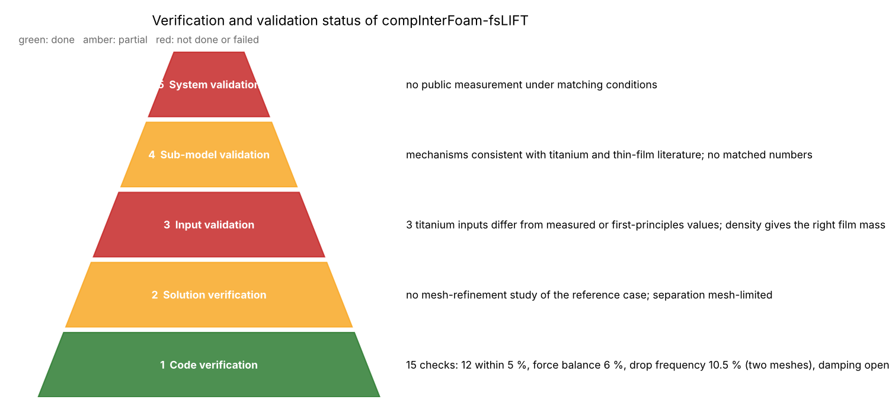
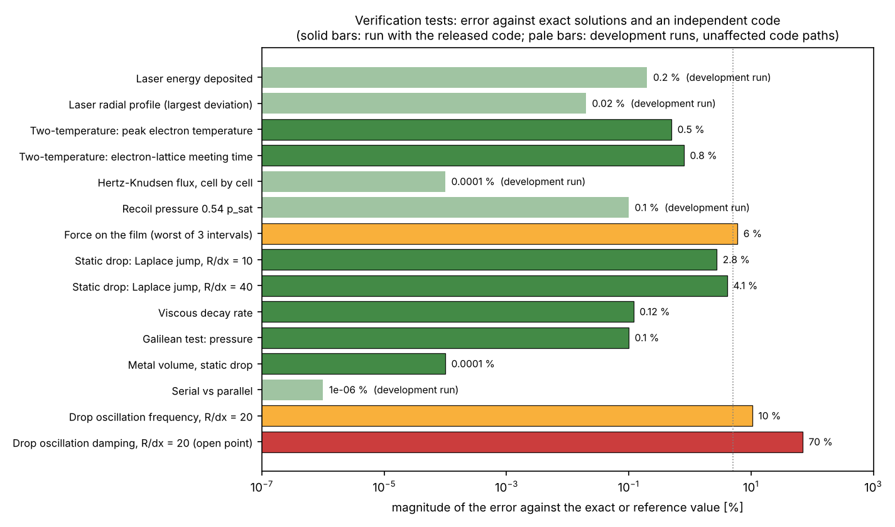
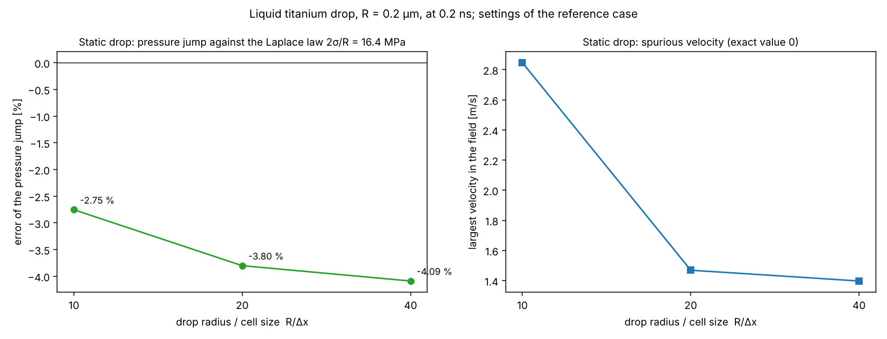
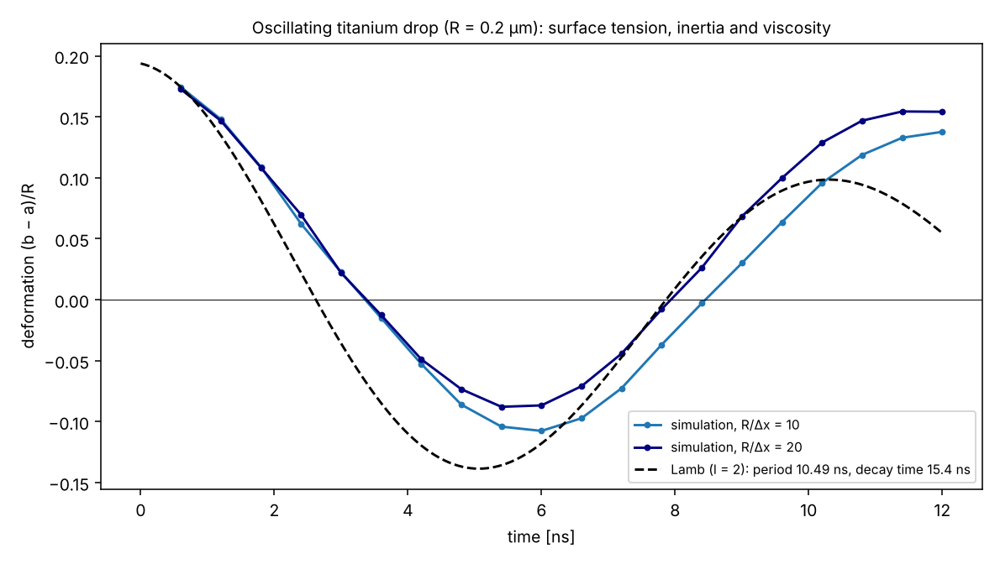
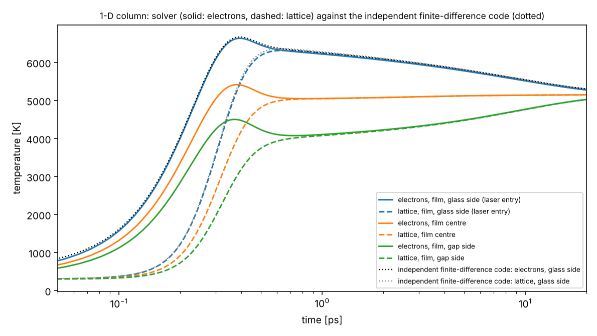
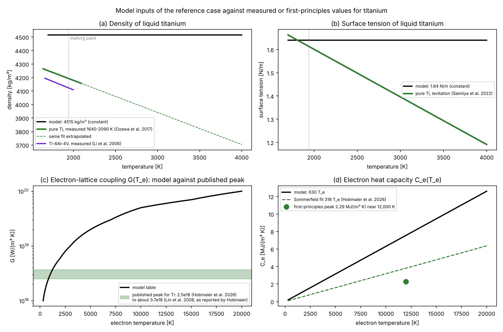
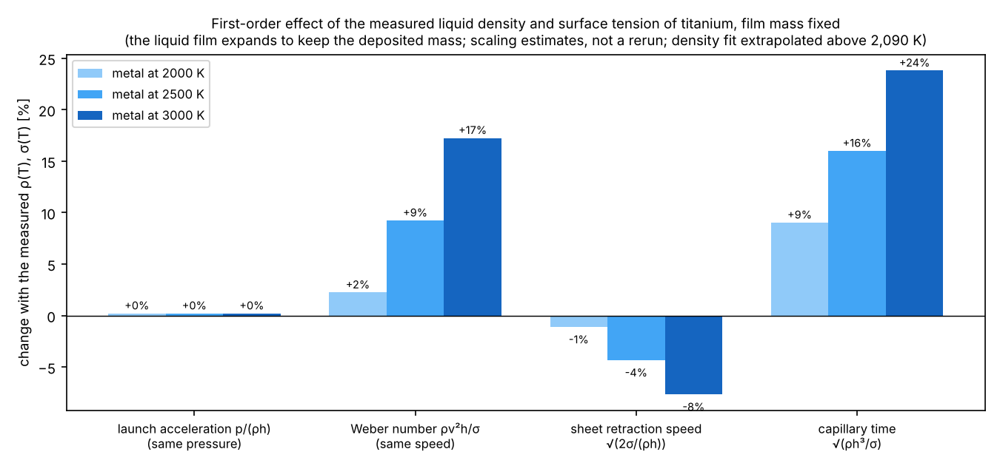
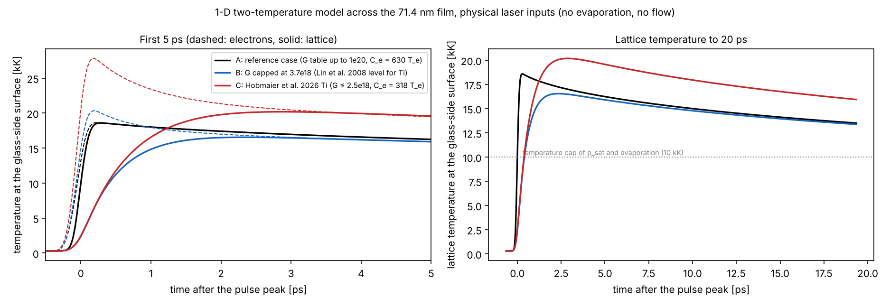
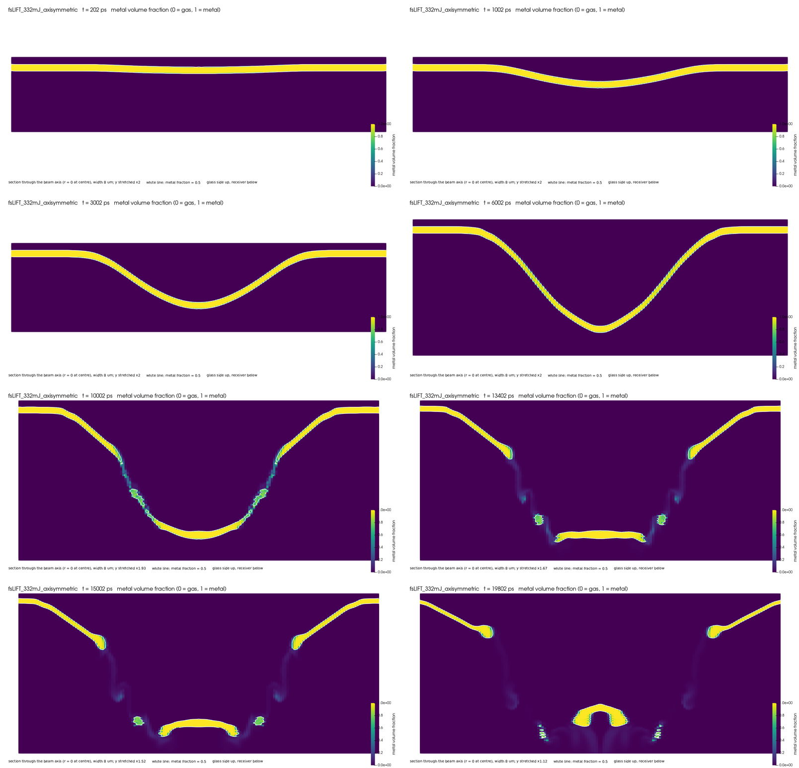
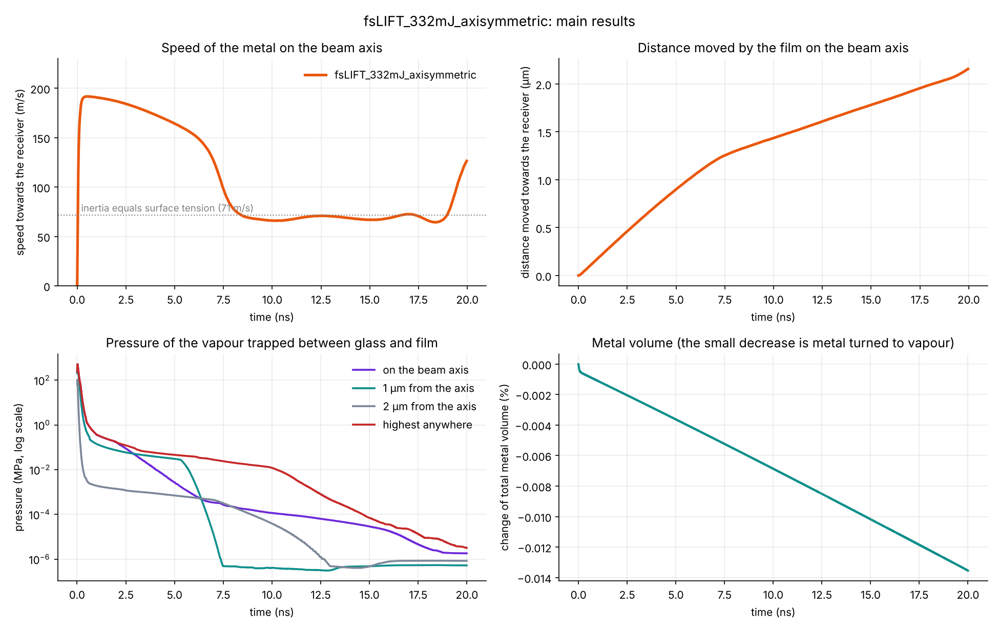

# Verification and validation report

This report collects all evidence on whether the solver and its reference result can be trusted. It is organised in the five levels used in computational science (code verification, solution verification, input validation, sub-model validation, system validation), and it states at each level what has been shown, how, and what has not.

The detailed test descriptions are in [VERIFICATION.md](VERIFICATION.md), the literature comparison in [LITERATURE.md](LITERATURE.md), the model in [MODEL.md](MODEL.md) and the result in [RESULTS.md](RESULTS.md). This report summarises them and adds the input validation against measured titanium data.

**Contents**

1. [Summary](#1-summary)
2. [Method](#2-method)
3. [Level 1: code verification](#3-level-1-code-verification)
4. [Level 2: solution verification](#4-level-2-solution-verification)
5. [Level 3: input validation](#5-level-3-input-validation)
6. [Level 4: sub-model validation](#6-level-4-sub-model-validation)
7. [Level 5: system validation](#7-level-5-system-validation)
8. [Literature evidence base](#8-literature-evidence-base)
9. [What can and cannot be claimed](#9-what-can-and-cannot-be-claimed)
10. [Validation plan](#10-validation-plan)
11. [References](#11-references)

---

## 1. Summary

| Level | Question | Status | Main evidence |
|---|---|---|---|
| 1. Code verification | Does the code solve its equations correctly? | **done** | 15 checks against exact solutions, an independent code and hand calculations: 12 within 5 %, force balance within 6 %, drop-oscillation frequency within 10.5 % and converging; oscillation damping too weak (open) |
| 2. Solution verification | How large is the numerical error of the reference run? | **partial** | resolution chosen from scale analysis; no mesh-refinement study; the droplet separation is limited by the radial cell size |
| 3. Input validation | Are the material and laser inputs right for titanium? | **failed for 3 inputs** | surface tension right at the melting point but constant (9 % high at 2,500 K); electron–lattice coupling 5–27 times high above 5,000 K; electron heat capacity about 2 times high; the density gives the right film mass but no thermal expansion |
| 4. Sub-model validation | Do the physics sub-models behave as titanium and thin films do? | **partial** | heating, phase explosion, stress confinement and thin-film bulging compared with the literature: mechanisms consistent; two missing mechanisms identified (stress waves, phase explosion); no matched numbers |
| 5. System validation | Does the whole simulated LIFT event match an experiment? | **not done** | no public measurement under matching conditions; the predicted sequence (bulge, cup, rupture, droplet smaller than the spot) is reported in several experiments on other metals |

**Bottom line.** The code is verified. The reference result is a verified solution of a model whose titanium inputs need four corrections and which lacks two known mechanisms. It is not yet validated. The launch phase is the most reliable part of the result; the separation of the droplet is mesh-limited.

---

## 2. Method

**Definitions.**
- **Verification:** the code solves its equations correctly (code verification), and the numerical error of a given run is known (solution verification).
- **Validation:** the equations describe the real process. It needs measurements, and it is quantified by comparing a simulated quantity S with a measured value D. The comparison error E = S − D is judged against the combined uncertainty u_val from numerics, inputs and experiment, as in the ASME V&V 20 standard. If |E| ≲ u_val, the model agrees within its uncertainty; otherwise the difference is a model error.

**The five levels.** Validation is built bottom-up: the inputs (level 3) and sub-models (level 4) are checked separately before the full system (level 5). A failure at a lower level explains, and must be fixed before, a mismatch at a higher one.

**Rules used in this report.**
1. A number is compared only with the same quantity under comparable conditions: material, film thickness, wavelength, pulse duration, fluence definition and gap.
2. Every literature value quoted was read in the source: in its abstract, its full text or an open-access copy. Papers whose abstract could not be read are listed as pending.
3. No figure from a publication is reproduced; published values are re-plotted from the equations given in the sources, with the source named.
4. Where something is an estimate, it says so.

---

## 3. Level 1: code verification

Each equation added to OpenFOAM was tested on its own, against an exact solution, an independent code or a hand calculation.

*Magnitude of the error of each test against its exact or reference value, on a logarithmic scale. Solid bars: run with the released code. Pale bars: development runs of code paths (laser, evaporation, recoil, parallel decomposition) that the last two corrections to the interface transport did not touch. The dotted line marks 5 %.*

| # | Part | Test | Reference | Result | Verdict |
|---|---|---|---|---|---|
| 1 | Laser energy | energy deposited in a 1-D film | analytic | −0.2 % | ✅ |
| 2 | Laser radial profile | deposited power against r | exp(−2r²/w₀²) | largest deviation 0.02 % | ✅ |
| 3 | Two-temperature model | peak electron temperature, 1-D column | independent finite-difference code | 6636 K against 6672 K, −0.5 % | ✅ |
| 4 | Two-temperature model | time at which electrons and lattice meet | same | 0.500 ps against 0.496 ps, +0.8 % | ✅ |
| 5 | Evaporation | Hertz–Knudsen flux in every evaporating cell | formula | ratio 1.000000 | ✅ |
| 6 | Recoil | 0.54 p_sat in every recoil cell | formula | within 0.1 % | ✅ |
| 7 | Force on the film | momentum change against applied impulse, reference run | Newton's second law | 0.99, 0.96, 0.94 over three intervals to 0.4 ns | ✅ (a few % unexplained) |
| 8 | Surface tension | static drop, 10 cells per radius | Laplace law, 16.40 MPa | −2.75 % | ✅ |
| 9 | Surface tension | static drop, 40 cells per radius | same | −4.09 % (settles, does not vanish) | ✅ known limit |
| 10 | Viscosity | decaying pipe flow | exact solution | −0.12 % | ✅ |
| 11 | Moving film | film moving at −170 m/s | velocity and pressure unchanged | velocity exact; pressure within 0.1 % | ✅ |
| 12 | Mass | metal volume of a static drop | constant | change below 10⁻⁶ | ✅ |
| 13 | Parallel runs | serial against 3 and 4 processes | identical | 8 digits | ✅ |
| 14 | Inertia + surface tension | drop oscillation frequency, 20 cells per radius | Lamb's solution | −10.5 %, converging (−12.9 % at 10 cells) | ⚠️ |
| 15 | Inertia + surface tension + viscosity | drop oscillation damping | Lamb's solution | 70 % too low, not converging | ❌ open |

*Static drop: error of the pressure jump against the Laplace law (left) and largest spurious velocity (right) at 10, 20 and 40 cells per drop radius.*

*Oscillating drop at two resolutions against Lamb's damped oscillation. The frequency approaches the exact value as the mesh is refined; the damping is too weak.*

*Two-temperature model in a 1-D film against the independent finite-difference code `tools/ttm_fd_1d.py`.*

**Comparison with other solvers of the same type.** The surface-tension behaviour (an error that settles instead of vanishing, spurious velocities that do not decay, weak damping) is a known property of the continuum-surface-force method with curvature from the gradient of α. Deshpande et al. (2012) report that in interFoam the curvature converges to a value about 10 % off the exact one. Lippert et al. (2022), comparing several open-source and commercial volume-of-fluid solvers, conclude that the surface-tension approximation of the OpenFOAM solvers needs significant improvement. This solver's static-drop error (2.75–4.1 %) is within that range.

**Defects found and corrected by the tests:** 15, listed in [VERIFICATION.md §4](VERIFICATION.md#4-defects-found-and-corrected). Among them:
- the recoil was applied at half strength;
- a false film edge at the outer boundary pushed on the film;
- the interface compression had no effect on a moving interface;
- a moving interface carried a false pressure of −ρU².

**Verdict, level 1: done.** The code solves its equations correctly. One open point remains, the damping of interface oscillations, which matters for the thinning of liquid walls.

---

## 4. Level 2: solution verification

**What has been done.**
- **Resolution from scale analysis** ([MODEL.md §8–9](MODEL.md#8-characteristic-scales-and-dimensionless-numbers)):
  - 16 cells across the 71.4 nm film (4.46 nm), resolving the 9.7 nm absorption depth with about two cells per depth (the deposition is exact per cell, [MODEL.md §3.2](MODEL.md#32-implementation));
  - 6 nm cells for the first 3 µm below the film, so the dome tip stays sharp; on coarser cells it smeared to α ≈ 0.5.
- **Time step** set by the flow Courant number (`maxCo`) and the staged `maxDeltaT`, which keeps it below the capillary limit of about 4.4 ps on the film cells. The interface Courant number and `maxThermalCourant` are not time-step limits in this solver (only logged, and a bound on the gas–metal exchange respectively).
- **Conservation:** the metal volume changed by −0.0135 % over 20 ns, a change that includes the evaporated metal.

**What has not been done.**
1. **No mesh-refinement study of the reference case.** The launch speed (191.7 m/s) has no numerical error bar yet.
2. **The separation is mesh-limited.** The radial cell size is 50 nm. The cup walls thin to about 50 nm by 8.4 ns and about 5 nm by 13.4 ns, so they are spread over one radial cell well before they tear. The time of separation (about 13 ns) and the droplet volume (0.254 µm³) therefore depend on the radial resolution.
3. **No time-step study.** The time step is set by the Courant limits, not by a convergence study.

**Recommended study** (the grid-convergence index of Roache, 1994): run the launch to 1 ns on three meshes, with a refinement ratio of about 1.5, and report the speed at 0.54 ns with its uncertainty. Separately, rerun 6–20 ns on a radially refined gap mesh (about 10 nm for r < 2.5 µm).

**Verdict, level 2: partial.**

---

## 5. Level 3: input validation

Every titanium input was compared with measured or first-principles values where a source could be read.

*(a) Density: the model's constant against the measured density of pure liquid titanium (Ozawa et al., 2017; measured 1640–2090 K, extrapolated beyond) and of the alloy Ti-6Al-4V (Li et al., 2006). (b) Surface tension: the model's constant against measurements on pure liquid titanium (Seimiya et al., 2022). (c) Electron–lattice coupling: the model's table against the published peak for titanium (Hobmaier et al., 2026; Lin et al., 2008 as reported by Hobmaier). (d) Electron heat capacity: the model against the first-principles result (Hobmaier et al., 2026).*

### 5.1 Comparison

| Input | Model | Published | Source | Difference | Verdict |
|---|---|---|---|---|---|
| Liquid density | 4515 kg/m³, constant (within 0.2 % of the room-temperature solid value, 4,506 kg/m³) | ρ = 4193 − 0.2376 (T − 1941 K) kg/m³ for pure liquid Ti, 1640–2090 K, expanded uncertainty ±1.4 % | Ozawa et al. 2017 (read in the open PDF) | 7.7 % above the liquid at the melting point. With the deposited 71.4 nm the mass per area ρh is right (solid Ti at 300 K: 4,506 kg/m³, +0.2 %); what is missing is the expansion of the liquid film (7.5 % thicker at the melting point) | ⚠️ |
| Liquid density (alloy, for comparison) | – | ρ = 4123 − 0.254 (T − 1943 K) kg/m³ for Ti-6Al-4V | Li et al. 2006 (abstract) | supports the pure-Ti value | – |
| Surface tension | 1.64 N/m, constant | σ = 1.613 − 0.000205 (T − 1941 K) N/m for 99.98 % pure liquid Ti, free of oxygen contamination | Seimiya et al. 2022 (abstract) | +1.7 % at the melting point; +9 % at 2,500 K; +17 % at 3,000 K. No temperature dependence in the model, so no Marangoni flow | ❌ |
| Electron–lattice coupling G | table from 10¹⁸ (300 K) to 10²⁰ W/(m³ K) (20,000 K) | peak ≈ 2.5×10¹⁸ W/(m³ K) (first principles); Lin et al. about 1.5 times higher | Hobmaier et al. 2026 (full text) | 5–8 times at 5,000 K; 14–20 times at 10,000 K; 27–40 times at 20,000 K | ❌ |
| Electron heat capacity | 630 T_e J/(m³ K) | Sommerfeld fit 318 T_e; full curve peaks at 2.29 MJ/(m³ K) near 12,000 K | Hobmaier et al. 2026 (full text) | about 2 times; 3.3 times at 12,000 K | ❌ |
| Electron conductivity form | Drude, 18.9 T_e/T_l W/(m K) | the Drude form overestimates the peak lattice temperature of Ti by 7 % (melting threshold), up to 19 % | Hobmaier et al. 2026 (full text) | known bias, same direction as the two rows above | ⚠️ |
| Critical temperature | 9,500 K (used only by a switched-off sub-model) | 8,980 K | as cited by Hobmaier et al. 2026 | 6 %, no effect on results | ⚠️ |
| Recoil coefficient | 0.54 p_sat | 0.54 p_sat for strong evaporation into vacuum; Knudsen-layer jump conditions | Anisimov 1968; Knight 1979 (abstract) | consistent; back pressure of the trapped vapour handled separately | ✅ |
| Optical constants at 343 nm | n = 1.7283, k = 2.8242 → R = 0.428, depth 9.66 nm | Johnson & Christy 1974 measured the optical constants of Ti | abstract not available | not checked | pending |
| Liquid viscosity | 2.35 mPa s | measured for molten Ti by oscillating drop | Ishikawa et al. 2012 (value in the full text, not read) | not checked | pending |
| Vapour pressure | Clausius–Clapeyron from 1 atm at 3,560 K, h_v = 9.1 MJ/kg | vapour-pressure equations for the metallic elements | Alcock et al. 1984 (abstract not available) | not checked | pending |
| Evaporation coefficient | β = 0.18 | none read | – | not checked | pending |

### 5.2 How much do the input errors matter?

**Density and surface tension.** In an incompressible model the density enters the launch through the mass per area ρh of the film. That mass is set by the deposited film, 71.4 nm of solid titanium at 4,506 kg/m³ at room temperature, and the case's 4,515 kg/m³ reproduces it to 0.2 %. Using the measured liquid density with the same thickness would remove 7 % of the metal, so it is not a correction. What the model misses is that the liquid expands: with the same mass, the film at the melting point is 7.5 % thicker (4,506 / 4,193), and more at higher temperature. A first-order scaling estimate with the mass held fixed, not a rerun:

*Change of four quantities if the film expanded as the measured liquid density requires (mass per area fixed) and the surface tension followed the measured σ(T), at three metal temperatures. The launch acceleration p/(ρh) for the same vapour pressure does not change (+0.2 %, the difference between 4,515 and 4,506 kg/m³). The Weber number rises by 2–17 % and the speed at which a torn sheet retracts falls by 1–8 %, both through the lower surface tension. The capillary time grows by 9–24 %, mostly because the expanded film is thicker.*

So neither input error changes the launch speed to first order. Both matter for the capillary stage (rupture and droplet formation): the hot liquid has a lower surface tension and a thicker film than the model. An earlier version of this section stated that the measured density would raise the launch acceleration by 8–15 %; that estimate wrongly changed the density at a fixed thickness, which removes metal.

**Coupling and electron heat capacity.** A 1-D sensitivity study with the solver's own two-temperature equations ([LITERATURE.md §3.3](LITERATURE.md#33-does-it-matter-a-sensitivity-study)):

*Temperatures at the glass-side surface for the reference parameters (A), the coupling capped at the level of Lin et al. (B), and the first-principles values of Hobmaier et al. (C).*

| Glass-side surface | A: reference | B: Lin level | C: first principles |
|---|---|---|---|
| Peak lattice temperature | 18,600 K at 0.28 ps | 16,500 K at 2.35 ps | 20,200 K at 2.88 ps |
| Electrons and lattice meet | 0.25 ps | 1.73 ps | 2.28 ps |
| Lattice temperature at 20 ps | 13,500 K | 13,400 K | 15,900 K |

The coupling error mainly changes how fast the lattice heats (0.25 ps instead of about 2 ps). The peak surface temperature changes by only −11 % to +9 %. Because the model evaluates the vapour pressure with the temperature capped at 10,000 K, and the surface stays above that cap for the first 20 ps in all three cases, the early vapour drive is nearly unchanged. With first-principles values, the surface stays hotter for longer, so the vapour drive would probably last longer.

**Combined.** The density does not bias the launch speed. With first-principles two-temperature parameters the surface stays hotter for longer, so the vapour drive would probably last longer and the launch speed of the reference run is more likely an underestimate than an overestimate [UNCERTAIN: the size is not known; it needs the 2-D rerun with corrected inputs, case `cases/fsLIFT_332mJ_Ti_meshStudy`; that case also changes the radial mesh, so it is not a mesh study of the reference result].

**Verdict, level 3: failed for three inputs** (temperature dependence of the surface tension, electron–lattice coupling, electron heat capacity); the density gives the right film mass but no expansion. The corrections are known and should be applied before any comparison with experiment.

---

## 6. Level 4: sub-model validation

The sub-models are checked against what is known for titanium and for femtosecond irradiation of thin metal films. Where the conditions differ, the comparison is about mechanisms, not numbers.

| Sub-model | Model behaviour | Literature | Assessment |
|---|---|---|---|
| Heating of electrons and lattice | electrons peak about 16,400 K at 0.54 ps; lattice equal by 0.6 ps | first-principles titanium parameters give equilibration in about 2 ps (Hobmaier et al., 2026) | heating too fast with the current parameters; the peak temperature is similar (§5.2) |
| Heat confinement | energy stays near the glass-side surface for nanoseconds | consistent with the low equilibrium electron conductivity of Ti | consistent |
| Phase explosion | sub-model switched off; surface reaches about 16,400 K | onset taken at 0.9 T_crit ≈ 8,100 K (Hobmaier et al., 2026) | **missing mechanism**: the surface is about twice the onset temperature |
| Stress waves and spallation | none (incompressible metal) | stress confinement when heating is faster than the acoustic time; liquid Ti sound speed 4.4 km/s (Hobmaier et al., 2026). Spallation of a titanium film by a stress wave is found in a combined two-temperature and molecular-dynamics simulation (Wang et al., 2021, which has a published correction). Spallation of 300 nm nickel films irradiated through the glass substrate (Temnov et al., 2020) | **missing mechanism**: the acoustic time across the film (16 ps) is far longer than the heating (0.3 ps), so the real film is stress-confined |
| Vapour-driven push | trapped vapour at the glass-side surface pushes the film | the back of the film reaches boiling before the film melts through, so the transfer is vapour-driven (Adrian et al., 1987, nanosecond pulses) | consistent |
| Bulging of a thin film | the heated centre bulges into a dome, then a cup | single ultrafast pulses on a 40 nm gold film give bump deformation, then bump rupture, then ablation as the fluence rises (Zhou & Shen, 2026); microbumps and nanojets on Cu and Cu/Ag films shaped by electron–lattice non-equilibrium (Naghilou et al., 2019); nanobumps on gold films in femtosecond LIFT (Tseng et al., 2012); modelled melt hydrodynamics in noble-metal films (Wang, Kuchmizhak et al., 2017) | consistent mechanism |
| Femtosecond ablation of thin titanium films | – | single- and multi-pulse ablation regimes of thin Ti films at 515 and 1030 nm (Kuzmin & Klekovkin, 2022) | numbers not compared (full text not read); a candidate for sub-model validation (§10) |

*The simulated sequence: bulge (0.2–1 ns), dome (3 ns), cup with thinning walls (6–10 ns), wall rupture (13.4 ns), and a free droplet with ring fragments (15–19.8 ns). This is the sequence the thin-film studies above describe qualitatively.*

**Verdict, level 4: partial.** The heating, heat confinement, vapour drive and film bulging are consistent with the literature. Two mechanisms that the literature shows to be active under these conditions are missing: stress-wave spallation and phase explosion.

---

## 7. Level 5: system validation

**Status: not done.** No public measurement exists under the conditions of the reference case: a 71.4 nm titanium film on glass, 343 nm, 214 fs, 332 mJ/cm² before the glass, and a 12 µm gap.

**What the result predicts**, for comparison with a future experiment at matching conditions:

| Observable | Simulated | Reliability |
|---|---|---|
| Film displacement on the axis at 1 / 5 / 20 ns | 0.18 / 0.90 / 2.16 µm | launch well resolved; inputs to be corrected |
| Highest speed on the axis | 191.7 m/s at 0.54 ns | probably an underestimate (§5.2); no mesh error bar |
| Time of separation | about 13 ns | mesh-limited |
| Droplet | 0.254 µm³, equal-volume sphere 0.79 µm, centre of mass at a constant ~100 m/s | separation time and volume mesh-limited |
| Transfer regime | one main droplet with ring fragments; no splash within 20 ns | qualitative |

**Qualitative comparison with experiments on other metals.** The predicted sequence agrees with what is observed in LIFT of metal films:
- the donor film bulges outward from the centre of the laser spot before material leaves (Willis & Grosu, 2005, Al and Ni);
- the transferred droplets are much smaller than the laser spot (Willis & Grosu, 2005). In the reference case the droplet's equal-volume diameter (0.79 µm) is about a quarter of the beam's 1/e² radius (3 µm);
- liquid-metal droplets are ejected and deposited from pure copper and gold films (Visser et al., 2015);
- femtosecond LIFT of thin metal films produces dots, droplets and nanobumps whose size depends on fluence and film thickness (Tseng et al., 2012; Grant-Jacob et al., 2013; Han et al., 2022).

This is corroboration of the mechanism, not validation: the metals, pulse durations, film thicknesses and fluences differ, and no number is compared.

**Verdict, level 5: not done.**

---

## 8. Literature evidence base

| Collection | Papers | Status |
|---|---|---|
| Register of related papers ([`literature/register.csv`](../literature/register.csv)) | 62 | 57 confirmed against their DOI or exact title; 11 full texts read |
| Further papers screened for this report ([`literature/screened_candidates.csv`](../literature/screened_candidates.csv)) | 48 | abstract read and judged relevant; each with its level and the reason |
| Relevant papers whose abstract could not be read | 8 | pending (listed in the same file) |
| **Total identified** | **118** | |

Of the 48 screened papers: 6 provide input data (level 3), 14 concern femtosecond irradiation of thin films (level 4), 16 concern LIFT itself (level 5), and 12 the numerical and evaporation methods. About 640 search records were screened to find them (Scite, Crossref, arXiv). The search is not exhaustive.

**Matched-condition validation sources in the public literature: none found.** The closest are:
- femtosecond ablation of thin titanium films (Kuzmin & Klekovkin, 2022);
- blister-based transfer from a titanium film on glass with femtosecond pulses (Goodfriend et al., 2024);
- LIFT of titanium films with nanosecond pulses (Zhao & Hu, 2019; Zhao et al., 2018).

---

## 9. What can and cannot be claimed

**Can be claimed:**
- The solver is verified: each added equation reproduces exact solutions, an independent code or hand calculations, with the exceptions stated.
- The reference case is a verified solution of the stated model, with known numerical limitations.
- The predicted mechanism (bulge, cup, rupture, single droplet smaller than the spot) is consistent with experiments on metal films.
- Four titanium inputs differ from measured or first-principles values, and their effect has been estimated.

**Cannot be claimed:**
- That the model is validated.
- That the launch speed, separation time or droplet size are predictions of an experiment.
- That the separation time and droplet volume are mesh-converged.

---

## 10. Validation plan

In order:

1. **Correct the four inputs.** Use the measured ρ(T) and σ(T) of liquid titanium (Ozawa et al., 2017; Seimiya et al., 2022), and first-principles G(T_e) and C_e(T_e) (Hobmaier et al., 2026, or Lin et al., 2008). Then check the pending inputs (viscosity, optical constants, vapour pressure) against their sources. Rerun the launch to 1 ns.
2. **Solution verification.** Mesh study of the launch to 1 ns (three meshes, grid-convergence index), and a radially refined run of the separation (6–20 ns).
3. **Proxy validation on a measured case.** Rerun the solver with the metal, film, pulse and gap of a published femtosecond or picosecond LIFT experiment that reports speeds or droplet sizes. Gold is the best first choice, because its two-temperature parameters and liquid properties are well established. The solver accepts pulse durations from 10 fs to 10 ps, so nanosecond experiments need code changes.
4. **Sub-model validation on titanium.** Simulate single-pulse femtosecond irradiation of titanium as in the published threshold experiments (Kuzmin & Klekovkin, 2022) and compare the melting and ablation thresholds.
5. **System validation.** Compare with measurements at matching conditions:
   - transfer threshold fluence;
   - deposited droplet volume against fluence;
   - diameter of the hole left in the donor;
   - time-resolved position and speed of the dome or jet.

   For each quantity, report E = S − D against u_val (ASME V&V 20).
6. **Missing physics**, if the comparison requires it: a compressible metal with an equation of state, for stress waves and spallation (the approach of Zhao & Shin, 2012), and a phase-explosion description.

---

## 11. References

Only sources whose abstract or text was read are cited; the full screened list with DOIs is in [`literature/screened_candidates.csv`](../literature/screened_candidates.csv).

- Adrian, F. J., Bohandy, J., Kim, B. F., Jette, A. N., & Thompson, P. (1987). A study of the mechanism of metal deposition by the laser-induced forward transfer process. *Journal of Vacuum Science & Technology B, 5*(5), 1490–1494. https://doi.org/10.1116/1.583661
- Anisimov, S. I. (1968). Vaporization of metal absorbing laser radiation. *Soviet Physics JETP, 27*, 182–183.
- Deshpande, S. S., Anumolu, L., & Trujillo, M. F. (2012). Evaluating the performance of the two-phase flow solver interFoam. *Computational Science & Discovery, 5*, 014016. https://doi.org/10.1088/1749-4699/5/1/014016
- Goodfriend, N. T., et al. (2024). Laser-induced gas-phase transfer and direct stamping of nanomaterials: Comparison of nanosecond and femtosecond pulses. *arXiv:2412.09725*.
- Grant-Jacob, J. A., et al. (2013). Micron-scale copper wires printed using femtosecond laser-induced forward transfer with automated donor replenishment. *Optical Materials Express, 3*(6), 747. https://doi.org/10.1364/ome.3.000747
- Han, M., et al. (2022). Microparticles of high entropy alloys made by laser-induced forward transfer. *Materials, 15*(22), 8063. https://doi.org/10.3390/ma15228063
- Hobmaier, K., Allemand, G. E., Marmodoro, A., Verstraete, M. J., Minár, J., Huber, H. P., & Redka, D. (2026). First-principles electronic transport properties of Ti and Ti-6Al-4V for modeling ultrashort-pulse laser ablation. *Physical Review Materials*. https://doi.org/10.1103/6sn3-ltl4
- Knight, C. J. (1979). Theoretical modeling of rapid surface vaporization with back pressure. *AIAA Journal, 17*(5), 519–523. https://doi.org/10.2514/3.61164
- Kuzmin, E. V., & Klekovkin, A. V. (2022). Features of structuring and ablation of thin titanium films by femtosecond laser pulses. *Optics and Spectroscopy, 130*(4), 412. https://doi.org/10.21883/eos.2022.04.53727.66-21
- Li, J. J. Z., Johnson, W. L., & Rhim, W.-K. (2006). Thermal expansion of liquid Ti–6Al–4V measured by electrostatic levitation. *Applied Physics Letters, 89*, 111913. https://doi.org/10.1063/1.2349840
- Lin, Z., Zhigilei, L. V., & Celli, V. (2008). Electron-phonon coupling and electron heat capacity of metals under conditions of strong electron-phonon nonequilibrium. *Physical Review B, 77*, 075133. https://doi.org/10.1103/PhysRevB.77.075133 (values as reported by Hobmaier et al.)
- Lippert, A., Tolle, T., Dörr, A., & Marić, T. (2022). A benchmark for surface-tension-driven incompressible two-phase flows. *arXiv:2212.02904*.
- Naghilou, A., He, M., Schubert, J. S., Zhigilei, L. V., & Kautek, W. (2019). Femtosecond laser generation of microbumps and nanojets on single and bilayer Cu/Ag thin films. *Physical Chemistry Chemical Physics, 21*(22), 11846–11860. https://doi.org/10.1039/c9cp02174d
- Ozawa, S., Kudo, Y., & Kuribayashi, K. (2017). Precise density measurement of liquid titanium by electrostatic levitator. *Materials Transactions, 58*(12), 1664–1669. https://doi.org/10.2320/matertrans.l-m2017835
- Roache, P. J. (1994). Perspective: A method for uniform reporting of grid refinement studies. *Journal of Fluids Engineering, 116*(3), 405–413. https://doi.org/10.1115/1.2910291
- Seimiya, Y., et al. (2022). Round-robin measurement of surface tension for liquid titanium by electromagnetic levitation (EML) and electrostatic levitation (ESL). *Metals, 12*(7), 1129. https://doi.org/10.3390/met12071129
- Temnov, V. V., et al. (2020). Nondestructive femtosecond laser lithography of Ni nanocavities by controlled thermo-mechanical spallation at the nanoscale. *arXiv:2006.11661*.
- Tseng, M. L., et al. (2012). Fabrication of plasmonic devices using femtosecond laser-induced forward transfer technique. *Nanotechnology, 23*(44), 444013. https://doi.org/10.1088/0957-4484/23/44/444013
- Visser, C. W., Pohl, R., Sun, C., Römer, G.-W., Huis in ‘t Veld, B., & Lohse, D. (2015). Toward 3D printing of pure metals by laser-induced forward transfer. *Advanced Materials, 27*, 4087–4092. https://doi.org/10.1002/adma.201501058
- Wang, X., Ye, X., Yao, H., Wei, P., Yin, F., & Cong, J. (2021). Simulation of femtosecond laser ablation and spallation of titanium film based on two-temperature model and molecular dynamics. *Journal of Laser Applications, 33*(1), 012047. https://doi.org/10.2351/7.0000264 (Scite lists a correction and an erratum for this paper)
- Wang, X., Kuchmizhak, A., Li, X., Juodkazis, S., Vitrik, O., & Kulchin, Y. (2017). Laser-induced translative hydrodynamic mass snapshots: Noninvasive characterization and predictive modeling via mapping at nanoscale. *Physical Review Applied, 8*(4), 044016. https://doi.org/10.1103/physrevapplied.8.044016
- Willis, D. A., & Grosu, V. (2005). Microdroplet deposition by laser-induced forward transfer. *Applied Physics Letters, 86*, 244103. https://doi.org/10.1063/1.1944895
- Zhao, J., & Hu, Y. (2019). Surface morphology formation of Ti films in laser-induced forward transfer. *Surface Topography: Metrology and Properties, 7*(2), 025022. https://doi.org/10.1088/2051-672x/ab295e
- Zhao, X., & Shin, Y. C. (2012). A two-dimensional comprehensive hydrodynamic model for femtosecond laser pulse interaction with metals. *Journal of Physics D: Applied Physics, 45*(10), 105201. https://doi.org/10.1088/0022-3727/45/10/105201
- Zhou, S., & Shen, H. (2026). Understanding deformation behavior of gold film induced by ultrafast laser with different fluences. *Journal of Laser Applications, 38*(2), 022001. https://doi.org/10.2351/7.0002052
